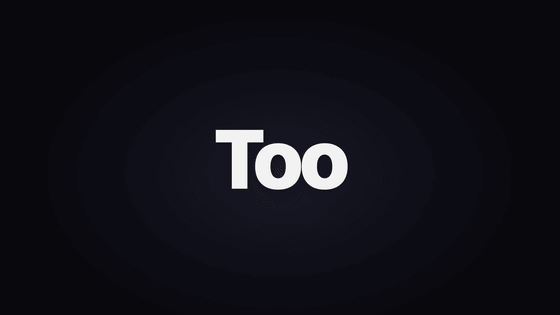
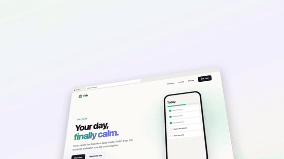
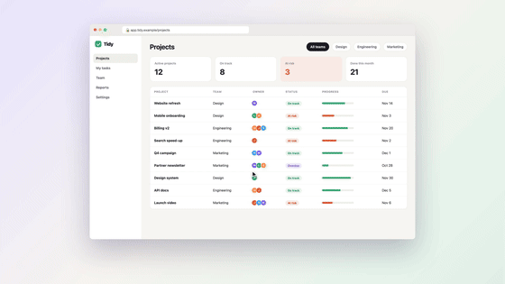
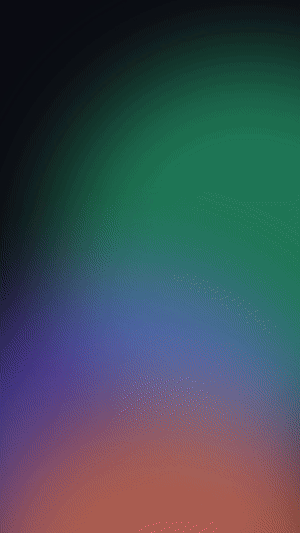

# Reelwright

**Make polished product videos from code** — app walkthroughs, launch films, explainers — with free,
local tools. No video editor, no paid services, no stock-footage subscriptions.

[](https://github.com/Nexace/reelwright/actions/workflows/ci.yml)
[](LICENSE)

You write a script, a scripted screen recording and a small HTML "edit". The kit voices the script with
neural TTS, records your product with Playwright, cuts every shot to the spoken words and the music's
beat, renders 1080p60 frames in headless Chrome, designs the sound, mixes, and encodes an mp4.
Because the whole edit is code, changing a line of the script or re-recording a screen re-flows the
film with one command.

```bash
git clone https://github.com/Nexace/reelwright && cd reelwright
./setup.sh          # once: ffmpeg, Node, Python libs, headless Chromium (Windows: node setup.mjs)
./video.sh all      # (Windows: node bin/reelwright.mjs all) builds the example → projects/example/out/tidy-example.mp4 (~1 min)
```

---

## Sample films

Six films, all made with this kit and all in [`projects/`](projects/), so you can rebuild any of them
with `./video.sh all <name>`. Every product, person and number in them is fictional. The previews are
silent GIFs. To watch the real mp4s with sound, open the
**[sample gallery ▶](https://nexace.github.io/reelwright/)** or click **▶ with sound** under any film.

<table>
<tr>
<td width="50%" valign="top">

<b>Launch teaser</b> · 13 s · music only · <a href="https://nexace.github.io/reelwright/#teaser">▶ with sound</a><br>
Kinetic type on every beat, a white flash on the drop, a 3D field of UI cards pumping with the kick,
and an RGB-glitch logo on the final hit. Original synth track. <code>projects/teaser</code>
</td>
<td width="50%" valign="top">

<b>Website promo</b> · 15 s · music only · <a href="https://nexace.github.io/reelwright/#website">▶ with sound</a><br>
Captures a landing page, then scrolls it in a 3D browser. Cards and pricing lift out of the page on the
beat, then the camera flies over the whole page. <code>projects/website</code>
</td>
</tr>
<tr>
<td valign="top">

<b>Data story</b> · 15 s · voiceover · <a href="https://nexace.github.io/reelwright/#stats">▶ with sound</a><br>
Counters, a bar chart, a self-drawing line chart and a donut, each landing on the exact spoken number
("<i>forty</i> percent", "by <i>half</i>"). Karaoke subtitles. Labelled as illustrative data. <code>projects/stats</code>
</td>
<td valign="top">

<b>Desktop walkthrough</b> · 14 s · voiceover · <a href="https://nexace.github.io/reelwright/#dashboard">▶ with sound</a><br>
A recorded web app in a browser window, with a drawn cursor following the recorded mouse path,
click ripples and camera punch-ins. A magnifier lens opens on "<i>before it slips</i>". <code>projects/dashboard</code>
</td>
</tr>
<tr>
<td valign="top">

<b>App walkthrough</b> · 23 s · voiceover · <a href="https://nexace.github.io/reelwright/#example">▶ with sound</a><br>
The starter project. A phone take re-timed so each tap lands on its word, with a punch-in while typing,
feature captions and an end card. <code>projects/example</code>
</td>
<td valign="top" align="center">

<br><b>Vertical reel (9:16)</b> · 10 s · voiceover · <a href="https://nexace.github.io/reelwright/#reel">▶ with sound</a><br>
1080×1920 for Reels, Shorts and TikTok. One-word captions, beat-synced zooms, confetti on "<i>Done.</i>",
and a final hit on the bar the edit picks. <code>projects/reel</code>
</td>
</tr>
</table>

---

## What's new in 1.0

Phase 11 finished the port. Of the 601 features audited in HyperFrames, Remotion, Manim, anidoodle, video-shotcraft,
motion-design-skill, GSAP, Lottie and the Higgsfield workflows, **441 are EQUAL or BETTER, each proved by a file or a
self-check, and the other 160 are exceptions you can read with their reasons** in [docs/PARITY.md](docs/PARITY.md). Nothing is
left planned or half-built. Everything new is opt-in, so a film written for 0.3 builds the same way. Every command is in
[Every command](#every-command); the craft notes are in [docs/playbook/](docs/playbook/README.md).

- **Variables, batch and stills.** `--variables` on any command (typed composition variables), `batch` renders one film per
  row of a CSV or JSON file, `stills` takes zoom, ranges and `--against` a reference, `compare` and `grade-compare` make
  labelled sheets. [variables](docs/playbook/variables.md)
- **Audio.** `audiofx` (17 effects, 22 presets, `project.json` `fx`), `automation` lanes, fades and a true-peak `limiter` in the
  mix, `audio-report` (onsets, sections, tempo), `beatsync` and `verify-av`, plus `measure`, `diff` and `reverse` for video.
  [audio-fx](docs/playbook/audio-fx.md)
- **Shotcards.** 88 shot recipes as `KIT.shotcards.*` (camera, opening, outro, transition, rhythm, typography, UI entrance,
  data, effects, interaction), each a pure function of time with a recipe page. [recipes](docs/recipes/shotcards/README.md)
- **Motion rules.** `KIT.motionRules` (easing, spring and duration tables, material feels, ambient loops, stagger), a
  `motion-rules` QA warning and `KIT.components` (info strip, digit roll, flash cut, vertical ticker, clip card).
  [motion-rules](docs/playbook/motion-rules.md)
- **Lottie and dotLottie.** `KIT.dotLottie` with a vendored player, `add-lottie`, expressions lint, text, masks and mattes.
  [lottie](docs/playbook/lottie.md)
- **Manim, natively.** `Create`, typing, tables, matrices, axes, number lines, bar charts, vector scenes, ZoomedScene, boolean
  path ops (vendored `polygon-clipping`), code highlighting (vendored `shiki`, `reelwright code`), 3D lighting and OBJ
  models, and `manim-lint`. [manim-native](docs/playbook/manim-native.md)
- **Remotion-style helpers.** `KIT.interpolate`, `KIT.seq`, `KIT.tseries`, `KIT.timing`, a colour, blur, distortion, pattern and
  reveal effects library (`fx-*`), `KIT.player`, `transcode`, `range`, `spectrum`, `audio-clip`, `silence`, `props`. [timing](docs/playbook/timing.md)
- **Doodle and camera craft.** Callouts, drawn kinetic type, shape handoff, camera keys, true dolly zoom, shake, time remap,
  one-canvas `KIT.world`, reading-time and subtitle rules, `brand`, `narrate`, `gate` (determinism and dead-air), `ship`
  (delivery checks), `deck` (46 named moves), `animimg`, linear-light motion blur (`--blur`) and any `--formats WxH`.
- **Promo template and review.** `promo` starts the 36 s Ink Press film; `arc` checks its energy arc; `review` prints the
  independent review brief; `capture-trio` writes the page capture set. [final-review](docs/playbook/final-review.md)
- **Studio.** A timeline with waveform, caption lane and gap dragging, undo and redo, an Audio FX rack, Blur, Variables, a
  render queue, Lint, Assets, Catalog and Slideshow tabs, and an MCP-free agent API (`reelwright studio look|inspect|select|set-style|frame`).
  [studio](docs/playbook/studio.md)
- **Rendering.** 4K on the HyperFrames path, a frame cache, ranges and `--resume`, `frames --stream` (no frames on disk),
  quality presets, `--workers`, timeouts, `--best-effort` and a render lock; `--json` envelope on any command; `doctor`.
- **Lint and capture.** `lint` (with `--components`) ports 31 of the 44 upstream rules the kit skips, `check` finds text outside
  the frame or covered, `audit` checks contrast and `*.motion.json`, `capture <url>` takes a site (with an SSRF guard).
- **Components and captions.** `catalog` lists and picks, `add <tag>` installs by tag, asset components install with their
  fonts and textures, `captions` feeds all 16 caption styles from your script's word times, `slideshow` turns a folder into a film.
- **Docs and skills.** Every command has a README row (checked by `tools/selfcheck/docs-index.mjs`), the playbook has an index
  of every page, and the skills know the new commands.

**What is not here, by decision.** Cloud and hosted render, the HeyGen desktop app, MCP and plug-in packaging, WebGPU-only
blocks, blocks with unlicensed assets, and the Higgsfield paid depth. The local models are opt-in installs, each
printing its plan and sizes and doing nothing without `--yes`: `reelwright face install`, `reelwright transcribe install` (faster-whisper) and
`reelwright tts install` (Kokoro). None is installed with the repo.

---

## What's new in 0.3

Phase 10 brought the parts of the neighbouring video tools that fit this kit (HyperFrames, motion-design and camera
libraries, Remotion, Manim) and rebuilt them as seekable, offline, pure-in-`t` code. Everything is opt-in: a film written
for 0.2 builds the same way. (The one new gate, the HyperFrames lint, applies to hyperframes films; every committed one
passes it.) The full craft notes are in [docs/PLAYBOOK.md](docs/PLAYBOOK.md); the audits of what was taken from each
source are in [docs/parity/](docs/parity/README.md); the compiled score is [docs/PARITY.md](docs/PARITY.md).

**Parity at 0.3.0** was 222 of 601 audited features; 1.0 is 441 of 601 plus 160 accepted exceptions (see above).

- **Preview anywhere.** `reelwright embed` writes `out/embed.html`: one self-contained page (film, kit, fonts, images,
  blocks, mix) played by the vendored HyperFrames player ([`vendor/hf-player/`](vendor/hf-player/VENDORED.md)). It needs
  no server and no network, so it plays from `file://`, in the desktop app's side panel or as a private artifact.
  [PLAYBOOK → Working with Claude](docs/PLAYBOOK.md#working-with-claude-brief--script--stills--taste--preview--render)
- **Studio.** `reelwright studio` opens a local editor on `127.0.0.1:4175`: the film in the player, a timeline of VO lines,
  scenes, beats and SFX cues, and an inspector for each line's text and gap, the style, title and fps, plus stills, taste
  and embed jobs. It writes only `project.json` and `brand.json`, never film code, and never calls a paid service.
  [PLAYBOOK → Studio](docs/PLAYBOOK.md#studio-reelwright-studio-toolsstudio)
- **Recipes and the taste check.** [`docs/recipes/`](docs/recipes/README.md) has eight proven scenes (hook title, kinetic
  line, stat count-up, chart, feature stagger, before/after, push-in, end card), each with its snippet and a still.
  `node tools/checks/taste.page.mjs projects/<name>` (seconds, no render; `qa` prints the same as `WARN taste:`) flags
  motion spikes, lopsided or empty frames, low contrast and VO that is too fast. It never fails a build.
- **HyperFrames lint in QA.** `qa` runs the vendored `@hyperframes/lint` on hyperframes films: its errors are a gate, its
  warnings are `WARN` lines. [PLAYBOOK → QA lint](docs/PLAYBOOK.md#qa-lint-for-hyperframes-films-toolscheckshf-lintpagemjs)
- **Animation runtimes.** GSAP and its plugins, Lottie, anime.js v4, Three.js r187, Rive and Skia (CanvasKit) plus plain
  CSS/WAAPI, bundled and driven only by seeking from `render(t)` (`KIT.gsap`, `KIT.lottie`, `KIT.anime`, `KIT.three`,
  `KIT.rive`, `KIT.skia`, `KIT.animations`). A `seekable-runtimes` QA gate bans the paths that use real time or `Math.random`.
  GSAP is **not MIT** (Webflow's "Standard No Charge" licence, see [THIRD_PARTY.md](THIRD_PARTY.md)).
  [PLAYBOOK → Animation runtimes](docs/PLAYBOOK.md#animation-runtimes-kitgsap-kitlottie-kitanime-kitthree-toolsruntimesjs)
- **27 themes.** The eleven originals plus HyperFrames' three theme-pack looks and thirteen frame presets, each mapped to
  the `--kit-*` tokens with a motion archetype and caption skin. `reelwright theme-brief "<what the product is>"` drafts a
  theme from a one-line brief, offline. `node tools/theme-check.mjs` and `node tools/theme-gallery.mjs` check and picture them.
- **Blocks and nested compositions.** `reelwright add <block>` brings in one of 136 supported HyperFrames blocks (of 210
  upstream); `KIT.mount` / `KIT.block` drop it, or any HyperFrames composition file, into a film as one timed layer.
- **More motion and camera.** `KIT.path` (draw, morph, ride a path), `KIT.transition` (18 types), `KIT.shader` (26 WebGL
  transitions: HyperFrames' 14 and Remotion's 12 presentations), more shots (`tour`, `planes` parallax, `bulletTime`, `rackFocus`, …), Manim's rate functions,
  `KIT.indicate`, `KIT.typewriter` and a seekable `KIT.sim`. `KIT.noise` is seeded simplex/curl noise sampled by `(t, id)`, and
  `KIT.stagger({ each, from, grid, axis, jitter, seed })` staggers a grid by distance from an origin.
- **Motion blur, grading and effects.** `"motionBlur": true` in `project.json` (per-shot `KIT.shot.shutter(deg, from, to)`); `KIT.grade` (grade presets, vignette, grain,
  LUTs) and `KIT.vfx` (noise, wave warp) on a layer; the per-pixel parts need the hyperframes renderer. `KIT.fx` has
  Remotion's effect set in CSS, canvas and WebGL2 (`fx-gl.js`: outline, tear, cylinder, sphere, pageTurn, shatter, …).
- **Video clips and extra audio.** `KIT.video` (speed ramps, trims) and `KIT.audio` mix clips and sounds over the soundtrack.
- **Sound.** New synthesised SFX kinds (shutter, sparkle, riser, subdrop, whoosh variants, …) and `house` and `hiphop` music
  beds beside `chill` and `drive`.
- **Doodle and math depth.** Pen strokes (pencil, riso, marker, …), a self-drawing score, pen lettering and depth seams;
  `KIT.tex` (MathJax glyphs that write and morph), shapes, plots, vector fields and `KIT.math3d`.
- **Output formats.** `--as webm|mov|gif|apng|png|hls` (or `"output"` in `project.json`), transparent alpha, HDR from the
  hyperframes renderer, and `--formats 4x5` (1080×1350) and `16x10` (1920×1200).
- **Optional renderers, opt-in.** `"renderer": "remotion"` renders a React film with Remotion; Manim scenes play as a layer in a
  normal film (`reelwright manim`). Neither is bundled and nothing installs without a yes ([Renderers](#renderers)).
  **Remotion is not open source:** free for individuals, companies of up to 3 people and non-profits, paid otherwise.
- **Demo films in CI.** Every project with `"ci": true` (`blocks-hf`, `doodle2-hf`, `engine-hf`, `math2-hf`, `motion-hf`,
  `runtimes-hf`) is built end to end on macOS, Windows and Ubuntu, and every `tools/selfcheck/*.mjs` runs.

**0.2 in one paragraph:** a motion vocabulary (`KIT.easing`, `KIT.bezier`, `KIT.spring`, `KIT.keys`, `KIT.stagger`; themes set
motion tokens), camera shots (`KIT.shot.*`), the doodle theme and hand-drawn marks, `KIT.math` charts and KaTeX equations,
`beats` import/export for spreadsheet scripts, more `WARN` checks, and the optional paid `gen` connector (off by default,
see [Connectors](#connectors-optional)).

---

## The tools

| Job | Tool | Why this one |
|---|---|---|
| Record the product | **Playwright** + Chrome DevTools screencast (`record.mjs`) | Scripted, repeatable take at 2× (Retina). Logs every tap and named moment so the edit can sync to them. Re-record any time the UI changes. |
| Capture a website | **Playwright** (`tools/capture_site.mjs`) | Scrolls first so scroll-animations fire, then saves each section, the full page and every image, plus the page's text, headings, colours and fonts (`site.json`). Read-only: form posts and other writes never leave the browser. |
| Film or theme from a URL | `reelwright from-url`, `reelwright theme-from` (`tools/from_url.mjs`, `tools/theme_from.mjs`) | Drafts a whole project (script, look, screenshots) or a theme from a page, by rules — no AI service, no key. |
| Use Figma designs | **Figma REST API** (`tools/figma_export.py`) | Exports every screen frame in a section as PNG — make a film from designs before the app exists. |
| Edit / animate | **HTML + CSS + JS "director"** (`film/film.js` + `tools/engine.js`) | The edit is code: `render(t)` draws the frame at time *t*. Built in: phone and browser mock-ups, a cursor that follows the recorded mouse, magnifier lens, counters, karaoke subtitles, words that appear as spoken. Camera shots (`tools/shots.js`, `shots2.js`), hand-drawn marks (`tools/doodle.js`, `doodle2.js`), charts, curves and equations (`tools/math.js`, `tex.js`, `plot2.js`, `math3d.js`), transitions, paths and the animation runtimes load on top. Plus anything CSS, SVG or 3D transforms can draw. |
| Render | **Playwright** (headless Chrome) → JPEG frames (`tools/renderers/pvk.mjs`), or **HyperFrames** (vendored, `tools/renderers/hyperframes.mjs`); optionally **Remotion** | Deterministic, 60 fps, parallel pages. 16x9, 9x16, 1x1, 4x5 or 16x10 from one edit. See [Renderers](#renderers). |
| Voiceover | **edge-tts** — Microsoft neural voices, free, no account (`tools/vo.py`) | Natural voices (Andrew, Ava, Hindi Swara…) **with word timings**, so visuals land on exact words. |
| Music | Any track (e.g. **Mixkit**, free licence) + beat-grid fit (`tools/beatgrid.py`), or a built-in original soundtrack: `chill`, `drive`, `house` or `hiphop` (the last three with a drop and a final hit) (`tools/music.py`) | Cuts land on the beat. The fit measures the real tempo from the drums — never trust a listed BPM. |
| Sound effects | Synthesised in **numpy** (`tools/mix.py`) | Whooshes, taps, pops, risers, impacts, chimes — generated, no sample licences. Placed by `cue()` calls in the film. |
| Mix | **numpy + ffmpeg loudnorm** (`tools/mix.py`) | Music ducks under the voice automatically; output normalised to −14 LUFS (YouTube/Instagram level). |
| Encode | **ffmpeg** (H.264 + AAC) | Plays everywhere: WhatsApp, Slack, Drive, YouTube, Keynote. Optional extra outputs: webm, ProRes mov, gif, apng, png frames, HLS, with alpha. |
| QA | `tools/qa.py`, `tools/qa_page.mjs`, `tools/sheet.py` | Finds blank frames and jumpy cuts, then gates that fail the build: loudness, caption fit and contrast, flashing (photosensitivity), an "Illustrative data" label on numbers, and code that can't be seeked (plus the HyperFrames lint for hyperframes films); `WARN` checks that never fail, including a taste check (motion, balance, empty frames, contrast, pacing). Contact sheet of stills to review the whole film at a glance. |
| Preview / edit | `reelwright preview` (scrubber), `embed` (one self-contained page), `studio` (local editor); the vendored HyperFrames player (`vendor/hf-player/`) | Look at the film without rendering it: `embed` plays offline from `file://` or as an artifact, `studio` edits the script, gaps and look. |

Optional: a coding agent in this folder (Claude Code, Codex, Antigravity, OpenCode, …) does all of the above from plain English; its instructions are in [AGENTS.md](AGENTS.md) (`CLAUDE.md` imports it).

---

## Setup (once, ~5 minutes)

Requirements: Node 18+, Python 3.9+, ffmpeg. `./setup.sh` installs what's missing (Homebrew on macOS:
install it from https://brew.sh first; apt on Debian/Ubuntu), then checks each piece. Re-run it any time.
On Windows, install Node first (`winget install OpenJS.NodeJS.LTS`), then run `node setup.mjs` (winget or
Chocolatey for the rest).

Every command is `node bin/reelwright.mjs <command> [project]` on any platform (`npm link` makes it plain
`reelwright`); `./video.sh` is the same thing on macOS and Linux. The docs use `./video.sh`.

### Does it work on my computer?

| Platform | Status |
|---|---|
| **macOS** (Apple Silicon or Intel) | ✅ Supported. All the sample films were made on a Mac. |
| **Linux** (Ubuntu / Debian) | ✅ Supported. CI builds both example films and the `"ci": true` demo films, and runs every self-check, on Ubuntu, macOS and Windows for every commit. Other distros work if you install ffmpeg, Node and Python yourself. |
| **Windows 10 / 11** | ✅ Native, no WSL. CI builds the example and demo films on Windows for every commit; nobody has tried it on a real Windows machine yet, so reports welcome. Use `node bin/reelwright.mjs` where the docs say `./video.sh`. |

Fonts: themed films use the bundled fonts in `fonts/`, so they look the same everywhere. Older samples without a
`"style"` use the system UI font, which is San Francisco on macOS and a fallback elsewhere.

## Make the example film (~2 minutes)

```bash
./video.sh all
open projects/example/out/tidy-example.mp4
```

That runs every step on a tiny fake to-do app (`projects/example/demo-app/`): records it, voices the script,
builds the music, edits, renders, mixes and checks the result. Read `projects/example/film/film.js` alongside
the video — it's the clearest way to see how the edit works.

---

## Make your own film — step by step

```bash
./video.sh new my-film          # copies the example to projects/my-film
```

### 1. Write the script — `project.json`
Each line becomes one voiceover clip. `gap` = seconds of silence before the line (use 1–2 s before a new
section so the picture can breathe).
```json
{ "id": "add", "gap": 1.4, "text": "Add a task in one tap. Type it, and it's on your list." }
```
Voice settings: `voice` (list them with `edge-tts --list-voices`; good ones: `en-US-AndrewNeural`,
`en-US-AvaNeural`, `en-IN-NeerjaNeural`, `hi-IN-SwaraNeural`), `rate` (`"+6%"` faster, `"-5%"` slower), `pitch`.

```bash
./video.sh vo my-film      # listen to projects/my-film/vo/*.mp3; edit text and re-run — only changed lines regenerate
```

### 2. Record the product — `record.mjs`
Point `URL` at your app (local dev server, staging, or a live site) and write the take: `tap(locator, name)`,
`type(text)`, `mark(name)`, `wait(ms)`. Names are what the edit syncs to.
```bash
./video.sh record my-film  # → clips/flow/ (frames) + film/clip.js (timings)
```
- Use test accounts and fake data. **Never let the take really publish, pay or message anyone** — mock those
  calls (Playwright `page.route`) or use a demo build.
- Phone apps: the viewport is 390×797 (an iPhone screen without the status bar; the film draws one).
  Desktop: set `W, H` to e.g. 1440×900 and put the screen in a browser frame instead of `KIT.phone`.
- No app yet? Skip recording and use Figma screens (below) as images.

### 3. Music (optional)
Without a track you get the built-in synth bed (fine for drafts and internal films). For real music:
1. Download a track, e.g. from https://mixkit.co/free-stock-music/ (free licence, no attribution) → save as
   `projects/my-film/music/track.mp3`.
2. `./video.sh beatgrid my-film` → measures the tempo and prints every bar's start time with a loudness bar.
3. Set `"music": { "start": <a bar time> }` in `project.json` — pick a bar just before a drop, so the film
   opens on energy (or a quiet bar for a calm opening).
4. `beatgrid` also finds the drop (where the kick and bass come in after a quieter stretch); `KIT.drop()` is its
   time in the film. Override with `"music": { "drop_bar": <bar> }`. `projects/teaser` cuts to it.

### 4. Edit — `film/film.js`
The edit is a list of things on screen, each with a time window. Times come from the voice and the take,
never typed by hand:
```js
W('add', 'tap')            // when the word "tap" is spoken in line "add"
V('add').start / .end      // when the line starts / ends
clip.filmAt(tapTime)       // when a recorded tap appears in the film
KIT.snap(t)                // nearest music beat
cue(t, 'whoosh')           // a sound effect: whoosh, whooshdown, pop, tap, impact, chime, riser
```
The recorded take is re-timed with **anchors** — `[clip time, film time]` pairs, e.g. "the Add button tap
lands on the word *list*". Between anchors it plays at a constant speed (the engine warns if any section
would play slower than 0.4× or faster than 2.5×).

Preview without rendering: `./video.sh preview my-film` opens a live scrubber at http://localhost:4173 —
the film's own page (so a frame there is the frame the renderer makes), a slider stepping whole frames
(←/→ one frame, shift ±1 s, space plays with sound), and the `mix.wav` waveform with the VO lines, SFX cues,
beats, bars and the drop marked. Saving film.js, data, the theme or the kit reloads it at the same moment; a
`project.json` edit shows "script changed: run `reelwright audio`". `./video.sh embed my-film` writes one
self-contained page (`out/embed.html`, plays offline from `file://`) to hand to someone, and `./video.sh studio my-film`
opens a local editor for the script, gaps and look (see [What's new in 0.3](#whats-new-in-03)). Or render stills:
```bash
./video.sh sched my-film && ./video.sh stills my-film          # 12 evenly spaced stills + stills/sheet.jpg
./video.sh stills my-film 3.2,7.8,15                            # specific moments
./video.sh remix my-film     # the 25/50/75 % moments in the 3 themes furthest from yours, as 16x9, 9x16 and 1x1
```
Before a full render, `node tools/checks/taste.page.mjs projects/my-film` prints taste `WARN`s in seconds.
`remix` writes `stills-remix/sheet.jpg`, one labelled row per look; pick one with `"style"` in project.json.
It also runs the variety check (a `qa` line too): a WARN when another film in `projects/` uses the same
theme, or the same fonts, a palette within ΔE 10 and the same `KIT.layout` scenes.

### 5. Build
```bash
./video.sh all my-film     # everything, from recording to mp4
./video.sh audio my-film   # after script/voice/music changes
./video.sh film my-film    # after film.js changes (re-renders)
./video.sh verify my-film  # inputs unchanged since the build, and a fresh render gives the same frames
./video.sh clean my-film   # delete frames/stills/.cache (GBs) — keeps the mp4
```
The mp4 lands where `project.json` → `out` says. Render speed is roughly 30–60 frames/s; `PAGES=6
./video.sh frames my-film` uses more CPU for a faster render.

Re-renders are incremental (pvk films): `frames` fingerprints what each frame shows (the visible DOM,
video times, scroll offsets, canvas pixels, plus every file the page loaded) and copies frames it has seen
before from `.cache/frames/`, so a caption edit re-renders only the frames that show it. It reports how many
frames it rendered and where (`260 rendered in 1 shot: 367–626 (6.12–10.45 s)`). `--no-cache` renders every
frame. HyperFrames films always render in full. The fingerprint doesn't see Web Animations' currentTime, form input
values or focus, `adoptedStyleSheets` or the inside of iframes (films driven by `render(t)` don't use them), and a
one-off render glitch stays cached until `--no-cache` or `clean`.

`encode` also writes `<out>.manifest.json`: tool versions, a hash of every input and of every frame, the
duration. `verify` names any input that changed since, then re-renders the frames with the cache off and
compares them to the manifest — identical on the same machine. What can differ on another OS:
[docs/REPRODUCIBLE.md](docs/REPRODUCIBLE.md).

---

## Renderers

`"renderer"` in `project.json` picks how frames are drawn. Everything else (voice, timing, music, mix, encode,
captions, QA) is the same for all of them, and they run the same timing helpers (`W`, `V`, `KIT.snap`, `cue`, themes).

| | `"pvk"` (default) | `"hyperframes"` |
|---|---|---|
| Film lives in | `film/index.html` + `film/film.js` | `hf/index.html` + `hf/film.js` (a HyperFrames composition) |
| Drawn by | Playwright pages calling `render(t)` | the vendored HyperFrames engine (`vendor/hyperframes/`) |
| Use it for | screen recordings: phone/browser mock-ups, the recorded take, cursor, magnifier | motion-graphics films: titles, charts, blocks and catalog components (`reelwright add`), shader transitions, grading, HDR |
| Re-renders | incremental: unchanged frames come from `.cache/frames/` | always the whole film |
| Start one | `./video.sh new my-film` | `./video.sh new my-film --renderer hyperframes` |

Pick pvk when the film is built around a recording of your product; pick HyperFrames when it's mostly type,
shapes and data and you want blocks and components. `projects/example` and `projects/example-hf` are the starters.

**Optional, opt-in.** Two more things ship as files only; nothing is installed until you say yes.

- **Remotion** (`"renderer": "remotion"`): a film written in React (`rm/src/Film.jsx`), for when you need something from the
  Remotion ecosystem. `./video.sh new my-film --renderer remotion` copies `templates/remotion`; the first `all` shows
  Remotion's licence notice and installs the pinned versions into `projects/my-film/rm/` (about 250 MB) only after you type
  `yes` (with no terminal it prints the notice and exits). Renders use Playwright's browser, and renders are muted: the mix is
  Reelwright's. **Licence caveat:** Remotion is not open source. It is free for individuals, for-profit companies of up to 3
  people and non-profits; any other company needs a paid Company License (remotion.pro/license). Using this renderer makes
  you a Remotion user; Reelwright is not affiliated with Remotion and does not grant a licence. Not run on Windows; no
  `preview`, `hdr`, `motionBlur` or shader windows. [PLAYBOOK → Remotion](docs/PLAYBOOK.md#the-remotion-renderer-optional-renderer-remotion)
- **Manim** (scenes as a layer, not a whole-film renderer): most of what Manim authors do is native (`KIT.math`, `KIT.tex`,
  `KIT.math3d`); use real Manim only for full LaTeX, Pango text, plug-ins or scenes you already have. `reelwright manim
  <project> install ce` prints the plan and downloads nothing; with `--yes` it creates one shared venv, `<repo>/.venv-manim`
  (gitignored, about 125 MB, Python 3.12 via uv). Scenes render to cached alpha clips (`manim <project> render`, after
  `sched`; `all` does not run Manim) and play with `KIT.manim(id)`. Manim CE 0.22.1 is verified on macOS arm64; Windows and
  Linux installs, and ManimGL, are untested. [PLAYBOOK → Optional Manim scenes](docs/PLAYBOOK.md#optional-manim-scenes-reelwright-manim-kitmanim)

## Themes, layouts and formats

**Themes** — `"style": "<name>"` in `project.json` (or `--style <name>` for one build, output `<out>-<name>.mp4`)
picks `themes/<name>.css`: colours, fonts, radius, shadows, caption style and motion (easing, tempo). 27 ship (`./video.sh themes`
lists them): eleven of ours (editorial, brutalist, pastel, dark-tech, playful, retro, swiss, luxury, clean, neon, doodle), the
three HyperFrames theme-pack looks (hf-bold, hf-editorial, hf-neutral) and thirteen ported HyperFrames frame presets
(biennale-yellow, blockframe, blue-professional, bold-poster, broadside, capsule, cartesian, cobalt-grid, code-editorial,
coral, creative-mode, daisy-days, editorial-forest). The picture of all of them is in the
[PLAYBOOK → Themes](docs/PLAYBOOK.md#themes-themescss-style-theme-check-theme-gallery). `theme-brief` drafts a theme from a
one-line product description (offline), `theme-from` from a site or image. The fonts are bundled in `fonts/` (SIL OFL, see [fonts/LICENSES.md](fonts/LICENSES.md)), so macOS, Windows
and Linux render the same type. An optional `brand.json` in the project overrides colours, fonts and logo on top
of the theme; `theme-from` drafts a theme from a site or image (see below).

**Layouts** — `KIT.layout.split`, `fullBleed`, `bento`, `tiltedDevice`, `stat`, `quote`, `kinetic`
(`tools/layouts.js`): ready-made scenes styled from the theme and sized to the safe area. `projects/layouts-hf`
shows all of them; the playbook says when to use each.

**Formats** — `--formats 16x9,9x16,1x1,4x5,16x10` on `film`, `all`, `stills`, `frames`, `encode` or `qa` builds 1920×1080,
1080×1920, 1080×1080, 1080×1350 and 1920×1200 from one `film.js`: audio once, then `out/<name>-<fmt>.mp4`. `KIT.fmt`,
`KIT.safe` and `KIT.u` let the edit adapt. `--as webm|mov|gif|apng|png|hls` (or `"output"` in `project.json`) writes an extra
file beside the mp4, with transparent alpha where the format has it; the mp4 is always written
([PLAYBOOK → Output formats](docs/PLAYBOOK.md#output-formats-alpha-hdr-45-output---as---formats)).

**Languages** — add `"langs": { "es": { "voice": "es-ES-AlvaroNeural", "lines": { "<id>": "…" } } }` to
`project.json`, then `./video.sh all my-film --lang es` → `<out>-es.mp4` with Spanish voice and captions. Every
line needs a translation; on-screen copy in `film.js` stays as written.

## Every command

`./video.sh` (or `node bin/reelwright.mjs`) with no command prints this list. `[project]` is a folder name in
`projects/` or a path, and defaults to `projects/example`.

| Command | What it does |
|---|---|
| `make "<brief>" [--name n] [--audience a] [--length s] [--voice\|--music-only] [--url u] [--folder f] [--yes]` | guided start, offline, no AI: routes the brief to `from-url`, `slideshow`, `promo`, `new` or `new --renderer hyperframes`, picks a theme with `theme-brief`, drafts the lines, prints the plan; `--yes` creates the project (never renders; [docs/playbook/make.md](docs/playbook/make.md)) |
| `new <name> [--renderer hyperframes\|remotion]` | copy the example (or example-hf, or `templates/remotion`) into `projects/<name>` |
| `new <name> --video <file> [--audio <file>]` | a HyperFrames project that plays your own media (a non-H.264 video is converted; `transcript.json` only when `whisper-cli` and `$WHISPER_MODEL` are set up, nothing is downloaded) |
| `add [project] <name> [--font-dir <folder>] [--all-textures]` | a HyperFrames catalog component → `<project>/hf/blocks/<name>.html` (use with `KIT.block`), or a HyperFrames block → `<project>/hf/compositions/<name>.html` (use with `KIT.mount`; hyperframes films only); prints the title, duration, variables and usage line; a component with assets installs with them (`--font-dir` points at fonts the repo does not bundle, `--all-textures` generates every texture-mask-text texture) |
| `add --list [tag]` | the supported blocks and components |
| `record` | run `record.mjs` → the screen take (`clips/`) + `film/clip.js` |
| `vo` | voiceover from `project.json` lines → `vo/` (only changed lines regenerate) |
| `beatgrid` | fit the beat grid of `music/track.mp3` → `music/grid.json` |
| `sched` | place the VO lines on the timeline → `film/data.js` (`hf/kit-data.js`) |
| `info` | `timeline.json`: duration and SFX cues |
| `music` | `music/bed.wav` from your track or the built-in bed |
| `mix` | `mix.wav`: voice + ducked music + SFX at the target loudness |
| `stills [t,t,..]` | preview frames → `stills/` + `stills/sheet.jpg` |
| `frames [from] [to]` | render every frame → `frames/` (`--no-cache` to skip the frame cache; `--resolution 4k\|portrait-4k\|square-4k` at that size from the same layout; hyperframes: `--cache` keeps frames by content hash, `--resume [--segment N]` finishes an interrupted render) |
| `encode` | frames + `mix.wav` → the mp4, plus `.srt`, `.vtt` and `.manifest.json` beside it |
| `qa` | blank frames, jumps, then the gates (loudness, captions, flash, illustrative, seekable; for hyperframes films also the HyperFrames lint and `seekable-runtimes`), WARN checks (overlap, tiny-text, wordy, dark, taste, lint warnings) and a variety line |
| `verify` | inputs still match the manifest and a fresh render gives the same frames |
| `preview` | live scrubber at http://localhost:4173 |
| `embed [project] [--out <file.html>]` | one self-contained preview page → `<project>/out/embed.html` (`sched` runs first): the film with every script, style, font, image and block inlined, played by the vendored HyperFrames player with `mix.wav`; works offline, from `file://` and as an artifact; add `#12.5` to open at a moment; lists any file the page still asks the network for |
| `studio [project] [--port N] [--edit-source]` | local editor at http://localhost:4175 (`PORT=…` works too): film in the player, timeline of lines, scenes, beats and cues with waveform and snapping, inspector for each line's text and gap, style, title and fps, raw `project.json` / `brand.json` editors, side panels (undo, audio FX, blur, variables, renders queue, lint, assets, catalog, captions, source), stills, taste and embed jobs; writes only those two files unless `--edit-source` lets the source panel save text files inside the project; listens on 127.0.0.1 ([docs/playbook/studio.md](docs/playbook/studio.md)) |
| `studio [project] look\|inspect\|select\|set-style\|frame\|state [--port N]` | talk to a running studio, Remotion Studio's WebMCP tools without MCP: `look [--t S \| --frame N] [--selector CSS] [--out f.png] [--format png\|jpeg]` screenshot of the film or one element; `inspect --selector CSS` box, computed style and script line; `select --line ID \| --selector CSS \| --clear`; `frame --t S \| --frame N` moves open tabs; `set-style --selector CSS --set prop=value … \| --reset` an unsaved overlay (`--edit-source` appends the rule to the film's `<style>` when the studio runs with it); prints JSON ([docs/playbook/studio.md](docs/playbook/studio.md)) |
| `remix` | stills in the 3 themes furthest from yours × 16x9, 9x16, 1x1 → `stills-remix/sheet.jpg` |
| `clean` | delete `frames/`, `stills/`, `.cache/` and intermediate audio (keeps the mp4) |
| `themes` | list the themes |
| `from-url <url> [name] [--yes]` | capture a page and draft a HyperFrames project from it |
| `theme-from <url\|image> [name]` | draft `themes/<name>.css` from a page or an image |
| `theme-brief "<what the product is>" [name]` | draft `themes/<name>.css` from a one-line brief ("budgeting app for students"): the best-matching product type's palette, font pairing and mood from the `ui-ux-pro-max` data (MIT), fonts mapped to the bundled OFL families; prints what it picked, what to avoid and the theme check; offline |
| `gallery [shotcards\|effects\|all] [--out dir] [--check] [--only id,id]` | render every shotcard helper and every `fx-*` effect at 3 to 5 moments on the pvk renderer (offline, deterministic) into `docs/gallery/index.html` (a grid with a module filter, a contact strip, the helper call and the recipe link per item) and `docs/gallery/refs/` (small reference strips); `--check` renders again, compares with the refs (per-pixel tolerance), writes nothing and exits 1 listing the items that changed; `--only` takes ids such as `outro.logoLockup` or `fx-blur.zoomBlur` |
| `manim [project] install [ce\|gl] [--yes] \| doctor [ce\|gl] \| render [--force] \| verify` | optional Manim scenes (`"manim"` block in `project.json`, `KIT.manim` in `film.js`): `install` prints what it would download into `<repo>/.venv-manim` and does it only with `--yes`; `render` runs after `sched` and after any VO change (`all` does not run Manim); exit 1 on any problem |
| `code [project] highlight <file> [--lang L] [--theme T] [--id name] [--lines a-b] \| model <file.obj> [--id name]` | build-time data for `KIT.math.code` (shiki) and `KIT.math3d` models: writes `film/code-<id>.js` or `model-<id>.js` (`hf/` for HyperFrames) |
| `manim-lint [project] [texts\|pace\|dark\|all] [--video f.mp4] [--strict]` | Manim scene lints: OFF-FRAME, TEXT-OVERLAP, TINY-TEXT, RUSHED, GAP, UNNARRATED, DARK-STRETCH |
| `lint [project] [--no-browser]` / `lint --components [name… \| --all]` | native lint beside the vendored one `qa` runs: upstream findings, native ports of 31 of the 44 skipped rules (the other 13 have no counterpart, each with its reason), coordinate drift, HDR; `--components` lints installed catalog components as fragments. Exit 1 on an upstream ERROR (docs/playbook/qa-lint.md) |
| `slideshow <folder> [name] [--seconds 3] [--transition fade\|a,b,c] [--tdur 0.6] [--zoom 0.05] [--clip-max 8] [--size 1920x1080] [--fit cover\|contain] [--out <dir>]` | a folder of images and clips → a HyperFrames film at `projects/<name>`: one layer per slide, `KIT.transition` between neighbours, slow zoom on stills; also the studio's Slideshow tab |
| `skills install [--apps codex,opencode,cursor,antigravity] [--dry-run]` | copy this repo's agent skills into Codex, OpenCode, Cursor and Antigravity's global skill folders (with this repo's path), so those agents can make films from any folder; re-run after an update |
| `add-lottie [project] x.lottie [name]` | unpack a dotLottie archive into `assets/lottie/` (animations, themes, state machines, index.json) and print the `KIT.dotLottie` / `KIT.lottie` lines; `--inline [out.json] [--animation <id>]` writes one animation as plain Lottie JSON (images inlined) for `KIT.lottie` instead |
| `audiofx <in> <out> --preset <name> \| --job <name> \| --profile <name>=0..1 \| --chain '<json>' \| --fx "<spec>"` | the audio FX rack (ffmpeg only, offline): 17 effects, 22 presets, 5 jobs, 5 one-knob profiles; `audiofx --list` shows them, `--print` shows the ffmpeg graph; in a build it is the `project.json` `fx` key ([docs/playbook/audio-fx.md](docs/playbook/audio-fx.md)) |
| `measure <video> probe\|cuts\|frames [--json] [--threshold 0.3] [--at 1.5,4,9 \| --count 8] [--out <dir>]` | numbers about any mp4/mov/webm (ffprobe + ffmpeg, offline): size, fps, codecs, duration; scene-change times; jpg frames at times |
| `diff <reference.mp4> <candidate.mp4> [--bar 0.9] [--fps 10] [--tol 0.15] [--threshold 0.3] [--json]` | how close a render is to a reference: SSIM per frame, missed and extra cuts, audio offset; exit 1 when the mean SSIM is under `--bar` |
| `reverse <video> [--out <dir>] [--threshold 0.3]` | a video taken apart into a shot list (`shots.json` and a still per shot) to rebuild it from; offline |
| `beats [project] import <file.csv\|timeline.json> [--replace] \| export [file.csv] [--replace]` | beat-sheet round trip: CSV (both docusphere headers) or `{timeline:[{start_s,end_s,label}]}` → `lines` + `beats` in project.json; only those keys change; `--replace` overwrites (on export: an existing csv) |
| `animimg <file.gif\|apng\|webp\|avif> [dir] [--width N] [--fps N]` | split an animated image into PNG frames + `<name>.frames.json` for `KIT.animatedImage` ([docs/playbook/text-media.md](docs/playbook/text-media.md)); offline |
| `arc [project] [--mix]` | validate the energy arc (`project.json` `"arc"`: a low open, one hero, a climb with breath cards, a peak close); WARN lines only; `--mix` also measures `mix.wav` per shot ([docs/playbook/shotcraft-lints.md](docs/playbook/shotcraft-lints.md)) |
| `audio-clip <src> <out.wav> [--trim A-B] [--dur S] [--delay S] [--vol t:v,…] [--rate R] [--tone F] [--varispeed] [--loop N\|inf] [--loop-volume repeat\|extend] [--stream I] [--fade-in S] [--fade-out S] [--gain G]` | one audio clip the way `KIT.audio` mixes it: trim, delay, volume curve, speed, pitch, loop, stream index; offline ([docs/playbook/codecs.md](docs/playbook/codecs.md)) |
| `audio-report <file> [--at T] [--range A B] [--place-at T] [--json]` | onsets, loudness sections and rhythm (tempo, steadiness) of any audio or video file; `--at` / `--place-at` name the onset and beat nearest a time |
| `audit [project] [--contrast] [--motion] [--range a-b] [--at-transitions]` | the browser audits of the built film page: WCAG contrast of every visible text (`--contrast`), the project's `*.motion.json` assertions (`--motion`); no flag runs both; exit 1 when a motion assertion fails |
| `batch <project> <rows.json\|rows.csv> [--concurrency N] [--fail-fast] [--out-dir dir] [--strict] [--keep-work]` | one film per row of composition variables → `out/batch/<name>.mp4` and `batch.json`; rows are checked first ([docs/playbook/variables.md](docs/playbook/variables.md)) |
| `beatsync [project] [--grid t0,beat] [--json]` | beat-synced cutting measured on the rendered mp4: hits per grid beat, the music offset in ms and every hard cut's error in frames; needs the mp4 and ffmpeg |
| `brand [project] inventory \| check` | the project's logos as a table, and the brand check (palette valid, ink on bg contrast, every logo on disk, raster logos big enough); exit 1 on any problem |
| `browser path \| ensure [--install] \| clear [--yes]` | the headless browser the kit renders with: `path` prints it, `ensure` launches it (`--install` downloads Chromium), `clear` lists the Playwright cache (`--yes` deletes it) |
| `captions [project] [<caption-component>] [--format remotion] [--from captions.json]` | write `transcript.json` from the VO words of `timeline.json` and, given a `caption-*` component, install it fed by that transcript (run `info` first). `--format remotion` also writes `captions.json` (Remotion's Caption JSON); `--from` reads such a file instead of `timeline.json` |
| `capture <url> [--out dir] [--shots N] [--width W] [--video]` | read-only capture of a public page you own or may use: scroll screenshots, contact sheet, HTML, CSS, text, design tokens, fonts, images, notes → `captures/<host>/`; refuses private and loopback addresses |
| `capture-trio <url> <out_dir> [width] [--selector "<css>"] [--max 40]` | the page capture trio: `full@2x.png`, a transparent cutout PNG per element and `layout.json`, for floating-chip and camera-over-a-page shots |
| `catalog [words…] [--type block\|component] [--tag <tag>] [--all] [--tags] [--json] [--pick]` | search the HyperFrames catalog; `--all` also shows what this repo cannot run, `--tags` lists tags, `--pick` asks for a number and prints the `add` line |
| `check [project] [--at 1.5,4] [--range 2 6] [--at-transitions] [--caption-zone] [--frame-check] [--json]` | layout and occlusion audit of the film page without rendering (text outside the frame, clipped, covered, or on the caption row); exit 1 on any finding |
| `compare <variant> <variant> [<variant>..] --at t,t [--labels a,b,c] [--out file.png]` | N variants of a film (a project, `projects/x@style`, a video, a folder of stills) at the same moments, one labelled PNG |
| `compositions [project] [--all] [--json]` | the compositions in a HyperFrames project (id, start, duration, size, file); `--all` lists every project's renderer and film length |
| `deck [list]` / `deck find <words>` / `deck deal [--seed S] [--cats open,cam,...]` | the motion deck: 46 named moves with the KIT call behind each; `deal` hands one per group from a seeded hash ([docs/playbook/motion-deck.md](docs/playbook/motion-deck.md)) |
| `docs [topic]` | the craft docs from the terminal: no topic lists `docs/playbook`, `docs/recipes` and PLAYBOOK pages, a topic prints the best match |
| `doctor [--json]` | what a film needs here: node, ffmpeg and its encoders, python and libs, the headless browser, docker and GPU (optional), disk, cores, RAM; exit 1 if a required check fails |
| `face <video> [--every s] [--json]` | where the faces are in a video: a local OpenCV Haar detector (`pip install opencv-python-headless`), share of time a face is present, segments, biggest face, head room |
| `gate [project] [--n 16]` | the two delivery gates on the built pvk film page: determinism (16 frames hashed forward, reverse, cached and cold) and dead air; exit 1 on either ([docs/playbook/delivery.md](docs/playbook/delivery.md)) |
| `grade-compare <image\|video> [--at t] [--presets a,b,c \| grade \| effect \| all] [--intensity 0..1] [--cols n] [--out file.png]` | one picture or video frame through the HyperFrames colour-grading presets (the ones `KIT.grade` takes), side by side, one labelled PNG |
| `json <command> [project] [args…]` | run any command and print ONE JSON envelope (`ok`, `command`, `args`, `exit`, `stdout`, `stderr`, `data?`, `_meta`); `--json` on any command does the same; exit 0 ok, 1 failed, 2 usage with `did_you_mean` |
| `lottie <file.lottie> [out.json] [--animation <id>]` | deprecated alias of `add-lottie --inline` (same arguments, same output) |
| `narrate providers \| speak "<text>" [--provider say] [--voice V] [--rate 1] [--yes] \| check <wav> "<text>" [--max-wer 0.1]` | narration providers beside edge-tts (say, piper, kokoro, openai, gemini, elevenlabs; the cloud ones need `--yes` and a key); takes are cached by hash; `check` transcribes a take with `whisper-cli` |
| `preflight [project] [--json]` | before a render: the disk the frames need, the disk that is free, and whether it fits with 10% to spare; exit 1 if not |
| `promo <name\|path> ["Title"]` | start a film from the Ink Press promo template: 36 s, 10 shots on the energy arc, music only; then edit `hf/content.js` ([docs/recipes/ink-press-promo.md](docs/recipes/ink-press-promo.md)) |
| `props <project> check [file.json \| '{...}']` / `schema [--write]` / `merge <file.json \| '{...}'>` | per-run props against `props.schema.json` (or the project's variables); any command takes `--props '{...}'` / `--props-file f.json` ([docs/playbook/codecs.md](docs/playbook/codecs.md)) |
| `qa-strict [project]` | run `qa` and exit 1 on any WARN as well as any FAIL (the CI mode) |
| `rand-lint [project]` | opt-in lint of the film's own scripts for `Math.random()`, `Date.now()`, `new Date()`, `performance.now()`, `requestAnimationFrame` and timers, with the fix (`KIT.random(seed)`, or `t`); exit 1 on any finding |
| `range [video] --frames 0-9,30,100- [--every-nth-frame N] [--duration S] [--stills dir [--format jpg\|png] [--jpeg-quality 1-100]] [--out clip.mp4] [--dry-run]` | cut a frame selection out of a finished film (Remotion's `--frames`, `--every-nth-frame`, `--duration`) as a clip or as stills |
| `review [project]` | print the brief for the final independent review: the project's facts, the commands to run and the itemised checklist ([docs/playbook/final-review.md](docs/playbook/final-review.md)); paste it into a fresh subagent |
| `ship [project] [--sign "name"]` | ship checks on the delivered mp4 (read time, safe zone, facts, motion scan, dead air, A/V sync) and a review ledger in `ship.json`; `--sign` adds a sign-off that counts only while the mp4's sha still matches |
| `silence <media> [--noise -40dB\|auto] [--min 0.5] [--merge 0.3] [--trim out.wav] [--pad 0.05] [--json]` | speech and silence segments of an audio or video file (ffmpeg `silencedetect`; `--noise auto` takes loudnorm's measured gate threshold; `--merge` absorbs a short sound between two silences); `--trim` writes the file with its leading and trailing silence cut off, for a voice line; offline ([docs/playbook/codecs.md](docs/playbook/codecs.md)) |
| `spectrum [file] [--out audio-bands.js] [--fps N] [--bins N]` | per-frame spectrum, level and waveform of an audio or video file, FFT at build time, as `window.AUDIO_BANDS` for `KIT.level` / `KIT.spectrum` / `KIT.waveform` |
| `stills2 [project] [t,t,..] [--at t,t] [--frames N] [--range a-b[:step]] [--zoom <selector>] [--pad px] [--against ref.mp4] [--min-ssim x]` | stills with more than `stills`: times, N evenly spaced, a range, a zoomed crop of one element, or a comparison with a reference video; `stills` with any of those flags runs it |
| `transcode [video] [--codec h264\|h265\|vp8\|vp9\|av1\|prores\|gif\|mp3\|aac\|wav] [--out file] [--crf N] [--quality draft\|looks\|standard\|high\|delivery] [--scale 0.5] [--hardware-acceleration auto\|on\|off] [--metadata key=value]` | a finished film into another codec with Remotion's quality, pixel-format, colour-tag and metadata knobs (the full flag list is in the header of `tools/commands/transcode.mjs`); offline |
| `transcribe install [--model tiny\|base\|small] [--yes]` / `transcribe <audio\|video> [--model m] [--lang l] [--out words.json]` | local speech to text (faster-whisper): word-level `[{text,start,end}]`, the shape `captions` takes. The install is opt-in: it prints the plan and sizes (about 100 MB of packages plus the model: tiny 75, base 145, small 484 MB) and changes nothing without `--yes`; it makes a repo-local `.venv-tts` and `.models/` (both gitignored). Once installed, `new --video/--audio` and `narrate check` use it |
| `tts install [--yes]` | local Kokoro voiceover, opt-in: plan and sizes first (about 60 MB of packages, `kokoro-v1.0.onnx` 310 MB, `voices-v1.0.bin` 27 MB), nothing without `--yes`. Then `"tts": "kokoro"` in `project.json` makes `vo` use it; with `transcribe install` too its word times are aligned to the audio (`"timing": "aligned"`) instead of estimated |
| `verify-av [project]` | does the sound in the rendered mp4 land where `mix.wav` put it: AAC priming, the global offset and the lag around every SFX cue; WARN past 1 frame |
| `all` | record → vo → (beatgrid) → sched → info → music → mix → frames → encode → qa |
| `audio` | vo → sched → info → music → mix (after editing the script) |
| `film` | sched → info → mix → frames → encode (after editing the edit) |
| `gen [project] --provider higgsfield "<prompt>" --out assets/<file> [--kind image\|video] [--yes]` | optional, paid, never part of a build: show the estimate, ask, save an AI image or clip to `assets/` |
| `gen [project] --import <file> --source firefly\|express "<note>"` | register a file made in Firefly or Express in `assets/gen.json` (offline) |

Options: `--lang <code>`, `--style <name>`, `--formats 16x9,9x16,1x1,4x5,16x10` (or any `WxH` with even sides), `--as <format>` (webm, mov, gif, apng, png, hls: an extra output beside the mp4), `--no-cache` (above), `--json` (any command: one JSON envelope), `--variables '<json>'` / `--variables-file <file>` / `--strict-variables` (composition variables for this run; `--props` and `--props-file` are the Remotion names), `--composition <id>` (one of the `"compositions"` in `project.json`: its keys laid over the project for this run; [timing](docs/playbook/timing.md#compositions-several-films-or-stills-in-one-project)), `--blur`, `--workers N`, `--low-memory`, the encode knobs `--quality draft|looks|standard|high|delivery`, `--crf N`, `--video-bitrate`, `--max-bitrate`, `--buffer-size`, `--keyframe-interval`, `--vp9-cpu-used`, `--resolution 4k|portrait-4k|square-4k`, `--hardware-acceleration auto|on|off` (GPU H.264 / H.265 encode: VideoToolbox, NVENC, QSV, VAAPI; default off, `project.json` `output.hardware`; [docs/playbook/codecs.md](docs/playbook/codecs.md)), and on `frames`, `film`, `all`, `stills` and `encode` the safety flags `--strict`, `--best-effort`, `--timeout S`, `--max-render S`, `--browser-timeout MS`, `--player-ready-timeout MS`, `--protocol-timeout MS`, `--lock [--lock-timeout S]`. Environment:
`PAGES=6` (parallel browser pages), `FPS`, `BROWSER=chrome|chromium`, `PYTHON`.

`gen` is off by default and needs a key for Higgsfield; setup, costs and the manual Firefly/Express route are in
[docs/CONNECTORS.md](docs/CONNECTORS.md).

---

## Other sources

**A film from a URL** — only for sites you own or have the right to use:
```bash
node bin/reelwright.mjs from-url https://example.com my-film   # capture + draft the voiceover, print it, stop
# read the lines, edit projects/my-film/project.json (and the on-screen copy in hf/site.js) if you want, then:
node bin/reelwright.mjs all my-film                            # build + QA gates (a failing gate names the time)
```
The draft is rule-based: the h1 is the hook, a "<Name> is …" sentence (else the meta description) says what it
is, the first three section headings that aren't navigation, sponsors or testimonials (with the sentence under
each) are the features, and the first "Get started / Install / Try" button is the call to action. Lines stay
under ~25 words; text with numbers in it is left out (they'd be the site's claims, unchecked). Numbers that show
inside the screenshots are listed at the stop, and the film credits the site ("Source: example.com") while such a
shot is on screen. The film is a HyperFrames project (`tools/from_url/`): the site's name from the first frame,
giving way to the hook word by word → the first screen on a tilted device → one split scene per feature with its
screenshot → the call to action, in the site's colours and the nearest bundled fonts (`brand.json`). `--yes`
skips the stop and builds at once. Read-only: nothing is clicked, writes get a fake answer in the browser,
popups, service workers and WebSockets are blocked. A 404 or challenge page stops the capture.

**A theme from a URL or an image** — `node bin/reelwright.mjs theme-from https://example.com acme` (or
`theme-from moodboard.png acme`) writes `themes/acme.css`: the site's background, text, muted and accent colours,
caption colours with WCAG contrast enforced, button radius, and its fonts mapped to the nearest bundled open-licence
family (the header says which, e.g. `"Helvetica Neue" → Inter`). Images give colours only. It's a draft on top of the
`clean` or `dark-tech` theme: edit it, then use `"style": "acme"`.

**A website** — `node tools/capture_site.mjs https://example.com projects/my-film/assets/site` saves each
section, `full.png` and all images. Put them in the film as `` layers (a slow scroll of `full.png` inside
a browser frame is a classic).

**Figma designs** — create a personal access token (Figma → Settings → Security → Personal access tokens,
read-only file content), then:
```bash
export FIGMA_TOKEN=figd_xxx
python3 tools/figma_export.py "https://www.figma.com/design/KEY/Name?node-id=12-345" projects/my-film/assets/screens
```
Link a section or page (right-click → Copy link to selection); every screen frame inside it is exported in
reading order. View access is enough.

---

## Connectors (optional)

Reelwright can pull AI-generated stills and clips into a film. It is **off by default**: no build step calls it, and
without it nothing needs a key, an account or a network beyond what the core already uses.

- **Higgsfield** (`reelwright gen --provider higgsfield`): needs your own API key and a paid balance. `gen` first asks
  Higgsfield for the price, prints the estimate and waits for a yes before it submits anything. The result is saved in
  `assets/` and cached in `assets/.gen/`, so rebuilding the film later makes no call and works offline.
- **Adobe Firefly and Adobe Express**: manual import only. Make the image or clip in the app, then register it with
  `reelwright gen --import <file> --source firefly|express "<note>"` (offline; the file is copied into `assets/`).
- Everything generated goes in `assets/gen.json`, and `KIT.aiLabel(el)` puts an "AI-generated" label on screen; `qa` warns
  when a generated file is shown without one.

Keys, costs, errors, terms and how to add a provider: [docs/CONNECTORS.md](docs/CONNECTORS.md).

**Works without any connector:** `new`, `add`, `record`, `vo`, `beatgrid`, `sched`, `info`, `music`, `mix`, `stills`, `frames`,
`encode`, `qa`, `verify`, `preview`, `embed`, `studio`, `remix`, `clean`, `themes`, `make`, `from-url`, `theme-from`, `theme-brief`, `beats`,
`all`, `audio` and `film`. Only `gen` is optional. (`vo` and `from-url` use the internet as before: edge-tts, and the page you point
it at. `manim` and the Remotion renderer need their own opt-in installs, see [Renderers](#renderers).)

---

## Render in the cloud (free)

No fast computer? Two free options, both building the same way as `./video.sh all`.

**Google Colab + Drive** ([cloud/reelwright_colab.ipynb](cloud/reelwright_colab.ipynb)). Drive stores files;
Colab does the rendering.
1. Open the notebook in Colab: [open it from GitHub](https://colab.research.google.com/github/Nexace/reelwright/blob/main/cloud/reelwright_colab.ipynb),
   or File → Upload notebook → `cloud/reelwright_colab.ipynb`.
2. Only for a private fork: add a Colab secret `GITHUB_TOKEN` (🔑 in the left bar), a fine-grained GitHub token
   with *Contents: read* on that repo only. The notebook sends it as a header; it isn't saved in the clone or printed.
3. Put your project in `MyDrive/reelwright/projects/<name>/` (bundled projects like `example` need nothing), set
   `PROJECT` in the first cell, then Runtime → Run all. Allow Drive access when asked (only "See, edit, create, and
   delete all of your Google Drive files" is needed); finish the popup within ~2 minutes or the mount times out
   (just run again).
4. The mp4, `.srt`, `.vtt`, manifest and `qa.txt` appear in `MyDrive/reelwright/projects/<name>/out/`.

The first session downloads Node and Chromium into `MyDrive/reelwright/cache/` (a few minutes); later ones unpack
from there. Colab disconnects idle sessions and caps session length (Google sets the free limits; no GPU needed).
After a disconnect, Run all again: each step is saved to Drive as it finishes, so the screen take, voiceover and
(pvk films) rendered frames are reused. HyperFrames films re-render their frames.

**GitHub Actions** ([render.yml](.github/workflows/render.yml)): Actions → Render → Run workflow, pick a project
committed to the repo and optional build options; download the film from the run's artifacts. This repo is public, so
Actions minutes are free; a private fork on GitHub Free gets 2,000 Linux minutes a month (the example takes about 10).

HyperFrames' own cloud rendering (AWS Lambda) isn't used: it's paid.

## Folder layout

```
bin/reelwright.mjs          every build step (video.sh is a wrapper for it); loads the plug-in commands
bin/pvk                     video.sh from any folder (adds Homebrew's ffmpeg to PATH)
setup.mjs, setup.sh         one-time setup
tools/                      shared — you rarely edit these
  engine.js, kit.css        the director engine (timing helpers, phone, clip player, subtitles, SFX cues)
  render.mjs                stills / frames / encode, through the renderer project.json picks
  renderers/pvk.mjs         the default renderer ("renderer": "pvk")
  renderers/hyperframes.mjs "renderer": "hyperframes" — hf/index.html rendered by the vendored HyperFrames engine
  renderers/remotion.mjs    the opt-in "renderer": "remotion" (installs nothing without a yes)
  renderers/media.mjs, shader_pass.mjs, shader_glsl.mjs, shader_glsl2.mjs   KIT.video frames and the KIT.shader / KIT.fx pass
  commands/                 plug-in commands, one file each: add, embed, studio, manim, theme-brief, gallery (header = its help)
  checks/                   plug-in QA checks: hf-lint, seekable-runtimes, taste (WARN or gate declared in the file)
  studio/                   reelwright studio: server, page and the preview shims it shares with embed
  selfcheck/                CI self-checks (node tools/selfcheck/<name>.mjs): runtimes, motion, themes, studio, sound, …
  layouts.js, theme.mjs     KIT.layout.* scenes; writes each film's theme.css from themes/ + brand.json
  shots.js, shots2.js       KIT.shot.* camera moves; the second file adds tour, planes (parallax), bulletTime, rackFocus, dof
  doodle.js, doodle2.js     KIT.doodle.* hand-drawn marks; pen strokes, score, lettering, seams
  math.js, math2.js, tex.js, plot2.js, math3d.js   KIT.math.* charts, KIT.tex (MathJax), shapes, plots and fields, KIT.math3d
  runtimes.js               KIT.gsap, KIT.lottie, KIT.anime, KIT.three, KIT.animations — seek-only
  path.js, transitions.js, motion.js, shaders.js   KIT.path, KIT.transition, KIT.rate / indicate / typewriter / sim, KIT.shader
  fx-color.js, fx-blur.js, fx-distort.js, fx-pattern.js, fx-reveal.js, fx-gl.js   KIT.fx: Remotion's effects in CSS, canvas and WebGL2
  compose.js, media.js      KIT.mount / KIT.block / KIT.grade / KIT.vfx; KIT.video / KIT.audio
  manim.js, manim.mjs, blocks.mjs   KIT.manim playback and the Manim driver; the HyperFrames blocks importer
  theme-check.mjs, theme-gallery.mjs, theme_from.mjs   check, picture and draft themes (theme-brief is in commands/)
  gallery.mjs, gallery-fx.mjs   the shotcard and effect gallery with its visual-regression check (commands/gallery.mjs)
  beats.mjs                 reelwright beats: beat-sheet CSV / timeline JSON <-> project.json
  gen.mjs, gen/             reelwright gen: optional generation connector (Higgsfield) and manual import; off by default
  motion-check.mjs          self-check of the easing, spring, doodle and math code (node tools/motion-check.mjs)
  vo.py, sched.py           voiceover + placing it on the timeline
  beatgrid.py, music.py     music tempo fit + music bed (chill, drive, house, hiphop)
  mix.py                    voice + ducked music + SFX → mix.wav
  qa.py, qa_page.mjs, sheet.py   checks, QA gates and contact sheets
  preview.mjs, preview.html the live scrubber (reelwright preview)
  look.mjs                  a film's resolved look: remix's theme pick and the variety check
  manifest.mjs              <out>.manifest.json and reelwright verify
  capture_site.mjs, figma_export.py, browser.mjs
  from_url.mjs, from_url/   reelwright from-url and the film template it copies
  smoke.mjs                 can this machine render? one frame each from Chromium and HyperFrames
vendor/hyperframes/         HyperFrames (Apache 2.0): render packages, lint, blocks and catalog components, see VENDORED.md
vendor/hf-player/           the HyperFrames player (Apache 2.0) behind embed and studio
vendor/gsap/ lottie/ anime/ three/ three-r147/   animation runtimes behind tools/runtimes.js (GSAP is not MIT, see its LICENSE-GSAP.md)
vendor/rive/ canvaskit/     Rive files (KIT.rive, tools/rive.js) and Skia drawing (KIT.skia, tools/skia.js), wasm loaded from disk
vendor/katex/ mathjax/ flubber/ paths/ polygon-clipping/ shiki/   math, paths, boolean ops and code highlighting: KIT.math.equation, KIT.tex, morphs, KIT.path, KIT.math.bool, reelwright code
vendor/d3/ topojson-client/ world-atlas/ us-atlas/   what the map blocks load
vendor/ui-ux-pro-max/       product-type data behind theme-brief (MIT)
python/reelwright_manim/    the Manim adapter (RWScene, frame-quantised timing); Manim itself is installed on request into .venv-manim
templates/remotion/         what new --renderer remotion copies; Remotion is installed per project, never bundled
themes/                     the 27 themes (themes/<name>.css), plus any theme-from / theme-brief writes
fonts/                      bundled OFL fonts and LICENSES.md (fetch.mjs re-downloads them)
cloud/                      reelwright_colab.ipynb + colab_build.py: free rendering in Colab, files in Drive
projects/
  example/                  the starter: app walkthrough (copy it with ./video.sh new <name>)
  example-hf/               HyperFrames starter (reelwright new <name> --renderer hyperframes)
  layouts-hf/               every KIT.layout scene, in the editorial theme
  shots-hf/                 camera shots (KIT.shot.*) and a doodle underline, in the dark-tech theme
  math-hf/                  axes, a plotted curve, a morph and a typeset equation (KIT.math.*)
  blocks-hf/ doodle2-hf/ engine-hf/ math2-hf/ motion-hf/ runtimes-hf/   the 0.3 demo films ("ci": true, built in CI)
  manim-hf/                 a real Manim scene as a layer (needs `manim install`, so not in CI)
  qa-broken/, qa-broken-lint/   trip the QA gates on purpose (CI checks that they fail)
  teaser/ website/ stats/ dashboard/ reel/   the other sample films — each shows different techniques
projects/<name>/
  project.json              script, voice, music, size, output path
  record.mjs                the screen take
  film/index.html, film.js  the look (CSS) and the edit
  hf/index.html, film.js    the same, for "renderer": "hyperframes"; hf/blocks/ holds catalog components, hf/compositions/ blocks
                            (reelwright add <project> <name>, then KIT.block / KIT.mount in film.js)
  rm/                       the same, for "renderer": "remotion" (src/Film.jsx; node_modules installed there on request)
  manim/                    Manim scene files, when the film uses any
  demo-app/                 (example only) the fake app being filmed
  .cache/frames/            rendered frames by fingerprint (reused by frames; clean deletes it)
docs/PLAYBOOK.md            what makes these films good — read before your first real one (topic sources in docs/playbook/)
docs/recipes/               eight proven scenes with a snippet and a still each, from one real film
docs/parity/                the audit of each source we ported from (HyperFrames, Remotion, Manim, …), one file per source
docs/CONNECTORS.md          the optional generation connector: keys, costs, manual Firefly / Express import
docs/REPRODUCIBLE.md        the manifest, verify, and what can differ across operating systems
docs/plans/, docs/archive/plans/   how this repo was built: the plans, phase specs and their status
NOTICE, THIRD_PARTY.md      licenses of the vendored code, fonts and tools
```

## Troubleshooting

| Problem | Fix |
|---|---|
| `TTS failed` / 403 / NoAudioReceived | Microsoft's endpoint is flaky; it retries automatically. If it keeps failing: `python3 -m pip install --user -U edge-tts` |
| `film/index.html failed to load` | The error above it names the problem — usually a word in `W('line', 'word')` that isn't in the script any more. |
| Blank/white frames in the video | The take was re-recorded after the edit was written: re-run `./video.sh sched` and check anchors still exist. `./video.sh qa` lists blank stretches. |
| Browser won't launch | `npx playwright install chromium`, or install Google Chrome (the kit falls back to it). |
| Music drifts off the beat | Run `./video.sh beatgrid` again and use its `start`; listed BPMs on music sites are often wrong. |
| Out of disk | Frames are ~1 GB per minute. `./video.sh clean <project>` after you have the mp4. |

## Contributing

Issues and PRs welcome — see [CONTRIBUTING.md](CONTRIBUTING.md). Ideas: more engine components.

**CI.** Each OS (Ubuntu, macOS, Windows) runs the self-checks in 3 parallel shards (`self-checks`) and everything else (syntax,
parity, the example and demo films) in `build-example`; the `ci-ok` job is green only when all of them are, so it is the one
check a PR gate needs. Locally: `node tools/selfcheck_run.mjs` runs every `tools/selfcheck/*.mjs` (`--only a,b`, `--shard 1/3`,
`--list`, `--jobs 4` to overlap the checks that are safe to; CI uses 2). The balance comes from `tools/selfcheck/timings.json`; after adding
a slow check, refresh it with `node tools/selfcheck_run.mjs --record --only <name>`.

## Licence and credits

Code: [MIT](LICENSE). The example app, script and sounds are original and covered by the same licence.
Voices are generated by Microsoft Edge's online TTS through [edge-tts](https://github.com/rany2/edge-tts) —
check Microsoft's terms for your use. Third-party code, fonts and tools: [THIRD_PARTY.md](THIRD_PARTY.md) and [NOTICE](NOTICE). `vendor/hyperframes/` is HyperFrames by HeyGen under
[Apache 2.0](vendor/hyperframes/LICENSE) ([what we took and changed](vendor/hyperframes/VENDORED.md)). `vendor/gsap/` is GSAP under Webflow's
"Standard No Charge" licence, **not MIT** ([LICENSE-GSAP.md](vendor/gsap/LICENSE-GSAP.md)). Remotion is not open source and is never bundled
(see [Renderers](#renderers)); Manim is installed on request into its own venv. Music you add is under its own licence (e.g. the
[Mixkit licence](https://mixkit.co/license/)); it is never committed (see `.gitignore`).
