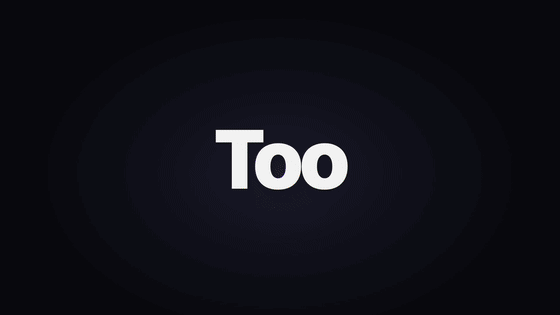
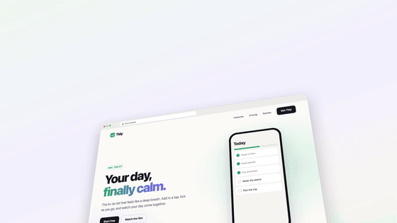
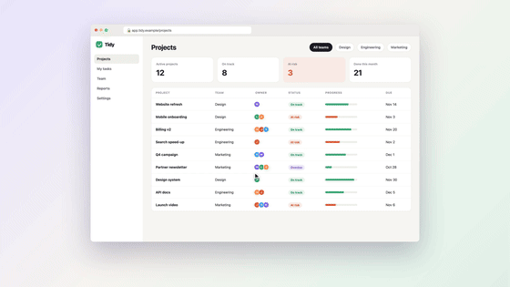

# Reelwright

**Make polished product videos from code** — app walkthroughs, launch films, explainers — with free,
local tools. No video editor, no paid services, no stock-footage subscriptions.

[](https://github.com/Nexace/reelwright/actions/workflows/ci.yml)
[](LICENSE)

You write a script, a scripted screen recording and a small HTML "edit". The kit voices the script with
neural TTS, records your product with Playwright, cuts every shot to the spoken words and the music's
beat, renders 1080p60 frames in headless Chrome, designs the sound, mixes, and encodes an mp4.
Because the whole edit is code, changing a line of the script or re-recording a screen re-flows the
film with one command.

```bash
git clone https://github.com/Nexace/reelwright && cd reelwright
./setup.sh          # once: ffmpeg, Node, Python libs, headless Chromium (Windows: node setup.mjs)
./video.sh all      # (Windows: node bin/reelwright.mjs all) builds the example → projects/example/out/tidy-example.mp4 (~1 min)
```

---

## Sample films

Six films, all made with this kit and all in [`projects/`](projects/), so you can rebuild any of them
with `./video.sh all <name>`. Every product, person and number in them is fictional. The previews are
silent GIFs. To watch the real mp4s with sound, open the
**[sample gallery ▶](https://nexace.github.io/reelwright/)** or click **▶ with sound** under any film.

<table>
<tr>
<td width="50%" valign="top">

<b>Launch teaser</b> · 13 s · music only · <a href="https://nexace.github.io/reelwright/#teaser">▶ with sound</a><br>
Kinetic type on every beat, a white flash on the drop, a 3D field of UI cards pumping with the kick,
and an RGB-glitch logo on the final hit. Original synth track. <code>projects/teaser</code>
</td>
<td width="50%" valign="top">

<b>Website promo</b> · 15 s · music only · <a href="https://nexace.github.io/reelwright/#website">▶ with sound</a><br>
Captures a landing page, then scrolls it in a 3D browser. Cards and pricing lift out of the page on the
beat, then the camera flies over the whole page. <code>projects/website</code>
</td>
</tr>
<tr>
<td valign="top">

<b>Data story</b> · 15 s · voiceover · <a href="https://nexace.github.io/reelwright/#stats">▶ with sound</a><br>
Counters, a bar chart, a self-drawing line chart and a donut, each landing on the exact spoken number
("<i>forty</i> percent", "by <i>half</i>"). Karaoke subtitles. Labelled as illustrative data. <code>projects/stats</code>
</td>
<td valign="top">

<b>Desktop walkthrough</b> · 14 s · voiceover · <a href="https://nexace.github.io/reelwright/#dashboard">▶ with sound</a><br>
A recorded web app in a browser window, with a drawn cursor following the recorded mouse path,
click ripples and camera punch-ins. A magnifier lens opens on "<i>before it slips</i>". <code>projects/dashboard</code>
</td>
</tr>
<tr>
<td valign="top">

<b>App walkthrough</b> · 23 s · voiceover · <a href="https://nexace.github.io/reelwright/#example">▶ with sound</a><br>
The starter project. A phone take re-timed so each tap lands on its word, with a punch-in while typing,
feature captions and an end card. <code>projects/example</code>
</td>
<td valign="top" align="center">

<br><b>Vertical reel (9:16)</b> · 10 s · voiceover · <a href="https://nexace.github.io/reelwright/#reel">▶ with sound</a><br>
1080×1920 for Reels, Shorts and TikTok. One-word captions, beat-synced zooms, confetti on "<i>Done.</i>",
and a final hit on the bar the edit picks. <code>projects/reel</code>
</td>
</tr>
</table>

---

## The tools

| Job | Tool | Why this one |
|---|---|---|
| Record the product | **Playwright** + Chrome DevTools screencast (`record.mjs`) | Scripted, repeatable take at 2× (Retina). Logs every tap and named moment so the edit can sync to them. Re-record any time the UI changes. |
| Capture a website | **Playwright** (`tools/capture_site.mjs`) | Scrolls first so scroll-animations fire, then saves each section, the full page and every image, plus the page's text, headings, colours and fonts (`site.json`). Read-only: form posts and other writes never leave the browser. |
| Film or theme from a URL | `reelwright from-url`, `reelwright theme-from` (`tools/from_url.mjs`, `tools/theme_from.mjs`) | Drafts a whole project (script, look, screenshots) or a theme from a page, by rules — no AI service, no key. |
| Use Figma designs | **Figma REST API** (`tools/figma_export.py`) | Exports every screen frame in a section as PNG — make a film from designs before the app exists. |
| Edit / animate | **HTML + CSS + JS "director"** (`film/film.js` + `tools/engine.js`) | The edit is code: `render(t)` draws the frame at time *t*. Built in: phone and browser mock-ups, a cursor that follows the recorded mouse, magnifier lens, counters, karaoke subtitles, words that appear as spoken. Plus anything CSS, SVG or 3D transforms can draw. |
| Render | **Playwright** (headless Chrome) → JPEG frames (`tools/renderers/pvk.mjs`), or **HyperFrames** (vendored, `tools/renderers/hyperframes.mjs`) | Deterministic, 60 fps, parallel pages. 16x9, 9x16 or 1x1 from one edit. See [Renderers](#renderers). |
| Voiceover | **edge-tts** — Microsoft neural voices, free, no account (`tools/vo.py`) | Natural voices (Andrew, Ava, Hindi Swara…) **with word timings**, so visuals land on exact words. |
| Music | Any track (e.g. **Mixkit**, free licence) + beat-grid fit (`tools/beatgrid.py`), or a built-in original soundtrack: `chill` or `drive` (with a drop and a final hit) (`tools/music.py`) | Cuts land on the beat. The fit measures the real tempo from the drums — never trust a listed BPM. |
| Sound effects | Synthesised in **numpy** (`tools/mix.py`) | Whooshes, taps, pops, impacts, chimes — generated, no sample licences. Placed by `cue()` calls in the film. |
| Mix | **numpy + ffmpeg loudnorm** (`tools/mix.py`) | Music ducks under the voice automatically; output normalised to −14 LUFS (YouTube/Instagram level). |
| Encode | **ffmpeg** (H.264 + AAC) | Plays everywhere: WhatsApp, Slack, Drive, YouTube, Keynote. |
| QA | `tools/qa.py`, `tools/qa_page.mjs`, `tools/sheet.py` | Finds blank frames and jumpy cuts, then gates that fail the build: loudness, caption fit and contrast, flashing (photosensitivity), an "Illustrative data" label on numbers, and code that can't be seeked. Contact sheet of stills to review the whole film at a glance. |

Optional: **Claude Code** in this folder does all of the above from plain English — see [CLAUDE.md](CLAUDE.md).

---

## Setup (once, ~5 minutes)

Requirements: Node 18+, Python 3.9+, ffmpeg. `./setup.sh` installs what's missing (Homebrew on macOS:
install it from https://brew.sh first; apt on Debian/Ubuntu), then checks each piece. Re-run it any time.
On Windows, install Node first (`winget install OpenJS.NodeJS.LTS`), then run `node setup.mjs` (winget or
Chocolatey for the rest).

Every command is `node bin/reelwright.mjs <command> [project]` on any platform (`npm link` makes it plain
`reelwright`); `./video.sh` is the same thing on macOS and Linux. The docs use `./video.sh`.

### Does it work on my computer?

| Platform | Status |
|---|---|
| **macOS** (Apple Silicon or Intel) | ✅ Supported. All the sample films were made on a Mac. |
| **Linux** (Ubuntu / Debian) | ✅ Supported. CI builds both example films on Ubuntu, macOS and Windows for every commit. Other distros work if you install ffmpeg, Node and Python yourself. |
| **Windows 10 / 11** | ✅ Native, no WSL. CI builds both example films on Windows for every commit; nobody has tried it on a real Windows machine yet, so reports welcome. Use `node bin/reelwright.mjs` where the docs say `./video.sh`. |

Fonts: themed films use the bundled fonts in `fonts/`, so they look the same everywhere. Older samples without a
`"style"` use the system UI font, which is San Francisco on macOS and a fallback elsewhere.

## Make the example film (~2 minutes)

```bash
./video.sh all
open projects/example/out/tidy-example.mp4
```

That runs every step on a tiny fake to-do app (`projects/example/demo-app/`): records it, voices the script,
builds the music, edits, renders, mixes and checks the result. Read `projects/example/film/film.js` alongside
the video — it's the clearest way to see how the edit works.

---

## Make your own film — step by step

```bash
./video.sh new my-film          # copies the example to projects/my-film
```

### 1. Write the script — `project.json`
Each line becomes one voiceover clip. `gap` = seconds of silence before the line (use 1–2 s before a new
section so the picture can breathe).
```json
{ "id": "add", "gap": 1.4, "text": "Add a task in one tap. Type it, and it's on your list." }
```
Voice settings: `voice` (list them with `edge-tts --list-voices`; good ones: `en-US-AndrewNeural`,
`en-US-AvaNeural`, `en-IN-NeerjaNeural`, `hi-IN-SwaraNeural`), `rate` (`"+6%"` faster, `"-5%"` slower), `pitch`.

```bash
./video.sh vo my-film      # listen to projects/my-film/vo/*.mp3; edit text and re-run — only changed lines regenerate
```

### 2. Record the product — `record.mjs`
Point `URL` at your app (local dev server, staging, or a live site) and write the take: `tap(locator, name)`,
`type(text)`, `mark(name)`, `wait(ms)`. Names are what the edit syncs to.
```bash
./video.sh record my-film  # → clips/flow/ (frames) + film/clip.js (timings)
```
- Use test accounts and fake data. **Never let the take really publish, pay or message anyone** — mock those
  calls (Playwright `page.route`) or use a demo build.
- Phone apps: the viewport is 390×797 (an iPhone screen without the status bar; the film draws one).
  Desktop: set `W, H` to e.g. 1440×900 and put the screen in a browser frame instead of `KIT.phone`.
- No app yet? Skip recording and use Figma screens (below) as images.

### 3. Music (optional)
Without a track you get the built-in synth bed (fine for drafts and internal films). For real music:
1. Download a track, e.g. from https://mixkit.co/free-stock-music/ (free licence, no attribution) → save as
   `projects/my-film/music/track.mp3`.
2. `./video.sh beatgrid my-film` → measures the tempo and prints every bar's start time with a loudness bar.
3. Set `"music": { "start": <a bar time> }` in `project.json` — pick a bar just before a drop, so the film
   opens on energy (or a quiet bar for a calm opening).
4. `beatgrid` also finds the drop (where the kick and bass come in after a quieter stretch); `KIT.drop()` is its
   time in the film. Override with `"music": { "drop_bar": <bar> }`. `projects/teaser` cuts to it.

### 4. Edit — `film/film.js`
The edit is a list of things on screen, each with a time window. Times come from the voice and the take,
never typed by hand:
```js
W('add', 'tap')            // when the word "tap" is spoken in line "add"
V('add').start / .end      // when the line starts / ends
clip.filmAt(tapTime)       // when a recorded tap appears in the film
KIT.snap(t)                // nearest music beat
cue(t, 'whoosh')           // a sound effect: whoosh, whooshdown, pop, tap, impact, chime, riser
```
The recorded take is re-timed with **anchors** — `[clip time, film time]` pairs, e.g. "the Add button tap
lands on the word *list*". Between anchors it plays at a constant speed (the engine warns if any section
would play slower than 0.4× or faster than 2.5×).

Preview without rendering: `./video.sh preview my-film` opens a live scrubber at http://localhost:4173 —
the film's own page (so a frame there is the frame the renderer makes), a slider stepping whole frames
(←/→ one frame, shift ±1 s, space plays with sound), and the `mix.wav` waveform with the VO lines, SFX cues,
beats, bars and the drop marked. Saving film.js, data, the theme or the kit reloads it at the same moment; a
`project.json` edit shows "script changed: run `reelwright audio`". Or render stills:
```bash
./video.sh sched my-film && ./video.sh stills my-film          # 12 evenly spaced stills + stills/sheet.jpg
./video.sh stills my-film 3.2,7.8,15                            # specific moments
./video.sh remix my-film     # the 25/50/75 % moments in the 3 themes furthest from yours, as 16x9, 9x16 and 1x1
```
`remix` writes `stills-remix/sheet.jpg`, one labelled row per look; pick one with `"style"` in project.json.
It also runs the variety check (a `qa` line too): a WARN when another film in `projects/` uses the same
theme, or the same fonts, a palette within ΔE 10 and the same `KIT.layout` scenes.

### 5. Build
```bash
./video.sh all my-film     # everything, from recording to mp4
./video.sh audio my-film   # after script/voice/music changes
./video.sh film my-film    # after film.js changes (re-renders)
./video.sh verify my-film  # inputs unchanged since the build, and a fresh render gives the same frames
./video.sh clean my-film   # delete frames/stills/.cache (GBs) — keeps the mp4
```
The mp4 lands where `project.json` → `out` says. Render speed is roughly 30–60 frames/s; `PAGES=6
./video.sh frames my-film` uses more CPU for a faster render.

Re-renders are incremental (pvk films): `frames` fingerprints what each frame shows (the visible DOM,
video times, scroll offsets, canvas pixels, plus every file the page loaded) and copies frames it has seen
before from `.cache/frames/`, so a caption edit re-renders only the frames that show it. It reports how many
frames it rendered and where (`260 rendered in 1 shot: 367–626 (6.12–10.45 s)`). `--no-cache` renders every
frame. HyperFrames films always render in full. The fingerprint doesn't see Web Animations' currentTime, form input
values or focus, `adoptedStyleSheets` or the inside of iframes (films driven by `render(t)` don't use them), and a
one-off render glitch stays cached until `--no-cache` or `clean`.

`encode` also writes `<out>.manifest.json`: tool versions, a hash of every input and of every frame, the
duration. `verify` names any input that changed since, then re-renders the frames with the cache off and
compares them to the manifest — identical on the same machine. What can differ on another OS:
[docs/REPRODUCIBLE.md](docs/REPRODUCIBLE.md).

---

## Renderers

`"renderer"` in `project.json` picks how frames are drawn. Everything else (voice, timing, music, mix, encode,
captions, QA) is the same for both, and both run the same engine (`W`, `V`, `KIT.snap`, `cue`, themes, layouts).

| | `"pvk"` (default) | `"hyperframes"` |
|---|---|---|
| Film lives in | `film/index.html` + `film/film.js` | `hf/index.html` + `hf/film.js` (a HyperFrames composition) |
| Drawn by | Playwright pages calling `render(t)` | the vendored HyperFrames engine (`vendor/hyperframes/`) |
| Use it for | screen recordings: phone/browser mock-ups, the recorded take, cursor, magnifier | motion-graphics films: titles, charts, catalog components (`reelwright add`) |
| Re-renders | incremental: unchanged frames come from `.cache/frames/` | always the whole film |
| Start one | `./video.sh new my-film` | `./video.sh new my-film --renderer hyperframes` |

Pick pvk when the film is built around a recording of your product; pick HyperFrames when it's mostly type,
shapes and data and you want catalog components. `projects/example` and `projects/example-hf` are the starters.

## Themes, layouts and formats

**Themes** — `"style": "<name>"` in `project.json` (or `--style <name>` for one build, output `<out>-<name>.mp4`)
picks `themes/<name>.css`: colours, fonts, radius, shadows, caption style and motion (easing, tempo). Ten ship:
editorial, brutalist, pastel, dark-tech, playful, retro, swiss, luxury, clean, neon (`./video.sh themes` lists
them). The fonts are bundled in `fonts/` (SIL OFL, see [fonts/LICENSES.md](fonts/LICENSES.md)), so macOS, Windows
and Linux render the same type. An optional `brand.json` in the project overrides colours, fonts and logo on top
of the theme; `theme-from` drafts a theme from a site or image (see below).

**Layouts** — `KIT.layout.split`, `fullBleed`, `bento`, `tiltedDevice`, `stat`, `quote`, `kinetic`
(`tools/layouts.js`): ready-made scenes styled from the theme and sized to the safe area. `projects/layouts-hf`
shows all of them; the playbook says when to use each.

**Formats** — `--formats 16x9,9x16,1x1` on `film`, `all`, `stills`, `frames`, `encode` or `qa` builds 1920×1080,
1080×1920 and 1080×1080 from one `film.js`: audio once, then `out/<name>-<fmt>.mp4`. `KIT.fmt`, `KIT.safe` and
`KIT.u` let the edit adapt.

**Languages** — add `"langs": { "es": { "voice": "es-ES-AlvaroNeural", "lines": { "<id>": "…" } } }` to
`project.json`, then `./video.sh all my-film --lang es` → `<out>-es.mp4` with Spanish voice and captions. Every
line needs a translation; on-screen copy in `film.js` stays as written.

## Every command

`./video.sh` (or `node bin/reelwright.mjs`) with no command prints this list. `[project]` is a folder name in
`projects/` or a path, and defaults to `projects/example`.

| Command | What it does |
|---|---|
| `new <name> [--renderer hyperframes]` | copy the example (or example-hf) into `projects/<name>` |
| `add <component>` | copy a HyperFrames catalog component into `<project>/hf/blocks/` (then `KIT.block('<component>')`) |
| `record` | run `record.mjs` → the screen take (`clips/`) + `film/clip.js` |
| `vo` | voiceover from `project.json` lines → `vo/` (only changed lines regenerate) |
| `beatgrid` | fit the beat grid of `music/track.mp3` → `music/grid.json` |
| `sched` | place the VO lines on the timeline → `film/data.js` (`hf/kit-data.js`) |
| `info` | `timeline.json`: duration and SFX cues |
| `music` | `music/bed.wav` from your track or the built-in bed |
| `mix` | `mix.wav`: voice + ducked music + SFX at the target loudness |
| `stills [t,t,..]` | preview frames → `stills/` + `stills/sheet.jpg` |
| `frames` | render every frame → `frames/` (`--no-cache` to skip the frame cache) |
| `encode` | frames + `mix.wav` → the mp4, plus `.srt`, `.vtt` and `.manifest.json` beside it |
| `qa` | blank frames, jumps, then the gates (loudness, captions, flash, illustrative, seekable) and a variety line |
| `verify` | inputs still match the manifest and a fresh render gives the same frames |
| `preview` | live scrubber at http://localhost:4173 |
| `remix` | stills in the 3 themes furthest from yours × 16x9, 9x16, 1x1 → `stills-remix/sheet.jpg` |
| `clean` | delete `frames/`, `stills/`, `.cache/` and intermediate audio (keeps the mp4) |
| `themes` | list the themes |
| `from-url <url> [name] [--yes]` | capture a page and draft a HyperFrames project from it |
| `theme-from <url\|image> [name]` | draft `themes/<name>.css` from a page or an image |
| `all` | record → vo → (beatgrid) → sched → info → music → mix → frames → encode → qa |
| `audio` | vo → sched → info → music → mix (after editing the script) |
| `film` | sched → info → mix → frames → encode (after editing the edit) |

Options: `--lang <code>`, `--style <name>`, `--formats 16x9,9x16,1x1`, `--no-cache` (above). Environment:
`PAGES=6` (parallel browser pages), `FPS`, `BROWSER=chrome|chromium`, `PYTHON`.

---

## Other sources

**A film from a URL** — only for sites you own or have the right to use:
```bash
node bin/reelwright.mjs from-url https://example.com my-film   # capture + draft the voiceover, print it, stop
# read the lines, edit projects/my-film/project.json (and the on-screen copy in hf/site.js) if you want, then:
node bin/reelwright.mjs all my-film                            # build + QA gates (a failing gate names the time)
```
The draft is rule-based: the h1 is the hook, a "<Name> is …" sentence (else the meta description) says what it
is, the first three section headings that aren't navigation, sponsors or testimonials (with the sentence under
each) are the features, and the first "Get started / Install / Try" button is the call to action. Lines stay
under ~25 words; text with numbers in it is left out (they'd be the site's claims, unchecked). Numbers that show
inside the screenshots are listed at the stop, and the film credits the site ("Source: example.com") while such a
shot is on screen. The film is a HyperFrames project (`tools/from_url/`): the site's name from the first frame,
giving way to the hook word by word → the first screen on a tilted device → one split scene per feature with its
screenshot → the call to action, in the site's colours and the nearest bundled fonts (`brand.json`). `--yes`
skips the stop and builds at once. Read-only: nothing is clicked, writes get a fake answer in the browser,
popups, service workers and WebSockets are blocked. A 404 or challenge page stops the capture.

**A theme from a URL or an image** — `node bin/reelwright.mjs theme-from https://example.com acme` (or
`theme-from moodboard.png acme`) writes `themes/acme.css`: the site's background, text, muted and accent colours,
caption colours with WCAG contrast enforced, button radius, and its fonts mapped to the nearest bundled open-licence
family (the header says which, e.g. `"Helvetica Neue" → Inter`). Images give colours only. It's a draft on top of the
`clean` or `dark-tech` theme: edit it, then use `"style": "acme"`.

**A website** — `node tools/capture_site.mjs https://example.com projects/my-film/assets/site` saves each
section, `full.png` and all images. Put them in the film as `` layers (a slow scroll of `full.png` inside
a browser frame is a classic).

**Figma designs** — create a personal access token (Figma → Settings → Security → Personal access tokens,
read-only file content), then:
```bash
export FIGMA_TOKEN=figd_xxx
python3 tools/figma_export.py "https://www.figma.com/design/KEY/Name?node-id=12-345" projects/my-film/assets/screens
```
Link a section or page (right-click → Copy link to selection); every screen frame inside it is exported in
reading order. View access is enough.

---

## Render in the cloud (free)

No fast computer? Two free options, both building the same way as `./video.sh all`.

**Google Colab + Drive** ([cloud/reelwright_colab.ipynb](cloud/reelwright_colab.ipynb)). Drive stores files;
Colab does the rendering.
1. Open the notebook in Colab: [open it from GitHub](https://colab.research.google.com/github/Nexace/reelwright/blob/main/cloud/reelwright_colab.ipynb),
   or File → Upload notebook → `cloud/reelwright_colab.ipynb`.
2. Only for a private fork: add a Colab secret `GITHUB_TOKEN` (🔑 in the left bar), a fine-grained GitHub token
   with *Contents: read* on that repo only. The notebook sends it as a header; it isn't saved in the clone or printed.
3. Put your project in `MyDrive/reelwright/projects/<name>/` (bundled projects like `example` need nothing), set
   `PROJECT` in the first cell, then Runtime → Run all. Allow Drive access when asked (only "See, edit, create, and
   delete all of your Google Drive files" is needed); finish the popup within ~2 minutes or the mount times out
   (just run again).
4. The mp4, `.srt`, `.vtt`, manifest and `qa.txt` appear in `MyDrive/reelwright/projects/<name>/out/`.

The first session downloads Node and Chromium into `MyDrive/reelwright/cache/` (a few minutes); later ones unpack
from there. Colab disconnects idle sessions and caps session length (Google sets the free limits; no GPU needed).
After a disconnect, Run all again: each step is saved to Drive as it finishes, so the screen take, voiceover and
(pvk films) rendered frames are reused. HyperFrames films re-render their frames.

**GitHub Actions** ([render.yml](.github/workflows/render.yml)): Actions → Render → Run workflow, pick a project
committed to the repo and optional build options; download the film from the run's artifacts. This repo is public, so
Actions minutes are free; a private fork on GitHub Free gets 2,000 Linux minutes a month (the example takes about 10).

HyperFrames' own cloud rendering (AWS Lambda) isn't used: it's paid.

## Folder layout

```
bin/reelwright.mjs          every build step (video.sh is a wrapper for it)
bin/pvk                     video.sh from any folder (adds Homebrew's ffmpeg to PATH)
setup.mjs, setup.sh         one-time setup
tools/                      shared — you rarely edit these
  engine.js, kit.css        the director engine (timing helpers, phone, clip player, subtitles, SFX cues)
  render.mjs                stills / frames / encode, through the renderer project.json picks
  renderers/pvk.mjs         the default renderer ("renderer": "pvk")
  renderers/hyperframes.mjs "renderer": "hyperframes" — hf/index.html rendered by the vendored HyperFrames engine
  layouts.js, theme.mjs     KIT.layout.* scenes; writes each film's theme.css from themes/ + brand.json
  vo.py, sched.py           voiceover + placing it on the timeline
  beatgrid.py, music.py     music tempo fit + music bed
  mix.py                    voice + ducked music + SFX → mix.wav
  qa.py, qa_page.mjs, sheet.py   checks, QA gates and contact sheets
  preview.mjs, preview.html the live scrubber (reelwright preview)
  look.mjs                  a film's resolved look: remix's theme pick and the variety check
  manifest.mjs              <out>.manifest.json and reelwright verify
  capture_site.mjs, figma_export.py, browser.mjs
  from_url.mjs, theme_from.mjs, from_url/   reelwright from-url / theme-from and the film template they copy
  smoke.mjs                 can this machine render? one frame each from Chromium and HyperFrames
vendor/hyperframes/         HyperFrames (Apache 2.0): render packages + catalog components, see VENDORED.md
themes/                     the ten themes (themes/<name>.css), plus any theme-from writes
fonts/                      bundled OFL fonts and LICENSES.md (fetch.mjs re-downloads them)
cloud/                      reelwright_colab.ipynb + colab_build.py: free rendering in Colab, files in Drive
projects/
  example/                  the starter: app walkthrough (copy it with ./video.sh new <name>)
  example-hf/               HyperFrames starter (reelwright new <name> --renderer hyperframes)
  layouts-hf/               every KIT.layout scene, in the editorial theme
  qa-broken/                trips every QA gate on purpose (CI checks that it fails)
  teaser/ website/ stats/ dashboard/ reel/   the other sample films — each shows different techniques
projects/<name>/
  project.json              script, voice, music, size, output path
  record.mjs                the screen take
  film/index.html, film.js  the look (CSS) and the edit
  hf/index.html, film.js    the same, for "renderer": "hyperframes"; hf/blocks/ holds catalog components
                            (reelwright add <project> <component>, then KIT.block('<component>') in film.js)
  demo-app/                 (example only) the fake app being filmed
  .cache/frames/            rendered frames by fingerprint (reused by frames; clean deletes it)
docs/PLAYBOOK.md            what makes these films good — read before your first real one
docs/REPRODUCIBLE.md        the manifest, verify, and what can differ across operating systems
docs/archive/plans/         how this repo was built: the plan, phase specs and their status
NOTICE, THIRD_PARTY.md      licenses of the vendored code, fonts and tools
```

## Troubleshooting

| Problem | Fix |
|---|---|
| `TTS failed` / 403 / NoAudioReceived | Microsoft's endpoint is flaky; it retries automatically. If it keeps failing: `python3 -m pip install --user -U edge-tts` |
| `film/index.html failed to load` | The error above it names the problem — usually a word in `W('line', 'word')` that isn't in the script any more. |
| Blank/white frames in the video | The take was re-recorded after the edit was written: re-run `./video.sh sched` and check anchors still exist. `./video.sh qa` lists blank stretches. |
| Browser won't launch | `npx playwright install chromium`, or install Google Chrome (the kit falls back to it). |
| Music drifts off the beat | Run `./video.sh beatgrid` again and use its `start`; listed BPMs on music sites are often wrong. |
| Out of disk | Frames are ~1 GB per minute. `./video.sh clean <project>` after you have the mp4. |

## Contributing

Issues and PRs welcome — see [CONTRIBUTING.md](CONTRIBUTING.md). Ideas: more engine components.

## Licence and credits

Code: [MIT](LICENSE). The example app, script and sounds are original and covered by the same licence.
Voices are generated by Microsoft Edge's online TTS through [edge-tts](https://github.com/rany2/edge-tts) —
check Microsoft's terms for your use. Third-party code, fonts and tools: [THIRD_PARTY.md](THIRD_PARTY.md) and [NOTICE](NOTICE). `vendor/hyperframes/` is HyperFrames by HeyGen under
[Apache 2.0](vendor/hyperframes/LICENSE) ([what we took and changed](vendor/hyperframes/VENDORED.md)). Music you add is under its own licence (e.g. the
[Mixkit licence](https://mixkit.co/license/)); it is never committed (see `.gitignore`).
