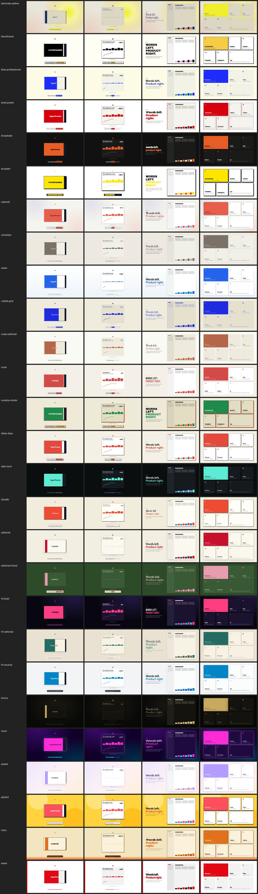

# Playbook — what makes these films work

Lessons from a dozen product films (launch films, creator pitches, manager walkthroughs, explainers).
Read once before your first real film.

## Contents

The first half is craft (story, picture, sound, process, engine rules, layouts, motion, camera, doodle, math). The second half is the tools added in 0.3.

- [Story before pixels](#story-before-pixels)
- [Truthfulness](#truthfulness)
- [Picture](#picture)
- [Sound](#sound)
- [Process](#process)
- [Engine rules](#engine-rules-when-writing-filmjs)
- [HyperFrames films](#hyperframes-films-renderer-hyperframes)
- [Scene layouts](#scene-layouts-kitlayout-toolslayoutsjs)
- [Motion](#motion-kiteasing-kitbezier-kitspring-kitkeys-toolsenginejs)
- [Camera shots](#camera-shots-kitshot-kitshoot-toolsshotsjs)
- [Doodle](#doodle-style-doodle-kitdoodle-toolsdoodlejs)
- [Math](#math-kitmath-toolsmathjs)
- [Working with Claude](#working-with-claude-brief--script--stills--taste--preview--render)
- [Themes](#themes-themescss-style-theme-check-theme-gallery)
- [Theme from a brief](#theme-from-a-brief-reelwright-theme-brief)
- [Animation runtimes](#animation-runtimes-kitgsap-kitlottie-kitanime-kitthree-toolsruntimesjs)
- [More motion: paths, transitions, camera, rates](#more-motion-paths-transitions-camera-rates-toolspathjs-transitionsjs-shots2js-motionjs)
- [Shader transitions](#shader-transitions-kitshader-toolsshadersjs)
- [Doodle depth](#doodle-depth-kitdoodle-pen-strokes-score-letters-toolsdoodle2js)
- [Math depth](#math-depth-kittex-kitmathshape-plot2-kitmath3d)
- [Colour grading and per-pixel effects](#colour-grading-and-per-pixel-effects-kitgrade-kitvfx)
- [Motion blur](#motion-blur-motionblur)
- [Video clips and extra audio](#video-clips-and-extra-audio-kitvideo-kitaudio-toolsmediajs)
- [Sound depth](#sound-depth-kitcue-toolsmixpy-toolsmusicpy)
- [HyperFrames blocks](#hyperframes-blocks-reelwright-add-kitmount-kitblock)
- [Nested compositions](#nested-compositions-kitmount-toolscomposejs)
- [Output formats, alpha, HDR, 4:5](#output-formats-alpha-hdr-45-output---as---formats)
- [QA lint for HyperFrames films](#qa-lint-for-hyperframes-films-toolscheckshf-lintpagemjs)
- [Studio](#studio-reelwright-studio-toolsstudio)
- [Optional Manim scenes](#optional-manim-scenes-reelwright-manim-kitmanim)
- [The Remotion renderer, optional](#the-remotion-renderer-optional-renderer-remotion)

## Story before pixels

- **Sell a story, not a feature list.** The film that worked: hook (the pain, in the viewer's words) →
  the grind (show how bad the old way is — a stopwatch, a repeated chore) → reveal → 3–6 features on real
  footage → payoff (before vs after, in numbers) → end card. A montage of features "looked bad and didn't sell".
- **Know the audience before writing a line.** Same product, different films:
  - *Users / launch*: emotion + benefit, fast, music-led, 30–90 s.
  - *Partners* (another company's team): trust and clarity — show permissions, what is and isn't done
    on their behalf. Calm, simple, no hype.
  - *Manager / founder in a meeting room*: **slow**. Each step visibly finishes before the next starts.
    Show the real thing (real data, real files, real flow), don't describe it. Two earlier cuts were
    rejected as "too fast" before a 0.7 s gap between lines and a −3% voice rate landed.
- **Write the VO first**, read it aloud, then build the picture to it. Short sentences. One idea per line.
- **Length**: 30 s (promo), 60–90 s (product demo), 2–5 min (explainer). If it's longer, it needs chapters.

## Truthfulness

- Numbers on screen that aren't real get a small **"Illustrative data"** label — unless the stakeholder
  explicitly decides otherwise for a dramatized film.
- Don't claim what the product doesn't do. Check claims against the code/product before the VO is recorded
  (e.g. a limit is 20, not 24; a feature is live, not "coming soon").
- Use fictional people, phone numbers and IDs (`+1 415 555 01xx`, "Maya Brooks") — never a real user's or
  a real test account's ID on screen.
- **Never let a recording really publish, pay, post or message.** Mock write calls (Playwright
  `page.route('**/api/**', …)` answering non-GET requests with a fake success) or use a demo build.
- AI-generated stills and clips (`reelwright gen`, Firefly, Express) get `KIT.aiLabel(el)` on screen; `qa` warns
  without it. See [CONNECTORS.md](CONNECTORS.md).

## Picture

- **Isolate the UI.** The best-looking shots put the app (or one panel of it) on a clean background, window
  chrome hidden. A full browser page with a dim overlay leaves half-words and white edges.
- **Phone apps go in a phone frame on a plain stage**; captions on the other side. Desktop: a browser frame.
- **Camera moves are slow and purposeful**: punch in on the thing being talked about, hold, pull back.
  No swooping. If you zoom into a full-width element (an input bar), it gets cropped — scale the whole
  device instead.
- **Every visual change happens on a word or a beat.** Use `W('line', 'word')` and `KIT.snap()`; never
  hand-typed seconds.
- Captions: few words, big. Subtitles (karaoke highlight) help when the audience may watch muted.
- Wait for images to load before a recorded tap, or the layout shifts and the tap lands on the wrong thing.

## Sound

- **Voice**: edge-tts Andrew (warm, US male) or Ava (bright, US female) at +4–8% rate for promos, −3 to
  −8% for explainers. Hindi: `hi-IN-SwaraNeural` at −6%, and spell English UI words in Devanagari for
  correct pronunciation, keeping the on-screen captions in English.
- **Music** sets the energy. Find free tracks on Mixkit (licence: free use, no attribution). Always measure
  the beat grid (`beatgrid`) — listed BPMs are often wrong, and a 0.5% error drifts a beat in two minutes.
- Start the music so the **drop lands on the reveal**, and let the song's final hit (or silence) land on
  the end card. `beatgrid` finds the drop; cut to `KIT.drop()` (or set `music.drop_bar` by hand).
- **Other languages**: add `"langs": { "es": { "voice": "es-ES-AlvaroNeural", "lines": { "<id>": "…" } } }` to
  `project.json` and build with `--lang es` → `out/<name>-es.mp4`. Voice, captions and `.srt/.vtt` follow; cues
  on English words (`W('chart', 'grows')`) land at the same point of the translated line. Copy you typed into
  film.js stays as typed. Get translations from a fluent speaker; nothing is machine-translated.
- If you cut music to shorten it, cut on bar lines between sections that sound alike, with a short
  crossfade — otherwise the jump is audible.
- Music ducks ~10 dB under the voice (automatic). Final loudness −14 LUFS (automatic).
- SFX: quiet. A tap click per tap, a whoosh per transition, one impact for the logo, one chime for the
  payoff. More than that gets tiring.

## Process

- **Ship a v1 fast, then iterate.** Render stills (`./video.sh stills`) and a contact sheet before a full
  render; it's seconds instead of minutes.
- **Watch it yourself before sending.** `./video.sh qa` lists blank frames and frame-to-frame jumps; every
  big jump should be on a cut. Then scrub the mp4 at the times it prints.
- `qa` also runs gates that fail the build: **loudness** (±1 LU of `loudness`, peak ≤ −1 dBTP), **captions**
  (inside the safe area, ≤ 2 lines, contrast ≥ 4.5), **flash** (≤ 3 flashes a second, for photosensitive
  viewers), **illustrative** (numbers like 40% or $12 need the label on screen), **seekable** (no clock,
  randomness, timers or CSS transitions in the film's code). Fix the film; turn a gate off only for a reason,
  e.g. `"qa": { "illustrative": false }` when the numbers are real. `projects/qa-broken` trips every gate.
  Five more checks only print `WARN` lines and never fail the build (turn one off the same way, e.g.
  `"qa": { "tiny-text": false }`; the fifth, **ai-label**, is under Truthfulness): **overlap** (two on-screen texts sitting on each other, sampled every 0.5 s;
  crossfades and wipes pass), **tiny-text** (rendered font under 24 px × `KIT.u`; the "Illustrative data" label
  and "Source:" credits are exempt), **wordy** (a label of 7+ words that repeats the VO line playing: show the
  keywords, not the narration), **dark** (over 2 s of near-black frames with no voiceover).
  Screenshots count too: give an `` of a page `data-qa-text="<the text it shows>"` and the gate reads its
  numbers; real figures from a real site pass with a visible "Source: …" credit instead of the label
  (`from-url` films do both). Version numbers (v8.3.4, 3.10.2) aren't data.
- **Beat sheets.** A script planned in a spreadsheet comes in with `./video.sh beats <project> import sheet.csv`
  and goes back out with `beats <project> export` (add `--replace` to overwrite lines, or an existing csv, that are already there). The CSV
  needs a `VO Script` column; both common headers work, `Scene, Beat Label, VO Script, VO Length, Clip Duration, SHOT,
  MOTION, TEXT ON SCREEN` followed by `SFX, IMG PROMPT, VID PROMPT` or by `AUDIO, Source, Status`. `VO Script` becomes
  each line's `text`, `Beat Label` its `id`; the rest goes to `beats` in project.json as notes for you (`VO Length` as
  the target seconds). Prompt and other unknown columns are kept word for word so export can write them back; nothing
  reads them or sends them anywhere. A `{ "timeline": [{ "start_s", "end_s", "label" }] }` JSON adds only beat sections.
- `encode` writes `<out>.srt` and `<out>.vtt` beside the mp4 for players and upload sites.
- Re-recorded the take? Re-run `sched` and `info` — anchors and SFX times derive from the take's marks;
  stale ones give blank white frames.
- Keep only the final mp4. Frames are ~1 GB per minute: `./video.sh clean <project>`.
- Make re-cuts in a copy (`./video.sh new v2` and copy files over) so the approved version stays reproducible.

## Engine rules (when writing film.js)

- `render(t)` sets every style from `t` alone. No CSS transitions/animations, no `requestAnimationFrame`,
  no state carried between frames — frames render out of order across parallel pages.
- Build all elements once at load; in `render(t)` only change `opacity`, `transform`, `src`, text.
- Use `KIT.show(el, opacity)` (also sets visibility) and `KIT.img(img, src)` (waits for decode).
- An element with a `z-index` inside a flex container can paint over overlays — give overlays their own
  higher `z-index`.
- Fonts: use a theme (`"style"`) and its bundled fonts, or put a `.woff2` in the project and name it in
  `brand.json` — the renderer waits for fonts before the first frame. System fonts differ by OS.

## HyperFrames films (`"renderer": "hyperframes"`)

- Same engine, same rules: `hf/film.js` hands its `render(t)` to `KIT.start`, and every time comes from `hf/kit-data.js`
  (written by `sched`: VO words, music grid) through `W()`, `V()`, `KIT.snap()` — never seconds typed by hand,
  never times in `data-start`/`data-duration` attributes.
- Only seekable animation: HyperFrames renders frames out of order and in parallel, so anything that runs on a
  clock (GSAP or anime.js timelines left playing, CSS animations and transitions, WAAPI, `requestAnimationFrame`,
  `setTimeout`, `Date.now`, `Math.random`) breaks. The `seekable` QA gate catches most of these.
- Catalog components and blocks (`reelwright add <name>`) are mounted with `KIT.block(name)` / `KIT.mount` (see Blocks below)
  and driven through the CSS custom properties their "Timeline integration" comment lists, from `render(t)`. Don't pull in
  components that need GSAP or load fonts and scripts from a CDN: renders must work offline and give the same frames every time.
- Keep the composition folder self-contained: assets go under `hf/` (HyperFrames serves only that folder; the
  renderer copies the theme and fonts into `hf/kit/`).

## Scene layouts (`KIT.layout.*`, tools/layouts.js)

Ready-made scenes for title cards and feature beats, so a film doesn't hand-place text. Each one is
`KIT.layout.<name>({ ...content, in, out, note })` → `{ el, set(t) }`: it builds itself inside the title-safe box,
re-arranges for 16x9 / 9x16 / 1x1, styles itself from the theme's tokens, enters after `in` and leaves before `out`
with the theme's motion. You compute `in`/`out` from `V()`/`W()`/`KIT.snap()` and call `set(t)` in `render(t)`.
`note: 'Illustrative data'` puts the label under the box.

| Layout | Use it for |
|---|---|
| `kinetic({ line, accent })` | The hook or a slogan: the VO line itself, huge, each word landing as it's spoken. |
| `fullBleed({ text, accent })` | One short claim that should fill the frame (no VO sync — words rise in turn). |
| `split({ kicker, title, body, media, flip })` | A feature with its picture: text beside a media card (stacked in vertical/square). Fill `.media` with a mock UI, an image, a clip. |
| `tiltedDevice({ kicker, title, body, screen, aspect })` | Revealing the product: a framed screen tilted in 3D that settles flat, caption beside/below. |
| `bento({ kicker, title, tiles: [{ icon, title, body, wide, hero }], step })` | "Everything it does" — a grid of tiles popping in on the beat (4 columns wide, 2 vertical). |
| `stat({ value, prefix, suffix, decimals, label, at })` | One number that matters, counting up from `at` (put it on the spoken number). |
| `quote({ text, author, role })` | Social proof. Fictional people unless it's a real, approved quote. |

```js
const L = KIT.layout, IN = (id) => KIT.snap(KIT.V(id).start - 0.45);   // on the beat just before the line
const stat = L.stat({ in: IN('stat'), out: IN('quote') + KIT.dur(0.45), value: 40, suffix: '%', label: 'faster to ship',
                      at: KIT.snap(KIT.W('stat', 'forty')), note: 'Illustrative data' });
function render(t) { stat.set(t); /* … */ }
```

One layout per VO line reads best. Let each scene's `out` fall just after the next one's `in`
(`+ KIT.dur(0.45)`): the exit takes the last 0.45 s before `out`, so the old scene fades as the new one enters; `out` = next `in` leaves a blank dip that
`qa` flags, while a short overlap reads as a crossfade. projects/layouts-hf is the worked example.

## Motion (`KIT.easing`, `KIT.bezier`, `KIT.spring`, `KIT.keys`, tools/engine.js)

All pure functions of `t`, the same in both renderers. Durations still come from `KIT.dur()`, times from `W()`/`V()`/`KIT.snap()`.

- `KIT.easing(name)` → `p => p`. Takes GSAP-style names: `power1`..`power4` (also `quad`, `cubic`, `quart`, `quint`), `sine`, `circ`,
  `expo`, `back`, `elastic`, `bounce`, each with `.in` / `.out` / `.inOut` (`'power3.inOut'`, `'back.out(1.7)'`,
  `'elastic.out(1, .3)'`); `steps(4)`; `none`; and the `KIT.E` keys (`out`, `in`, `inOut`, `outExpo`, `outBack`, `premium`,
  `corporate`, `emphasized`, `accel`, `settle`). Unknown family names and malformed names throw; extra arguments are ignored. `steps(n)` is not CSS `steps()`: it jumps at k/(n+1).
- `KIT.bezier(x1, y1, x2, y2)` → easing from a CSS-style cubic-bezier. The named ones: `premium` (.4,0,.2,1), `corporate` (.2,0,0,1),
  `emphasized` (.05,.7,.1,1), `accel` (.3,0,1,1), `settle` (.175,.885,.32,1.275, overshoots).
- `KIT.spring({ from = 0, to = 1, mass = 1, damping = 10, stiffness = 100 })` → `t => value`, with `t` in seconds since the
  start (it returns `from` for `t <= 0`). Closed form, so scrubbing is safe. `damping` at or above critical gives a fast
  non-bouncing curve (`damping: 200` is a quick push, not a crawl). `mass` and `stiffness` must be > 0. `KIT.springDur(sameOptions)` → seconds until it is
  within 0.005 of rest (capped at 10 s): use it to time what follows.
- `KIT.keys(t, [[t0, v0], [t1, v1], …], eases)` → value across keyframes, held before the first and after the last. `eases[i]`
  is the easing (function or name) of segment i; default is the theme's `KIT.ease`.
- `KIT.stagger(i, n, total)` → start offset of item i of n spread over `total` seconds (0 if n < 2). `KIT.local(t, from, dur, rate = 1)`
  → time inside a slot, clamped to `[0, dur]`: `KIT.local(t, a, d) / d` is 0..1 progress.

```js
const x   = KIT.keys(t, [[a, -400], [a + KIT.dur(0.5), 0], [b, 0], [b + KIT.dur(0.3), 120]], [null, null, KIT.easeIn]);
const pop = KIT.spring({ damping: 12 })(t - a);                       // 0 → 1, overshoots, settles
cards.forEach((c, i) => c.style.opacity = KIT.easing('power2.out')(KIT.seg(t - KIT.stagger(i, cards.length, KIT.dur(0.4)), a, a + KIT.dur(0.4))));
```

**Theme motion tokens** (`--kit-*`, set in themes/*.css, defaults in tools/kit.css): `--kit-ease` → `KIT.ease` (entrances), `--kit-ease-in` →
`KIT.easeIn` (exits), `--kit-tempo` (`KIT.dur(s)` = s × tempo), `--kit-stagger` → `KIT.staggerStep` (seconds between items,
× tempo), `--kit-settle` → `KIT.settle` (seconds for an overshoot to rest, × tempo). Each theme picks one of four archetypes:

| Archetype | Themes | `--kit-ease` / `--kit-ease-in` | stagger / settle (s) |
|---|---|---|---|
| playful | playful | `settle` / `power2.in` | .06 / .5 |
| premium | luxury, editorial, pastel, retro | `premium` / `accel` | .08 / .8 |
| corporate | clean, swiss | `corporate` / `accel` | .05 / .45 |
| energetic | brutalist, neon, dark-tech | `expo.out` / `expo.in` | .03 / .3 |

`doodle` uses the playful curves (`settle` / `power2.in`) with stagger .07 and settle .55.

Use `KIT.ease`, `KIT.easeIn`, `KIT.staggerStep` and `KIT.settle` instead of naming eases, so a theme swap changes the feel with no edits.

Rules:
- Never linear for a move through space. Enter with `KIT.ease`, leave with `KIT.easeIn`.
- No move across more than a third of the screen in one segment: add an intermediate keyframe (`KIT.keys`) or use a camera move (`KIT.camAt`).
- Morph, don't fade: transform one object into the next (position, size, colour) rather than cross-fading two.
- To focus one thing, dim the rest to about 0.25 opacity rather than hiding it.
- On-screen text is labels and numbers. The narration is spoken, not printed.
- Stagger budget: a group's whole stagger (`KIT.stagger`'s `total`, or `staggerStep × (n − 1)`) stays under about 0.5 s; for many items shrink the step.
- Overlapping scenes: film length = sum of scene lengths − sum of overlaps. Compute scene `in`/`out` from `V()`/`KIT.snap()` as in Scene layouts, so the VO still lines up.

## Camera shots (`KIT.shot.*`, `KIT.shoot`, tools/shots.js)

A shot moves a virtual camera over one layer: `KIT.shot.<name>(opts)` → `t => state`, and `KIT.shoot(el, state(t))` in
`render(t)` films `el` (a frame-sized layer holding the scene). Times come from the caller (`t0`/`t1` or `at`, from
`W()`/`V()`/`KIT.snap()`); shape constants are frames at 30 fps × `KIT.dur`. Every shot holds its start state before its
window and its end state after it (`dutchRoll` drifts until `at`), so the stillness after a move is built in. Load with `<script src="kit/shots.js">`
(hf) or `../../../tools/shots.js` (pvk) after engine.js.

| Shot | Use it for | Energy |
|---|---|---|
| `pushIn({ t0, t1, x, y, from, to })` | Leaning in on what matters: a word, a number, a button (1 → 1.14, accelerating). | low |
| `pullBack({ t0, t1, x, y })` | The reveal: from a detail out to the whole (1.14 → 1, decelerating). | low |
| `crashZoom({ at, x, y, zoom, variant })` | One number or word that must land: 1 → 2.6 in 6 frames, then a shake (`'stop'`) or a small settle (`'rebound'`). | high |
| `whipPan({ at, dir, variant })` | Changing topic: the camera swings 1.5 frame widths in 8 frames with speed blur; put the next thing there. `'brake'` slows into it. | high |
| `dollyZoom({ t0, t1, to })` → `{ bg, hero }` | A moment of realisation: shoot the background layer with `bg`, leave the hero still (`to`: the background's final zoom, default 2.25). | medium |
| `orbit({ t0, t1, ry })` | Showing a product as an object: rotateY −18° → +18°. | medium |
| `craneRise({ t0, t1 })` | The ending: rise from below, tilted and zoomed, to the logo, level. | medium |
| `dutchRoll({ at })` | Something was off, now it's fixed: tilted −10°, rolls to level at `at`. | medium |

Helpers: `KIT.shot.track([{ at, shot }])` sequences shots on one layer (hard cut between them); `KIT.handheld(t, amp, seed)` →
`{ x, y }` drift to add to a state (amp 2–4 × `KIT.u` reads as hand-held, more as nervous); `KIT.shake(t, t0, amp)` an impact
shake; `KIT.remap(t, [[tOut, tSrc], …])` speed ramps and freezes; `KIT.speedBlur(shot, t)` blur from how fast a shot moves.

Grammar:
- At most two big moves (crash, whip) per film; the other scenes push, pull or sit still. A shot reel like projects/shots-hf
  is the exception.
- One mover per segment: while the camera moves, the content holds — no layout entrance or count-up at the same time.
- Stillness after a move: let the frame rest at least a beat before the next move or cut, or the eye has nothing to read.
- Blur only in the fast part: `whipPan` adds speed blur by itself; don't blur a push or an orbit.
- Hand-held is a low drift under a slow shot, not a move of its own.
- Orbit, dutch roll and crane tilt the layer, so its edges come into view: give the filmed layer a floor bigger than the
  frame (a child at `inset: -40%` with the background) or film a card on a still background. Whip pan travels 1.5 frame
  widths: lay out the destination content and extend the floor 1.5 widths in `dir` (shots-hf: `right: -190%`, the 40% bleed plus 150%). Push, pull
  and crash never show an edge as long as the focal point stays at least W/(2·z) from the layer's edge; otherwise give it a floor.

```js
const cam = document.querySelector('.cam');                        // frame-sized layer: floor (inset -40%) + content
const hit = KIT.W('crash', 'hard');
const shot = KIT.shot.crashZoom({ at: hit - KIT.dur(6 / 30), x: KIT.W_ / 2, y: KIT.H_ * 0.48 });   // lands on "hard"
KIT.cue(hit, 'impact');
function render(t) { KIT.shoot(cam, shot(t)); }
```

projects/shots-hf is the worked example: push-in with hand-held, crash zoom, whip pan, orbit and crane rise.

## Doodle (`"style": "doodle"`, `KIT.doodle.*`, tools/doodle.js)

The doodle theme is a notebook page: warm paper with a static grain, Caveat and Patrick Hand, marker red and blue, a
calm `settle` ease. `tools/doodle.js` (load it after engine.js, like shots.js) draws hand-made marks; any theme may use it.

- Draw-on: `KIT.doodle.underline(el, { in, draw, out, id })` and `KIT.doodle.circle(el, …)` build an SVG mark inside `el` once;
  call `.set(t)` in `render(t)`. `in` is when the pen starts, `draw` how long it takes (default `KIT.dur(0.5)`), `out`
  (optional) fades it like a layout. Put `in` on the spoken word: `in: KIT.W('push', 'matters')`. For your own paths,
  `KIT.doodle.drawOn(pathEl, p)` and `KIT.doodle.schedule(lengths, t0, t1)` time several strokes one after another.
- Boil: `--kit-boil` (doodle: 8) re-jitters every line that many times a second, like redrawn animation frames; other
  themes leave it 0, so the marks hold still.
- Determinism: a mark's wobble comes from `hash(id)` and its boil from `floor(t × boil)` — never `Math.random` or frame
  numbers — so scrubbing, `--formats` and other fps give the same drawing. Give each mark its own `id`.
- Marks measure their element once, when built: build them in the first render after `document.fonts.ready` if the element is text (renders and preview wait for it;
  `index.html#t` URLs don't).

## Math (`KIT.math.*`, tools/math.js)

Charts, curves, shapes that turn into other shapes, typeset formulas: the explainer moves Manim is known for, built as
SVG/HTML once at load and driven by `.set(t)`. Use them when the film explains a number, a trend or an idea; a feature
tour doesn't need them. Load `kit/doodle.js`, then `kit/katex/katex.min.js` (only for equations), then `kit/math.js`
after engine.js, plus `kit/katex/katex.min.css` in `<head>`; the HyperFrames renderer copies both folders into `hf/kit/`.
Options work like a layout's: `in` (start), `draw`/`dur` (how long), `out` (optional; fades over the 0.45 s before it).

| Call | Gives you |
|---|---|
| `axes({ x: [min, max, step], y: [...], box, grid, labels, in, draw, out })` | Two axes with ticks and labels that draw on. `.c2p(x, y)` turns graph units into stage px. |
| `numberLine({ range: [min, max, step], box, labels, in, draw, out })` | One axis across the middle of the safe area. |
| `plot(axes, f, { x: [x0, x1], samples, in, draw, out, color, width })` | The curve of `f`, drawn from left to right. `.progress(t)` is how far it has drawn; `.pointAt(p)` is the point that far along, for a dot on the tip. |
| `morph(pathA, pathB, { in, dur, n })` | Path A reshaped into path B (an element or a `d` string). One subpath each, both drawn the same way round. |
| `equation(tex, { in, step, out, size, x, y, display, parent })` | KaTeX-typeset formula whose glyphs rise in one by one, `step` apart. |
| `ease.smooth`, `ease.thereAndBack` | Manim's smoothstep, and a go-and-return curve for a pulse. |

- The Motion rules apply: morph one thing into another instead of cross-fading, dim the rest to about 0.25 opacity to point at one part, and keep on-screen text to labels, terms and numbers.
- Put the draw on the word: a curve starts on "curve", a formula on "writes". A dot riding the tip (`pointAt(progress(t))`)
  makes the drawing feel live. Made-up data on a chart still gets "Illustrative data".
- Equations: KaTeX covers most of LaTeX math (fractions, roots, `\left( … \right)`, `\text{}`, matrices) but no packages
  (`\newcommand` and `\def` inside the formula work). It runs with `throwOnError`, so a bad formula stops the film at load, not on a blank frame.
  Check the reveal in stills: glyphs come in reading order, delimiters and the fraction bar included.

projects/math-hf is the worked example.

## Working with Claude (brief → script → stills → taste → preview → render)

The loop an agent (Claude Code, the desktop app, Codex, …) runs for a film. Each step is cheap until the last.

1. **Brief.** Audience, length, voice or music-only, the one thing the viewer must remember, what must be shown.
   Write it at the top of `project.json` as `"brief"` (any text; nothing reads it but people and agents).
2. **Script.** The VO lines in `project.json` → `lines`. Show them to the owner before building anything.
3. **Stills.** `./video.sh audio <name>` (voiceover timings; needs internet), then `./video.sh stills <name>` and read `stills/sheet.jpg` yourself. Start
   scenes from [docs/recipes/](recipes/README.md): proven patterns with a still each, so the first draft already
   looks finished.
4. **Taste.** `node tools/checks/taste.page.mjs projects/<name>` (seconds, no render). It prints WARN lines:
   - `motion` — a one-frame velocity spike (a jump or jitter) or a move that starts/stops dead at speed (no easing);
   - `balance` — content piled to one side of the frame for over a second;
   - `empty` — a near-empty frame for over 1.5 s, or over 85% of it covered;
   - `contrast` — text below WCAG 4.5 (3 for large text) against what's behind it;
   - `pacing` — a VO line faster than 6.5 words/s (edge-tts reads up to ~6), or over 4 s where nothing moves.
   They never fail the build (qa prints them as `WARN taste:` too); fix them or say why the shot wants it.
5. **Preview in the chat.** `./video.sh embed <name>` writes `projects/<name>/out/embed.html`: one self-contained page
   (film, kit, fonts, images, blocks, mix) in the vendored HyperFrames player. No server, no network (its own CSP
   forbids it), so it plays from file://, in the desktop app's side panel (send the file to the user with
   `display: "render"`), or as a private claude.ai artifact (publish the file; ≤ 16 MB, raster frames are halved
   automatically when a recording would be bigger). Add `#12.5` to open paused on a moment. Re-run after every edit.
6. **Render.** `./video.sh all <name>` in the background, then fix every QA FAIL and look at every WARN.

`./video.sh preview <name>` is still the scrubber with the waveform and hot reload for a person at the keyboard; `embed`
is the one to hand over.

## Themes (`themes/*.css`, `"style"`, `theme-check`, `theme-gallery`)

A theme is one file, `themes/<name>.css`, picked by `"style"` in project.json or `--style <name>`. It sets every
`--kit-*` token from `tools/kit.css`: palette, bundled fonts, shape, a motion archetype (`--kit-ease`, `--kit-ease-in`,
`--kit-tempo`, `--kit-stagger`, `--kit-settle`) and a caption skin (`--kit-sub-*`, plus a few `.kit-subrow` rules).
`./video.sh themes` lists them. `./video.sh remix <name>` shows the three furthest from yours.



### The 27 themes

| Theme | Look | From |
|---|---|---|
| clean, dark-tech, editorial, luxury, neon, pastel, playful, retro, swiss, brutalist, doodle | see each file's header | Reelwright |
| hf-bold | night-club poster: violet black, hot pink, cyan; Bebas Neue caps | HyperFrames theme pack `bold` |
| hf-editorial | warm sand paper, teal accent; Libre Baskerville over EB Garamond | HyperFrames theme pack `editorial` |
| hf-neutral | quiet product UI: cool grey, sky blue; Inter | HyperFrames theme pack `neutral` |
| biennale-yellow | museum catalogue: parchment, indigo ink, solar-yellow bloom; Instrument Serif | HyperFrames frame preset |
| blockframe | loud neobrutalist: 4px black borders, hard shadows, candy pastels; Archivo Black caps | HyperFrames frame preset |
| blue-professional | consulting restraint: cream, one cobalt; Space Grotesk + Inter | HyperFrames frame preset |
| bold-poster | vintage poster: Shrikhand, Baskerville, tomato red | HyperFrames frame preset |
| broadside | protest poster: ink black, fire orange, lowercase Barlow 900 | HyperFrames frame preset |
| capsule | friendly editorial: pills, cream, coral; Bodoni Moda | HyperFrames frame preset |
| cartesian | quiet catalogue: warm stone, taupe hairlines; Playfair + Inter | HyperFrames frame preset |
| cobalt-grid | two-colour risograph: cream paper, cobalt ink, graph grid; Newsreader | HyperFrames frame preset |
| code-editorial | developer brand book: warm paper, terracotta; EB Garamond | HyperFrames frame preset |
| coral | bold magazine: coral, ink, cream planes, 45° hatch; Bebas Neue | HyperFrames frame preset |
| creative-mode | sparse neobrutalist: cream, 4px ink borders; Archivo Black caps | HyperFrames frame preset |
| daisy-days | picture book: charcoal outlines, sunny pastels; Fredoka | HyperFrames frame preset |
| editorial-forest | literary: forest green, oat cream, dusty rose; Source Serif 4 | HyperFrames frame preset |

Ported from [HyperFrames](https://github.com/heygen-com/hyperframes) (Apache-2.0, © HeyGen): `themes/{bold,editorial,neutral}.css`
and `skills/hyperframes/assets/frame-presets/*/` (`FRAME.md` + `caption-skin.html`). Each ported file says so in its
header. The hex values come from the presets, except where a value failed contrast. There the port uses the preset's
own darker sibling, or a mix of its ink and paper, and the header says which. Fonts upstream doesn't bundle are swapped
for the nearest bundled OFL family: Impact → Bebas Neue, Inter 900 → Archivo Black, Fredoka One → Fredoka 600.

### How the HyperFrames tokens map

| HyperFrames | Reelwright |
|---|---|
| `--bg --fg --muted --surface --brand/--accent --accent-2` | `--kit-bg --kit-ink --kit-muted --kit-surface --kit-accent --kit-accent-2` (+ `--kit-on-accent`) |
| `--font-display --font-body --font-mono` | `--kit-font-display --kit-font-text --kit-font-mono --kit-label-font` (bundled `fonts/` only) |
| `--radius --space-2 --border` | `--kit-radius --kit-space --kit-border` (+ `--kit-shadow`) |
| `--dur-beat --ease-standard --ease-emphasis` | `--kit-tempo` (≈ dur-beat / 0.4 s), `--kit-ease` (cubic-bezier → nearest `KIT.easing` name: (0.16,1,0.3,1) → `expo.out`, (0.34,1.56,0.64,1) → `back.out(1.56)`) |
| preset `caption-skin.html` | `--kit-sub-bg --kit-sub-ink --kit-sub-said --kit-sub-now --kit-sub-font --kit-sub-radius --kit-sub-deco` + `.kit-subrow` rules |

No new tokens were needed. The presets leave motion out of scope, so each port takes the archetype its look implies:
loud posters get fast `expo` / `back` with a short stagger, quiet catalogues get slow `premium` / `power2` with a long
settle.

### Checking a theme

- `node tools/theme-check.mjs [theme …]` runs without a browser. It FAILs on a missing token, a non-hex palette colour
  or a font that isn't bundled. It WARNs on token contrast: ink ≥ 4.5, muted ≥ 3, accent on bg ≥ 3, on-accent ≥ 3. CI
  runs it through `tools/selfcheck/themes.mjs`, which also requires the HyperFrames ports to have no WARN.
- `node tools/theme-gallery.mjs [theme …] [--out dir] [--sheet file.jpg]` renders each theme on example-hf and
  layouts-hf, on copies of the two projects. Stills land mid-sentence so the captions show. It then runs page QA:
  caption contrast and fit on real pixels, plus the overlap, tiny-text and wordy WARNs. Last, it writes one sheet with a
  row per theme. `--sheet docs/playbook/theme-gallery.jpg` rebuilds the picture above. Build each project's audio first
  with `./video.sh audio <project>`.
- A new theme: copy the closest file, change the values, and run both tools until they print nothing. Then look at the
  sheet.

Known WARNs (owner's call, left as they are): the brand accents of brutalist (yellow on white, 1.27:1), pastel (accent
2.05, muted 2.64/2.96, on-accent 2.30), playful (accent 2.23) and retro (accent 2.53, on-accent 2.53) sit under the 3:1
token contrast. Everything else in all 27 themes prints clean in `theme-gallery`.

## Theme from a brief (`reelwright theme-brief`)

`reelwright theme-brief "<what the product is>" [name]` drafts `themes/<name>.css` from a one-line brief, offline.
It matches the brief against 192 product types from the ui-ux-pro-max data (`vendor/ui-ux-pro-max/`, MIT), takes that
type's palette, picks the font pairing whose mood fits the type's typography mood, maps both fonts to the bundled OFL
families (a family we don't bundle becomes the nearest one we do), and prints the type's anti-patterns ("avoid: …").
Words are weighted by rarity, so "budget" or "meditation" decides the match, not "app".

The result is a starting point on the `clean` or `dark-tech` base, like `theme-from`: look at the stills, then edit it.
Use it when none of the bundled themes fits the product. Only 17 of the 74 pairings use two bundled fonts; the rest
get a stand-in, which the printout names. `node tools/selfcheck/theme-brief.mjs` checks it.

## Animation runtimes (`KIT.gsap`, `KIT.lottie`, `KIT.anime`, `KIT.three`, tools/runtimes.js)

The libraries are bundled in `vendor/` and driven by `tools/runtimes.js`. The KIT helpers (`KIT.keys`, `KIT.easing`, layouts) still cover most
films; reach for a runtime for label-based choreography over many elements, SVG/text plugins, an After Effects export, or 3D.

### The rule

Every library is paused at load and only ever **seeked** from `render(t)`: `h.set(t)` (or `KIT.animations(t)`) inside
`render`, nothing else moves it. Loading finishes before the first frame (`READY` waits; HyperFrames waits through
`window.__hfTimelinesBuilding`). HyperFrames' own adapters also seek what they find, but its root timeline — our
`render(t)` — seeks last, so the helpers decide every frame. Times come from `W()` / `V()` / `KIT.snap()`, as everywhere.

### Loading

| Runtime | pvk `film/index.html` (after `../../../tools/engine.js`) | HyperFrames `hf/index.html` (after `kit/engine.js`) |
|---|---|---|
| GSAP + plugins | `../../../vendor/gsap/dist/gsap.min.js`, then each plugin you use | `kit/gsap/dist/…` (the `gsap/dist/` path keeps HF from swapping in its CDN) |
| Lottie | `../../../vendor/lottie/lottie.min.js` | `kit/lottie/lottie.min.js` |
| anime.js v4 | `../../../vendor/anime/anime.umd.min.js` | `kit/anime/anime.umd.min.js` |
| Three.js r187 | no tag: `KIT.three` imports `three.module.js` on first use | same |
| all | then `../../../tools/runtimes.js`, then `film.js` | then `kit/runtimes.js`, then `film.js` |

Bundled GSAP plugins: CustomEase, CustomWiggle, CustomBounce, EasePack (SlowMo, ExpoScaleEase), SplitText, DrawSVG,
MorphSVG, TextPlugin, Physics2D, PhysicsProps — `KIT.gsap` registers whichever are loaded. GSAP is **not MIT**: it is under
Webflow's "Standard No Charge" licence (`vendor/gsap/LICENSE-GSAP.md`); keep the banner in each file, and never expose
GSAP authoring in a visual no-code editor.

### API

```js
// GSAP: build(tl, gsap) adds tweens to a paused timeline at absolute times; primed once (end, then 0)
const g = KIT.gsap((tl) => {
  const chars = new SplitText(title, { type: 'chars' }).chars;      // split after fonts load (KIT.gsap waits for them)
  tl.fromTo(chars, { yPercent: 70, autoAlpha: 0 }, { yPercent: 0, autoAlpha: 1, stagger: { each: 0.03, from: 'center' } }, KIT.snap(V('hook').start));
  tl.fromTo('#line', { drawSVG: '0% 0%' }, { drawSVG: '0% 100%', duration: KIT.dur(0.7) }, W('hook', 'fast'));
});
// Lottie: data = the JSON object (or a path); t0 = when frame 0 shows; loop wraps, otherwise it holds the last frame
const l = KIT.lottie(box, LOTTIE_JSON, { t0: W('hook', 'icon'), speed: 1, loop: false, renderer: 'svg' });   // or 'canvas'
// anime.js v4: return animate()/createTimeline() results with autoplay: false; positions in ms
const a = KIT.anime((A) => A.createTimeline({ autoplay: false }).add('.dot', { y: [40, 0], delay: A.stagger(60) }, W('hook', 'dots') * 1000));
// Three.js: build(THREE, renderer, { w, h }) → { scene, camera, update(t) }; the canvas fills `el`
const s = KIT.three(el, (THREE, renderer, { w, h }) => { /* scene, camera, meshes */ return { scene, camera, update: (t) => { mesh.rotation.y = t; } }; });
// CSS @keyframes and element.animate(): authored as usual (finite, fill both); currentTime = t s after load
function render(t) { g.set(t); l.set(t); a.set(t); s.set(t); KIT.animations(t); }
```

CSS animation delays are times on the film clock: set them from the VO (`el.style.animationDelay = W('end', 'go') + 's'`).
anime.js writes nothing before a tween starts, so give its targets their "before" look in CSS (e.g. `opacity: 0`).

### Banned (the `seekable-runtimes` QA gate, `tools/checks/seekable-runtimes.py`)

| Path | Why | Use instead |
|---|---|---|
| GSAP ScrambleText | calls `Math.random` on every render | a seeded scramble from `KIT.doodle.hash` |
| `stagger: { from: 'random' }` (GSAP, anime) | `Math.random` | `'center'`, `'edges'`, `'end'`, an index, or a seeded order |
| RoughEase / `rough(…)` | `Math.random` | CustomWiggle `easeOut` / `uniform` / `anticipate` |
| CustomWiggle `type: 'random'` | `Math.random` | the other wiggle types |
| `utils.random` / `utils.shuffle` (GSAP, anime) | `Math.random` | a seeded function of an index |
| MotionPath | differed under shuffled seeks (first frames, after the end was visited) | `KIT.path` (see "More motion") |
| `.play()`, `repeat: -1`, `gsap.ticker.add`, ScrollTrigger, Draggable, Observer | real-time playback | seek from `render(t)` |
| global `gsap.to/from/fromTo(…)` | runs on GSAP's real-time ticker | add it to the `KIT.gsap` timeline |
| `autoplay: true` | real-time playback | leave it off (the helpers do) |
| `"random(…)"` string values (GSAP) | `Math.random` once at build: pages differ | a seeded value |
| `lottie.loadAnimation(…)` directly | autoplays by default | `KIT.lottie` |
| `gsap.timeline()` / `gsap.delayedCall` outside `KIT.gsap` | real time | the `tl` `KIT.gsap` passes to build |
| `THREE.Clock`, `getElapsedTime`, `setAnimationLoop` | real time | animate in `update(t)` |

Not bundled: ScrollTrigger and the other interactive plugins, GSDevTools, MotionPathHelper, Flip and CSSRulePlugin
(seek behaviour unverified), the `.map` files.

### Verified (`node tools/selfcheck/runtimes.mjs`, CI on macOS, Windows, Ubuntu)

Each runtime, in both renderers: page A seeks 12 times forward, page B (a fresh browser) the same times shuffled. pvk
screenshots are byte-identical; HyperFrames screenshots are identical or within its software-raster noise (the
`.github/framediff.py` rule: ≤ 64 px off by more than 2/255 — measured 0 px), because HF's seek path has no re-raster step.
Covered: GSAP timeline + `fromTo` + stagger from center, SplitText chars, DrawSVG, MorphSVG, CustomEase, CustomWiggle
(easeOut), CustomBounce, TextPlugin, SlowMo, ExpoScaleEase, Physics2D, PhysicsProps; Lottie shape layers (group,
rounded rect, fill, stroke; position/rotation/opacity/scale keys) with SVG and canvas renderers, `t0`, `speed`, `loop`;
anime.js v4 timeline, keyframe arrays, `stagger` from center, colour and border-radius tweens; Three.js r187 WebGL
(standard materials, lights, perspective camera); CSS `@keyframes` (delay, iterations, alternate) and `element.animate()`.
`projects/runtimes-hf` (`"ci": true`) renders all five through the real HyperFrames producer.

Rules the test found:
- **Physics2D / PhysicsProps read their start values lazily.** Give a physics tween its own element: another tween on
  the same element made frames depend on seek order.
- **Use `fromTo()`.** `KIT.gsap` primes the timeline (end, then 0) so `.from()` and relative values resolve once, but
  only `fromTo()` was tested.
- **anime.js timelines are primed** (seeked to the end, then 0) like GSAP's: without it a child placed after 0 showed
  its from-state before it started only once a later time had been visited.
- **A runtime that fails to load fails the render**: pvk's READY rejects; in HyperFrames the page stays "building", so
  capture never starts instead of rendering without that layer.
- **No `autoSplit`** on SplitText (it re-splits on resize/font events, outside `render(t)`).

Not tested: Lottie masks, mattes, gradients, text, images and expressions (expressions may call `random`/`wiggle`: test a
file before relying on it); dotLottie (`.lottie`); Three.js loaders, textures and post-processing; WebGL on a real GPU
(renders use software GL, which is what makes frames match across machines).

### Notes

- Three.js is ES modules only since r160: `KIT.three` imports it with `import()`. pvk pages run under
  `--allow-file-access-from-files`, so this works from `file://`; preview and HyperFrames serve over http.
- HyperFrames' producer wraps `gsap.timeline()` in a proxy that queues tweens and flushes them later; `KIT.gsap` builds
  on the real timeline underneath (`__hfReal`), so the timeline is complete when it is primed.
- `KIT.animations` stamps each animation's progress on `<html data-kit-animations>`: `currentTime` alone changes
  nothing in the DOM, and pvk's frame cache keys on the DOM.
- A preview moment (`index.html#12.5`) still works: READY renders the hash time once the libraries are built.
- engine.js re-rasters each pvk frame by hiding `<body>` for a moment, which restarts CSS animations; `runtimes.js` seeks
  them again after that step.

## More motion: paths, transitions, camera, rates (tools/path.js, transitions.js, shots2.js, motion.js)

Four kit modules, each a pure function of t (build the DOM once, write styles from t, no clocks, no `Math.random`, no state
between calls). Their headers are the full API reference; this page is when to reach for each and the rules the tests found.

| Module | Load (HyperFrames `kit/…`; pvk `../../../tools/…`) | Gives |
|---|---|---|
| `tools/path.js` | after `paths/paths.js` (vendor/paths, @remotion/paths MIT) | `KIT.path(d)` → `{ len, at(p), slice }`, `.draw`, `.morph`, `.morphMany`, `.follow`, `.fromPoints` |
| `tools/transitions.js` | after engine.js | `KIT.transition(type, { from, to, at, dur, dir, x, y, seed, color, cue })` → `{ set(t) }`, 18 types |
| `tools/shots2.js` | after shots.js | `KIT.shot.tour`, `planes`, `parallax`, `tiltReveal`, `tabletopDrop`, `droneDive`, `graze`, `steepTilt` (+ghosts), `explode`, `bulletTime`, `rackFocus`, `dof` |
| `tools/motion.js` | after engine.js | `KIT.rate.*` (Manim rate functions), `KIT.indicate.*`, `KIT.typewriter`, `KIT.sim` |

`projects/motion-hf` (`"ci": true`) is the worked example: a path drawn and ridden, an iris, a typewriter with a mistake and a
circumscribe, a light leak, three cards on depth planes flown by a tour, a brush wipe, and balls from `KIT.sim`.

### Paths — `KIT.path`

- Motion along a path is `KIT.path.follow(el, path, p)`: it replaces GSAP MotionPath, which the `seekable-runtimes` gate bans
  (it differed under shuffled seeks). `fromPoints(pts, { curviness })` replaces MotionPath's "path from points".
- `draw(pathEl, p)` is the draw-on; `morph(a, b, p)` morphs two paths of any shape (exact at p = 0 and 1); `morphMany` runs
  through several. `KIT.path.lib` is the whole @remotion/paths API (`warpPath`, `getSubpaths`, …).
- `follow` reads the element's size on every call (`offsetWidth`/`offsetHeight`), so it does not size SVG children.
- `slice(p0, p1)` works across subpaths (each sliced on its own). `KIT.path.lib.interpolatePaths` takes extrapolate
  `extend`, `clamp` or `wrap`; `identity` throws (a path is not a number).

### Transitions — `KIT.transition`

Scenes are full-stage layers (`.scene`); a transition owns their `transform`, `clip-path`, `mask`, `filter`, `opacity`,
`z-index` and `visibility`, so style the scene's children, not the layer. A hidden layer gets `opacity: 0` as well as
`visibility: hidden`, because a child that `KIT.show` made visible would otherwise still paint. Window `[at, at + dur]`: before it `from` shows,
after it `to` shows. Chains work (a layer can be the `to` of one and the `from` of the next). Call every `set(t)` in `render(t)`.

Types: `cut` (`none`), `fade`, `fadeThrough`, `slide`, `push`, `wipe`, `barnDoor`, `blinds`, `clockWipe`, `iris`, `flip`, `cube`,
`zoom`, `pushCut`, `flash`, `lightLeak`, `brush`, `glitch`, or a function `(p, ctx) => void` of your own. `cue: 'whoosh'` adds
the sound at `at`. Seeded looks (`brush`, `glitch`, `lightLeak`) change with `seed`, never between frames.
`brush` uses a `clip-path: path()` of seeded bristles (an SVG mask would need an async decode); `glitch` swaps seeded bands
between the two layers (it cannot shift one band of a single layer); `clockWipe` always turns clockwise from 12.

### Camera — `KIT.shot` (shots2)

- `tour(poses)` flies through `[{ t, state }]` and lands exactly on each pose. Feed it to `KIT.shoot` or to `planes`.
- `planes([{ el, z }], cam)`: true parallax from one camera (z = 1 focal plane, bigger = farther). Each plane gets
  `--kit-line` = S^0.35 / S: multiply stroke widths inside a plane by it so lines thicken as S^0.35, not S.
- `bulletTime(o)` returns two clocks: `world(t)` freezes inside the window while `cam(t)` keeps orbiting — feed `world(t)`
  to the scene's own animation. `rackFocus(near, far)` moves the blur; `dof(o)` returns CSS for a tilted-page focus band.
- Timings and angles of tiltReveal, tabletopDrop, droneDive, graze and explode are our choices (the source cards give none);
  steepTilt's −60° and bezier(.3,.12,.72,.9) and the 0.35 / 0.7 / 1.4 parallax coefficients come from video-shotcraft.

### Motion — rates, indications, typewriter, sim

- `KIT.rate.*` are Manim CE's rate functions (and ManimGL's `overshoot`). `KIT.rate.smooth` is Manim's sigmoid; the cubic
  is `KIT.rate.smoothstep` (= `KIT.math.ease.smooth`).
- `KIT.indicate.indicate / flash / focusOn / circumscribe / wiggle / blink / applyWave / showPassingFlash(el, { at, dur })`
  measure `el` once at creation: create them after layout and fonts. Each owns the properties it writes on `el`, even at rest
  (`indicate`: scale, color; `wiggle`: rotate, scale; `blink`: opacity; `applyWave`: the children), so fade or tint a wrapper instead.
- `KIT.typewriter(el, text, { at, cps, mistakes: [{ index, wrong }] })` types, mistypes, backspaces and retypes; `end` is
  when the text is complete.
- `KIT.sim(step, state0, { dt, dur })` runs a fixed-step simulation once at load and interpolates samples: physics you can
  seek (bouncing, springs, particles). Never integrate from the previous frame in `render(t)`.

### Verified (`node tools/selfcheck/motion.mjs`, CI on macOS, Windows, Ubuntu)

One fixture per module (`tools/selfcheck/motion/*.mjs`), each in both renderers: 12 seeks forward on one page, the same
times shuffled on a fresh browser. pvk frames are byte-identical; HyperFrames frames match within its software-raster noise
(≤ 64 px off by more than 2/255, the `.github/framediff.py` rule). Each fixture's `check()` also asserts the module's pure
parts (path endpoints and lengths, transition windows and resets, preset holds before/after their windows and exact tour
poses, rate-function endpoints, typewriter text, sim samples in shuffled order).

**Rotation in HyperFrames.** A rotated element (e.g. `KIT.indicate.wiggle`) re-rasters differently depending on what the page
drew before. Measured on macOS at 640×360: 59 px off at the sampled frame (same over 3 runs), 120–165 px with other wiggle
angles and sizes. The motion fixture states a 200 px limit for frames inside its wiggle window (`hfNoise`) and keeps 64 px
elsewhere; pvk stays byte-identical, so the module is pure. Expect the same noise in any HyperFrames film that rotates.

Not checked by eye beyond the demo's stills: the look of `explode`, the `dof` band and every transition type at 9:16.

## Shader transitions (`KIT.shader`, tools/shaders.js)

HyperFrames' 14 WebGL transitions between two scenes: `domain-warp`, `ridged-burn`, `whip-pan`, `sdf-iris`,
`ripple-waves`, `gravitational-lens`, `cinematic-zoom`, `chromatic-split`, `glitch`, `swirl-vortex`,
`thermal-distortion`, `flash-through-white`, `cross-warp-morph`, `light-leak`. Both renderers, same pixels on every
machine (the shaders run on SwiftShader). Use one where a scene change is the moment (the reveal, the turn), not
between every scene: a cut or a crossfade is still the default.

```html
<script src="kit/shaders.js"></script>            <!-- hf, after kit/engine.js -->
<script src="../../../tools/shaders.js"></script> <!-- pvk, after tools/engine.js -->
```

```js
const A = el('div', 'scene'), B = el('div', 'scene');   // two full-frame scenes
const CUT = KIT.snap(W('reveal', 'now'));
KIT.shader(A, B, { shader: 'sdf-iris', t: CUT - 0.35, dur: 0.7 });   // ease 'power2.inOut', accent '#rrggbb' optional
KIT.start({ dur, render(t) { show(A, t < CUT ? 1 : 0); show(B, t >= CUT ? 1 : 0); /* … */ } });
```

- `t` and `dur` are seconds from `W()`, `V()`, `KIT.snap()`. `ease` is any `KIT.easing` name (default `power2.inOut`,
  as upstream) or a function. `accent` tints the shaders that glow (`ridged-burn`, `domain-warp`, `sdf-iris`,
  `light-leak`, …); default is upstream's orange.
- During `[t, t + dur)` `KIT.shader` owns both scenes' opacity and visibility: whatever the film does with them there
  is overridden. Cut between them anywhere inside the window (or at `t`) — outside it, the film's own render decides.
- Preview, the live scrubber and the renderer's first pass show a crossfade there. After frames (and stills) are
  written, `tools/renderers/shader_pass.mjs` opens the page in plain Chromium, captures each scene alone at every
  frame in the window and replaces the frame with the shader's composite. A pvk frame-cache hit still gets the pass.
- Everything outside the two scenes (subtitles, a logo bug) is in both captures, so it gets warped too. Keep overlays
  you want steady out of transition windows or accept the effect.

Limits:
- Transition frames are opaque: `output.alpha` keeps transparency everywhere else.
- `motionBlur`: transition frames are sharp (one capture per frame).
- hf: captures come from plain Chromium, not the producer, so runtime-only features (`KIT.grade` / `KIT.vfx` looks,
  producer-injected `<video>` frames) don't show inside a window, and glyph edges can shift by a pixel at the cut in
  and out. `output.hdr` (the producer's own mp4) gets the crossfade, not the shader.
- About 1 s per transition frame to composite (three screenshots); a 0.7 s window at 60 fps is ~40 s.

GLSL ported from HyperFrames `packages/shader-transitions/src/shaders` v0.9.19 (Apache-2.0, Copyright HeyGen) into
`tools/renderers/shader_glsl.mjs`.

## Doodle depth (`KIT.doodle` pen strokes, score, letters, tools/doodle2.js)

Load it after `doodle.js`: in hf films, `<script src="kit/doodle2.js">` (the kit is copied by glob); in pvk films, the
same way as doodle.js. It adds to `KIT.doodle`. It keeps doodle.js's rules: every mark is a pure function of t and its
id, it is seeded from `D.hash(id)`, and the DOM is measured once, at load. The full API is in the file's header. Demo
film: `projects/doodle2-hf`. Self-check: `node tools/selfcheck/doodle2.mjs`.

### Pen strokes
- `D.stroke(parent, pts, { id, style, in, draw, out })` draws one mark with a hand-pen look. It is a filled **ribbon**
  that tapers in and out (14 % attack, 20 % release) and changes width with pressure. Its edge has a little "bite".
  Draw-on cuts the centreline before the ribbon is built, so the moving tip keeps its taper. At `t ≥ in + draw` you get
  exactly the finished stroke.
- **Styles** (`D.styles`): `pencil` (retrace + grain), `riso`, `marker`, `ballpoint`, `chalk`, `blueprint`. Override any
  field per mark, for example `{ style: 'pencil', w: 5 * KIT.u }`.
- **Retrace** (`retrace: true`) draws a second thin line at 40 % opacity: the sketchy double line.
- **Pencil grain** (`D.grain(svg)`) makes the graphite skip the paper's valleys. The tooth tile is baked in JS from
  `D.noise`, not `feTurbulence`, so frames match on every Chromium build.
- **Boil**: with the doodle theme's `--kit-boil: 8`, lines re-jitter 8 times a second. `D.wobble2` / `D.boil2` are the
  smooth variants, where neighbouring points move together (rubber hose).

### Drawing score and drawSVG
- `D.score(marks, t0, t1)` is a picture that draws itself. Marks run in dependency order (`deps: ['box']`), and each
  gets time in proportion to its ink length, plus 9 px for every pen lift. `o.layers` shows only some layers. The last
  frame is the finished picture. Put `t0`/`t1` on the VO with `W()`/`V()` or `KIT.snap`.
- `D.drawSVG(svg, { t0, t1, style })` animates any inline SVG you bring. Outlines draw on in DOM order, and fills fade
  in after their own outline. At `t1`, every attribute is back to the original.

### Pen lettering
`D.letters(parent, 'HELLO', { size, style, in })` writes text with a pointed nib: wide downstrokes, hairline upstrokes,
and the pen moving at constant speed across the word. The single-stroke alphabet is our own: A–Z, 0–9 and
`. , ! ? - ' : —`. Lower case is drawn as upper case, and other characters throw. Use it for short titles; for body copy,
use a font.

### Depth and seams
- `D.planes([{ el, z }], cam)` gives true depth parallax from one camera `{x, y, zoom}`: a plane at depth z moves 1/z of
  the pan and scales by zoom^(1/z). Pass `zoom` to `D.stroke` and line weight compensates by zoom^-0.35, so lines don't
  get fat in a push-in.
- **Seams** join one scene to the next without a fade. There are six:
  - **foreground-as-transition**: something passes the lens and covers the cut.
  - **persistent actor**: one object stays on screen across the cut.
  - **selection → expansion**: the thing you picked grows into the next scene.
  - **registered decomposition**: the picture splits into parts that line up with the next one.
  - **continuous canvas**: the camera keeps moving over one big drawing.
  - **exploded layers**: the layers fly apart.

  `D.matchedMove({ dir, exitDist, exitDur, entryDur })` gives the numbers for a cut that hides in motion. The exit
  accelerates into the cut, the cut sits on the fastest frame, and the entry leaves at the same speed and decelerates.

## Math depth (`KIT.tex`, `KIT.math.shape`, plot2, `KIT.math3d`)

Builds on the Math section above (`tools/math.js`: axes, plot, morph, equation). Each module below is a pure function
of t, and its header comment is the API reference. `projects/math2-hf` (`"ci": true`) is the worked example: an identity
written glyph by glyph and rearranged, a complex plane warped by z², and a saddle with a helix in 3D.

| Module | Load after | Gives |
|---|---|---|
| `tools/tex.js` | `mathjax/config.js`, `mathjax/tex-svg-full.js`, `flubber/flubber.min.js` | `KIT.tex(tex, o)` → `write`, `unwrite`, `transform(other)` (TransformMatchingTex), `color(match, c)` |
| `tools/math2.js` | doodle.js, math.js (+ flubber for morphs) | `KIT.math.shape.*` (d strings), `mob`, circle/arrow/vector/brace/surround/underline/labeled, `morphShapes` |
| `tools/plot2.js` | doodle.js, math.js | `plane` (number/polar/complex), `plot2`, `parametric`, `polar`, `implicit`, `area`, `riemann`, `secant`, `tangent`, `vline`, `tLabel`, `warp`, `basis`, `field`, `streamLines` |
| `tools/math3d.js` | runtimes.js (`KIT.three`) | `KIT.math3d.scene(el, build, { phi, theta, gamma, zoom })` with axes, surface, curve, line, arrow, dot, primitives, polyhedra, glow points; camera `orient` / `ambient` |

### KaTeX or MathJax

- **`KIT.math.equation` (KaTeX, HTML)** — keep it for equations that rise in as a whole or glyph by glyph as text; it is
  what existing films use and it is unchanged. Small (273 KB) and fast.
- **`KIT.tex` (MathJax 3.2.2, SVG paths)** — use it when the glyphs must be *drawn*: Manim's Write (outline, then fill),
  TransformMatchingTex (glyphs move to their place in a new equation), morphing glyph into glyph, colouring a substring.
- Both are vendored and work offline. MathJax is the `tex-svg-full.js` build: the smaller `tex-svg.js` loads TeX extensions
  (`\color`, `\cancel`, …) from its folder at runtime; the full build has them all, so nothing is fetched
  (`tools/selfcheck/tex-offline.mjs` typesets with the network blocked and fails on any request).
- **Typesetting finishes before READY.** `MathJax.tex2svg` is synchronous once its script has loaded, and `KIT.tex` typesets
  when it is created (while film.js loads), so no frame ever renders a half-typeset equation. There is no build step
  (`tools/commands/tex.mjs` in the plan is not needed).
- `\textcolor` / `\color` in the source are kept per glyph (TeX rule: `\color{red}` colours the rest of its group), `\boxed`
  draws as an outline, and stretched delimiters, over/underbraces and long arrows land in place (MathJax nests `<svg>`s for them).
- `color(match, c)` matches the glyph sequence `match` renders to; a substring that renders differently on its own (size,
  variant, a stretched `\left(`) is not found, and every run with the same glyphs is coloured. `pathArc` moves each glyph's
  centre along the arc without rotating it. Mid-morph, extra subpaths grow from or shrink to a dot.

### Shapes and morphs

- Shapes are d strings in stage px (`KIT.math.shape.*`), angles in radians counter-clockwise on screen; `KIT.math.mob(d, o)`
  draws one on (stroke, then fill) with the usual `in` / `draw` / `out`.
- `morphShapes(from, to)` takes one or many paths each side (flubber interpolate / separate / combine / interpolateAll),
  built once at creation. Mid-morph outlines are polygons; pass `flubber: { maxSegmentLength: 2 }` for smoother ones.
- `surround`, `brace`, `underline` measure their target once at load: they do not follow later transforms.

### Planes, plots, calculus, fields

- `plane({ kind: 'complex' })` gives `n2p(z)`; `'polar'` gives `pr2p(r, θ)`. Use `labels: false` on a plane you warp (labels
  don't follow), and call chained warps' `set(t)` in creation order.
- `implicit(ax, F)` is native marching squares at level 0 (`res` = grid step). `streamLines` integrate once at creation
  (RK4, fixed dt, seeded) and only draw as a function of t; with `flow` a dash runs along each line.
- `tangent`, `vline` and `tLabel` take x or a function of t (a sliding tangent).

### 3D

- Manim coordinates (z up); mapped to Three as (x, z, −y). The camera is Manim's (phi, theta, gamma, zoom), keyed by
  `orient(t0, t1, …)` windows and an `ambient` rate, evaluated from t alone.
- Colours for Three must be real colours: read `--kit-*` tokens with `getComputedStyle` (the demo's `tok()`), not `var(...)`.
- Tick labels are canvas text in sans-serif (not the theme font), so a late font can't change frames. No textures,
  OBJ/GLTF models or ConvexHull3D.
- The taste check's "near-empty frame" WARN does not see WebGL content: a 3D scene reads as empty to it.

### Verified (`node tools/selfcheck/motion.mjs`, CI on macOS, Windows, Ubuntu)

Fixtures `tex`, `math2`, `plot2`, `math3d` in `tools/selfcheck/motion/`: 12 seeks forward vs shuffled on a fresh browser,
both renderers; pvk byte-identical, HyperFrames within its raster noise (measured: plot2 ≤ 8 px, the others 0 px). Each
fixture's `check()` also asserts the module's pure parts — glyph keys and write end states, matched transforms landing within
0.05 px; shape lengths, brace tips, morph ends within 0.5 px; n2p round trips, implicit points on the curve, Riemann error,
warp ends, repeatable stream lines; Manim→Three mapping, camera state independent of seek order, surface vertex counts.

## Colour grading and per-pixel effects (`KIT.grade`, `KIT.vfx`)

Grade a screenshot, a recording or a generated still so it sits with the theme (a mono pass under a headline, a
warm lift on a product shot), or give one layer a look a CSS filter can't do (scanlines, halftone, a wave warp,
generated noise). Use it sparingly: one graded layer per scene, and only where it says something.

```html
<script src="kit/compose.js"></script>            <!-- hf, after kit/engine.js -->
<script src="../../../tools/compose.js"></script> <!-- pvk, after tools/engine.js -->
```

```js
const shot = el('img'); shot.src = 'shot.png';
const g = KIT.grade(shot, { preset: 'mono-clean', effects: { scanlines: 0.8 } });   // → set(path, value)
const card = el('div', 'card', undefined, 'Shipped');
const fx = KIT.vfx(card, [{ type: 'wave-warp', id: 'w', params: { height: 20, width: 80 } }]);   // → set(id, key, value)
KIT.start({ dur, render(t) {
  g('intensity', seg(t, V('look').start, W('look', 'clean')));   // grade fades in on the word
  fx('w', 'phase', t * 90);                                      // --vfx-w-phase
} });
```

### `KIT.grade(el, opts)`

- `el` must be an ``, `<video>` or `<canvas>`. For text or a card, wrap it — grading applies to media only,
  same as HyperFrames. Wrong tags, presets, top-level keys, `adjust` / `details` / `effects` names throw at load.
- `opts` is HyperFrames' `data-color-grading` object: `preset` (grade: neutral, warm-daylight, clean-studio,
  skin-soft, food-pop, night-lift, muted-editorial, vintage-wash, mono-clean, mono-fade, soft-boost, bright-pop,
  deep-contrast; effect: creator-camcorder, vhs-playback, home-movie-8mm, editorial-halftone, two-ink-print),
  `intensity` 0–1, `adjust` {exposure, contrast, saturation, temperature, …}, `details` {vignette, grain, …},
  `effects` {scanlines, halftone, pixelate, bloom, …}, `lut` {src, intensity}.
- Animate from `render(t)` with the returned `set(path, v)`. Animatable paths: `intensity`, `lut.intensity`,
  `adjust.exposure`, `effects.blur`, `effects.bloom`, `effects.kuwahara`, `effects.pixelate`, `effects.ascii`,
  `effects.dither`. On hf, `set` writes the `--hf-color-grading-*` CSS variable, and the runtime reads it again
  each time it draws the frame. Verified: an intensity ramp renders as a ramp. Other values are static. Rewriting the
  `data-color-grading` attribute per frame is picked up by a MutationObserver that may run one frame late. Not verified, don't rely on it.

### `KIT.vfx(host, nodes)`

Builds the `data-vfx-chain` host the HyperFrames runtime paints: `nodes` = `[{ type, id, params }]`, kernels
`fractal-noise` (generated, replaces the host's look), `wave-warp`, `displacement-map`, `luma-matte` (these read
the host's own pixels: its children move into a `<canvas layoutsubtree>` with an explicit pixel box, so size the
host before calling). Static values go in `params`; animated ones through the setter (`--vfx-<id>-<key>`). The
host's own background stays outside the capture, so only its content warps. A chain adds render time, so put one
only on a layer that needs it.

### Per renderer

| | hf | pvk |
|---|---|---|
| grade presets + `adjust` | WebGL grade by the HF runtime | CSS filter: exposure, contrast, saturation, temperature (rough), × intensity |
| `details`, `effects`, effect presets, `lut`, curves, wheels | yes | skipped, one `console.warn` each ("needs renderer hyperframes") |
| animated `intensity` / `adjust.exposure` | yes | yes (refilters) |
| other animated paths | yes | no |
| `KIT.vfx` | yes: `fractal-noise` and `wave-warp` rendered and animated in the headless shell | no-op (host left as is) and one warning |

## Motion blur (`"motionBlur"`)

Opt-in, per project:

```jsonc
"motionBlur": true                              // 180° shutter, 8 samples
"motionBlur": { "shutter": 180, "samples": 8 }  // shutter in degrees (360 = a full frame of smear)
```

| renderer | how |
|---|---|
| pvk | each output frame f is the average of `samples` renders of `render(t)` at `t = f/FPS + (i/samples − 0.5) · shutter/360/FPS` (clamped at 0), averaged with ffmpeg `tmix` (premultiplied when `output.alpha`). The frame cache is skipped, and a render costs about `samples` times as long |
| hyperframes | the producer's own sub-frame blur: `motionBlur: {shutterAngle, samplesPerFrame}` is passed in the render request and seeks `window.__hf.seek(t)` at the sub-times, so it works on `render(t)` films. Costs about `samples` times as long |

Blur is centred on the frame time (a 180° shutter smears ±¼ frame). Use it for fast pans, wipes and sliding cards;
leave it off for text that sits still and for screen recordings, which already carry their own blur. Because every
sub-frame is a pure `render(t)`, nothing in the film changes; do not add your own blur to the same motion.

Checked by rendering a box moving 500 px/s at 30 fps: sharp edges become ramps about 8 px wide (pvk, 180°) and the
hyperframes frame spreads a 1500 px/s box over about 25 px each side.

## Video clips and extra audio (`KIT.video`, `KIT.audio`, tools/media.js)

Opt in with `tools/media.js` after the engine: `<script src="kit/media.js"></script>` (hf) or
`<script src="../../../tools/media.js"></script>` (pvk). Films that don't load it render and encode exactly as before.

```js
const S = V('demo');   // times come from W(), V(), KIT.snap(), like everything else
const clip = KIT.video('media/take.mp4', { id: 'take', start: S.start, dur: S.end - S.start + 0.4,
  in: 2.0,                                                       // source seconds to start from
  ramp: [{ t: 0, v: 1 }, { t: 1.2, v: 0.35 }, { t: 2.4, v: 1 }],  // or rate: 1.5 (0.1–10)
  audio: true, volume: 0.6 });                                    // mix the clip's own sound in
KIT.audio('media/whoosh.wav', { start: W('demo', 'fast'), in: 0, out: 1.2, gain: 0.5, fadeIn: 0.05, fadeOut: 0.3 });
// in render(t): position and style `clip` like any element (css(clip, {...}), show(clip, op), KIT.grade(clip, ...))
```

- `ramp` points are `{t, v, curve?}`: `t` seconds from the clip start, `v` the speed. Speed is interpolated in log space and
  source time is its integral (ported from HyperFrames `speedRamp.ts`), so both renderers show the same source frame.
  `curve` (-1..1) bends the segment leaving a point, as upstream (`x^(2^(2·curve))`); the studio's drawn `viaX/viaY`
  conics are not supported.
- The clip shows only inside `[start, start + dur)`. Past the end of the source, pvk holds the last frame and
  hyperframes may hide it (not checked), so keep `dur` inside the source.
- `audio: true` clips and `KIT.audio` are mixed over `mix.wav` at encode (`amix normalize=0`, so `gain` is linear and
  nothing else moves). With no `mix.wav` you get the clips alone. A ramp's sound is cut into 0.25 s slices, each
  time-stretched with `atempo` (pitch kept), as HyperFrames does. The clip list is written by `info`
  (`.cache/media-audio.json`), so run `film`/`all`, not a bare `encode`, after changing it.
- `mix.py` doesn't see these sounds: there's no ducking under them, and `qa` checks loudness on the final mp4, so a
  loud clip can push the film over its loudness target. Keep `gain` low (0.3–0.6 under VO) and re-run `qa`.

| | pvk | hyperframes |
|---|---|---|
| element returned | ``: the renderer extracts frames with ffmpeg at the film FPS into `.cache/video/<key>/` (Playwright's Chromium can't decode H.264) | `<video muted>` with `data-start/-duration/-media-start/-playback-rate/-automation`; the producer extracts and draws the frames |
| media path | relative to `film/` | relative to `hf/` (the producer serves only that folder) |
| `rate`, `ramp`, `in` | yes | yes |
| `audio`, `KIT.audio` | yes (encode) | yes (encode; the producer's own audio is not used) |
| stills | exact frame | nearest frame of a 10 fps extraction |

Checked with a clip whose frames carry their index as binary stripes: at 30 fps, every frame of a 1× clip with `in: 2`
and of a `0.5 → 3 → 1` ramp showed the same source frame on both renderers; the mixed audio had the beep and the
clip's 440 Hz tone (still 440 Hz through the ramp) exactly in their windows, and `qa` passed.

## Sound depth (`KIT.cue`, tools/mix.py, tools/music.py)

Every sound is synthesised with numpy: no samples and no Mixkit, so it is royalty-free by construction. Self-check:
`node tools/selfcheck/sound.mjs`. Existing films are byte-identical: the 9 old kinds and the chill/drive beds did not
change.

### SFX kinds (`KIT.cue(t, kind)`, mixed by `tools/mix.py`)
| Kind | Use |
|---|---|
| click, tap, pop, toggle | UI presses, a switch flipping |
| tick, typing | a key, a burst of typing |
| shutter | a screenshot or capture |
| notification, chime, sparkle, bubble | something arrives, success, a shine, a playful pop |
| paper, scratch | a page slide, a pen on paper (doodle films) |
| swish, whoosh, whooshsoft, whooshfast, whooshdeep, whooshdown | movement: light → heavy, falling |
| riser, impact, thud, subdrop, glitch | build-up, hit, soft landing, bass drop, digital break |

- Each kind has a **peak time** (PEAK table in mix.py). The mix starts the sound early, so its peak lands on the cue
  (a whoosh 0.3 s early, a riser 1.45 s early).
- **Repeats:** new kinds cued again within 0.5 s alternate pitch (0, +1, −1 semitone) and step down ×0.8 each, so a
  burst sounds played rather than copied.
- **Ducking:** the music dips −6 dB (30 ms down, 300 ms up) under each `subdrop`. To duck under `impact` and `riser`
  too, set `"music": { "duck_sfx": true }`. It is off by default so older films keep their mix.
- **One big phrase per film:** mix.py prints a WARN when a film has more than one riser or more than one subdrop. The
  classic close is riser → impact → sparkle.

### Beds (`"music": { "style": … }`, built by `tools/music.py`)
| Style | Default BPM | Feel |
|---|---|---|
| chill | 100 | pad, pluck arpeggio, soft kick (default) |
| drive | 100 | four-on-the-floor, supersaw stabs, filtered intro, drop |
| house | 124 | four-on-the-floor, offbeat open hats, clap on 2 and 4, sidechain pump, chord stabs |
| hiphop | 90 | boom-bap kick and snare, ~58 % swung 16th hats, sub bass, mellow keys, faint vinyl hiss |

drive, house and hiphop honour `drop_bar` (filtered intro, then the drop) and `end_bar` (a final chord plus a boom
that rings out). `music.bpm` overrides the default tempo. To use a real track, put it at `music.file`. These two beds
replace the five Mixkit tracks video-shotcraft ships; never copy those files.

## HyperFrames blocks (`reelwright add`, `KIT.mount`, `KIT.block`)

HyperFrames' registry has 210 *blocks*: full 5–30 s scenes (lower thirds, carousels, mock UIs, code scenes, shader
transitions, 3D titles). The ones that run deterministically here are vendored, converted, in
`vendor/hyperframes/registry/blocks/` (list: [CATALOG.md](../vendor/hyperframes/registry/blocks/CATALOG.md); the
rest and why: [UNSUPPORTED.md](../vendor/hyperframes/registry/blocks/UNSUPPORTED.md)). hf films only.

```sh
reelwright add --list [tag]           # supported blocks (and catalog components), e.g. --list lower-third
reelwright add my-film lt-neon-border  # → hf/compositions/lt-neon-border.html (+ compositions/lt-neon-border/ fonts, assets)
```

`add` prints the title, duration, size, every variable with its default, and the usage line:

```html
<script src="kit/engine.js"></script>
<script src="kit/compose.js"></script>   <!-- KIT.mount / KIT.block(name, {…}) -->
<script src="film.js"></script>
```

```js
// film.js — times from the script, never from the block
const lt = KIT.mount('lt-neon-border', { start: W('name', 'Ada'), dur: 4.8, vars: { name: 'Ada Lovelace', role: 'Analyst' } });
KIT.css(lt, { transform: `scale(${KIT.u})`, transformOrigin: '0 0' });   // the host is the block's own size
// same thing: KIT.block('lt-neon-border', { start: W('name', 'Ada'), dur: 4.8, vars: { … } })
```

- 136 of 210 upstream blocks are here (verified under the HyperFrames runtime); none of the html-in-canvas
  (`drawElementImage`) blocks passed.
- Blocks written for three r147 (`spiral-galaxy`, `code-3d-extrude`, `vfx-portal`, …) load the classic global build
  (`window.THREE`, vendor/three-r147/); the ES-module three (r187) blocks don't touch it. The maps (`world-map`,
  `us-map-bubble`) load d3 + topojson-client and their atlas JSON from the kit.
- `dur` can be shorter than the block (it cuts) or longer (it holds the last frame). `playbackStart` skips into it.
- The host is the block's size (`width`×`height` in CATALOG.md); a 1080×1920 block in a 16x9 film needs scaling.
- `vars` override the defaults `add` printed. Image variables whose upstream sample had no known licence default to a
  transparent pixel: pass your own image (a path relative to `hf/index.html`).
- Mount each block once: blocks look up their own elements by id.
- pvk films: `add` refuses blocks. They are verified only under the HyperFrames runtime (they wait on
  `window.__hf.buildReady`, which pvk's READY doesn't).
- Fonts are bundled ones (CATALOG.md notes say where a block's family was replaced by the nearest bundled family).
- Blocks look like HyperFrames' samples, not like your theme: restyle through their variables, or with CSS in
  `hf/index.html` under `[data-composition-id="<id>"]`.

Maintainers: `node tools/blocks.mjs import <upstream registry/blocks>` (re-import on a HyperFrames update),
`verify [names…]`, `render <out> <names…>`; what the conversion does: vendor/hyperframes/VENDORED.md "Blocks".
CI: `tools/selfcheck/blocks.mjs`.

## Nested compositions (`KIT.mount`, tools/compose.js)

A HyperFrames composition file (a `<template>` whose root has `data-composition-id` and whose script registers
`window.__timelines[<id>]`) can be dropped into any film as one timed layer. Use it for a piece made elsewhere — a
catalog scene, a lower third you reuse across films, an export from HyperFrames Studio — when rebuilding it in
film.js isn't worth it.

```html
<script src="kit/compose.js"></script>            <!-- hf, after kit/engine.js -->
<script src="../../../tools/compose.js"></script> <!-- pvk, after tools/engine.js -->
```

```js
// film.js: hf/compositions/lower-third.html (hf) or film/compositions/lower-third.html (pvk)
const lt = KIT.mount('lower-third', { start: V('name').start, dur: V('name').end - V('name').start + 0.6,
  playbackStart: 0, vars: { title: 'Ada Lovelace' } });   // → the host div, position it like any element
KIT.css(lt, { transform: `scale(${KIT.u})` });
```

- Times come from the call (`W()`, `V()`, `KIT.snap()`), never from the child file. The child is seeked to
  `playbackStart + clamp(t − start, 0, dur)` after your own `render(t)`, and its host is `display: none` outside
  `[start, start + dur)`.
- The child's timeline only needs `seek(t)` (and optionally `pause()`): a paused GSAP timeline works if the film
  loads GSAP, so does a plain `{ seek(t) { … } }` object. Keep it a pure function of `t`, like `render(t)`.
- `vars` are written to the host's `data-variable-values`, and `window.__hyperframes.getVariables()` returns them
  while the child's scripts run (read them at load, not inside `seek`).
- Scope the child's queries to its own copy: `document.currentScript.parentNode.querySelector(…)`. A
  `document.querySelector('[data-composition-id="x"] …')` finds only the first mount of the same file.
- The child's CSS is not scoped: prefix its selectors with `[data-composition-id="x"]`, as HyperFrames asks.

### How it works, per renderer

Both renderers use the same path: `compose.js` fetches the file with a synchronous XHR (like `KIT.block`), inlines
the template into a host div, re-creates its scripts so they run, and **moves the child's timeline out of
`window.__timelines`** into its own list. On the hf renderer that keeps the HyperFrames runtime from seeking it a
second time as a scene (the runtime seeks every non-root `__timelines` entry whose `data-composition-id` it finds in
the DOM, which the inlined root has). The root also gets `data-no-timeline`, or the producer waits 45 s per render
for a timeline it never sees. Don't put `data-start`/`data-duration` on the child's root: the producer then treats it as a timed clip and
hides the mount after that duration (seen in projects/engine-hf); `KIT.mount`'s `start`/`dur` set the window. HyperFrames' own `data-composition-src` host, created by film.js at load, was
tried: the runtime loads it and shows and hides it on time, but a `{ seek(t) }` child timeline stayed at its first
frame. KIT.mount does not use that host.

| | hf | pvk |
|---|---|---|
| child placed and seeked at the right times | yes | yes |
| `vars` / `getVariables()` at load | yes | yes |
| media (`<video data-start>`, `<audio>`) inside the child | not re-timed — put media in the film | no |

## Output formats, alpha, HDR, 4:5 (`"output"`, `--as`, `--formats`)

All opt-in. A film with no `"output"` key encodes exactly the mp4 it always did.

```jsonc
// project.json
"output": { "format": "webm", "alpha": true, "crf": 24, "scale": 1 }   // or: reelwright encode <p> --as webm
```

| key | default | meaning |
|---|---|---|
| `format` | `mp4` | `webm` (VP9 + Opus), `mov` (ProRes), `gif`, `apng`, `png` (folder), `hls` (VOD playlist + 6 s segments, `hlsSegment`). `--as <format>` overrides it |
| `alpha` | `false` | transparent frames (see below); webm → `yuva420p`, mov → ProRes 4444 `yuva444p10le`, gif transparent palette, apng RGBA |
| `prores` | `4444` with alpha, else `hq` | `proxy`, `lt`, `422`, `hq`, `4444`, `4444xq` |
| `crf` | mp4 16, webm 24 | quality for mp4 and webm |
| `gifFps` | `15` | gif frame rate (loops forever, no audio) |
| `scale` | `1` | multiplies the size of the extra output (not the mp4) |
| `hdr` | `false` | hyperframes only, mp4 only (below) |

**The mp4 is always written.** qa (loudness), the manifest and `all` read the mp4 at `out`, so a non-mp4 format is an
extra file beside it: `out/film.webm`, `film.mov`, `film.gif`, `film.apng`, or the folders `out/film-png/` and `out/film-hls/` (`index.m3u8`)
(`frame_00001.png`, …). With `--formats`/`--lang`/`--style` the suffix follows the mp4 (`film-9x16.webm`). Subtitles
(.srt/.vtt) are written as before. With `alpha` the mp4 itself is flattened (no alpha in H.264).

### Alpha
The renderer injects `html, body, #stage { background: transparent }` after the page loads and takes PNG screenshots
with a transparent background (pvk: `omitBackground`; hyperframes: the style is stamped into `hf/index.html` for the
render and restored after). **The film must not paint its own backdrop**: anything you paint stays opaque, so skip
`KIT.stage` fills, full-bleed images and gradients you do not want. pvk frames are `frames/f00000.png`, not `.jpg`
(the frame cache and `manifest.json` frame hashes only cover the jpg frames, so a verify of an alpha film checks inputs
and frame count only). Check with
`ffprobe` (webm stores alpha as a stream tag `alpha_mode=1`, pix_fmt reads `yuv420p`; decode with `-c:v libvpx-vp9` to get
`yuva420p`).

### HDR (`output.hdr`)
hyperframes renderer only; pvk exits with "HDR needs the hyperframes renderer". `frames` renders through the producer's
own mp4 path (`hdrMode: "force-hdr"`) into `frames/hdr.mp4`, `encode` muxes `mix.wav` in (video copied). Measured with
HyperFrames 0.9.19: the producer only produces HDR when the page contains HDR **sources** (a `<video>` or image that is
PQ/HLG, detected by ffprobe). Then the output is HEVC Main 10, `bt2020nc`/`bt2020`, transfer `arib-std-b67` (HLG) or
`smpte2084` matching the source. A composition with no HDR source still logs "output: HLG" but the file is plain SDR
H.264 (`bt709`). HDR cannot be combined with alpha or another format.

### 4:5 and 16:10
`--formats 4x5` renders 1080×1350 (Instagram feed portrait), next to `16x9`, `9x16`, `1x1`. Films that lay out in the
title-safe box (`KIT.safe`, `KIT.u`) already adapt. `--formats 16x10` renders 1920×1200 (laptop-screen ratio) the same way.

## QA lint for HyperFrames films (tools/checks/hf-lint*.page.mjs)

`reelwright qa` runs the vendored [`@hyperframes/lint`](../vendor/hyperframes/lint) on every film whose
`project.json` has `"renderer": "hyperframes"` (nothing runs for the pvk renderer). It reads `hf/index.html` and the
files it references, statically: no browser, no network, no rendered frames, about 5–30 ms per film.

| Plug-in | Kind | What it reports |
|---|---|---|
| `tools/checks/hf-lint.page.mjs` | gate (FAIL) | upstream **errors**: broken HTML/CSS, missing local assets, non-deterministic code (`Math.random`, `requestAnimationFrame`), GSAP misuse, SVG, textures |
| `tools/checks/hf-lint-warn.page.mjs` | WARN | upstream warnings and info, plus the errors in `DOWNGRADE` |

Each line is `<code>: <message> (fix: <hint>)`, cut to 200 characters. `tools/checks/hf-lint.mjs` holds the shared run and
both lists below. The fixture `projects/qa-broken-lint` trips 6 gate and 6 warn codes on purpose;
`node tools/selfcheck/hf-lint.mjs` checks it and that every committed hyperframes film passes the gate.

Findings in Reelwright's own kit (`hf/kit/`, e.g. the preview-only loop in `engine.js`) are dropped, and so are
`non_deterministic_code` / `requestanimationframe_in_composition` findings in the film's own `hf/film.js`: the built-in
`seekable` gate already fails those, so one mistake would fail twice.

### Rules not run (`SKIP`)
Reelwright builds the page in `film.js` and `render(t)` is the only clock, so a rule is skipped when its premise is
HyperFrames' own model. The one-line reason for each is next to it in `SKIP`. By group:

- **Timeline registration and duration**: `KIT.start` (and `KIT.gsap`) register `window.__timelines.main` and its
  duration at runtime, which static lint can't see (`missing_timeline_registry`, `root_composition_missing_duration_source`, …).
- **Declarative clips**: `data-start` / `data-duration` / track and clip-class rules, linked clips, caption tracks.
  Reelwright shows elements from `render(t)`.
- **Hand-driven media**: `KIT.video` seeks and `KIT.img` swaps `src` from `render(t)` on purpose
  (`imperative_media_control`, `media_runtime_src_mutation`).
- **Audio**: the mp4's sound is the ffmpeg mix of voiceover and music, not elements in the page (audio groups, lanes,
  `audio_file_without_element`).
- **Studio and CLI tools**: editability, Studio preview paths, inspection viewport cap.
- **Size and performance advice**, and rules that can't fire locally (`system_font_will_alias` is distributed-render only).

Rules that run but only as WARN: `gsap_non_transform_motion`, `media_crossorigin_breaks_preview`,
`deprecated_data_layer`, `deprecated_data_end`, `font_family_without_font_face` (`DOWNGRADE`, each with its reason; the last because
five themes end their font stack in the system fallback Impact, which has no `@font-face`). If you think another rule is wrong
for a film, move it there or into `SKIP` in `tools/checks/hf-lint.mjs`, with the reason.

### Silencing
In `project.json`:

```json
"qa": { "hf-lint": false }                              // both plug-ins, this film
"qa": { "hf-lint-warn": false }                         // only the WARN lines
"qa": { "hf-lint-skip": ["css_transition_used", "…"] }  // single rules, by code
```

Fix the cause first: `css_transition_used`, `non_deterministic_code` and the GSAP rules point at frames that would
differ between a preview and a render.

## Studio (`reelwright studio`, tools/studio/)

A local editor on top of the vendored HyperFrames player. It edits what Reelwright stores (the script, the gaps, the
look) and shows the result; it does not edit the film.

```
./video.sh studio [project] [--port N]     # http://localhost:4175 (PORT=… works too); runs sched first
```

### What is on the page
- **Player**: `<hyperframes-player>` (vendor/hf-player/) playing the film page (`hf/index.html` or `film/index.html`)
  with `mix.wav` as audio when it exists. The page gets the same two preview shims as `embed` (the hide-until-load
  `__timelines.main` snippet and the real-time clock), copied into `tools/studio/shims.mjs`.
- **Timeline**, drawn from the film's own `window.FILM`: scenes (each line's lead-in gap plus the line, labelled with
  the gap), VO lines (id and first words), the music beat/bar grid with the drop, and SFX cues. Click or drag to seek.
  Space plays/pauses, left/right is one frame, shift is one second. The playhead follows the player.
- **Inspector**: the selected line's `text` and `gap`; the project's `style` (every theme in `themes/`), `title` and
  `fps`; raw editors for the whole `project.json` and for `brand.json` (saving creates it).
- **Jobs**: *Still at playhead* (`stills <t>`) and *Contact sheet* (`stills`) show the image beside the player;
  *Taste* runs `tools/checks/taste.page.mjs`; *Embed* runs `embed` and links `out/embed.html`. The log pane shows the
  tail of stdout/stderr; a failed job turns the banner red.

### What a save does
Save validates, writes `project.json` / `brand.json` (tmp file, then rename), regenerates `theme.css` (and the kit for
HyperFrames films), runs `sched`, and the page reloads at the same moment. Edits made in an editor outside the studio
reload it too. If a line's text no longer matches `vo/lines.json` the page says "script changed — re-voice" and offers
`audio`; that button is the one thing that uses the network (edge-tts), and it says so. Saving rewrites
`project.json` as 2-space JSON, so hand-aligned columns are lost; use the raw editor to keep your formatting.

### What it never does
- It never writes `film.js`, `hf/*` or any animation code, and exposes no GSAP authoring (the GSAP licence).
- It writes only `<project>/project.json` and `<project>/brand.json`. Job outputs (`stills/`, `out/`, `vo/`, `mix.wav`)
  come from the repo's own commands.
- It never calls a paid service. `gen` is not reachable from it.

### Security
- Listens on `127.0.0.1` only. Every request's `Host` must be `localhost:PORT` or `127.0.0.1:PORT` (DNS rebinding).
- The only state-changing routes are `POST /__save` and `POST /__run`. They need `content-type: application/json` and an
  `Origin` equal to the studio's own origin, so another site's page can neither write nor, with the Host check, read.
- Saves must parse as a JSON object. `project.json` keeps `lines` an array of `{ id, text }` (ids `[\w-]+`, unique, gap
  0-60), a known `style`, a sane `fps`/size, and `out` inside the project; `brand.json`'s `logo` and font `src` must be
  files inside the project. A refused save changes nothing.
- Jobs come from a fixed allow-list (`sched`, `audio`, `stills`, `taste`, `embed`), started with
  `spawn(process.execPath, [...])` and no shell; the only extra argument is a validated number. One job at a time (409).
- Static GET is read-only, from the repo root (and from the project folder when it lives outside the repo); `..`
  traversal and any dot-folder (`.git`, `.reelwright/credentials.json`, `.env`) are refused.

Check: `node tools/selfcheck/studio.mjs` (about 45 s, most of it the still's render).

Not here (see docs/parity/hyperframes.md H1-H5): clicking elements in the frame to edit them, dragging a gap on the
timeline, trimming, a render queue, an undo history.

## Optional Manim scenes (`reelwright manim`, `KIT.manim`)

Most of what Manim authors do day to day (axes, plots, Write, morphs, equations, 3D surfaces) is native in Reelwright now —
`KIT.math`, `KIT.tex`, `KIT.math3d` (Math depth, above) — and stays offline and pure in t. Use Manim itself only for what
JS will not reach: full LaTeX, Pango text, Manim plugins, scenes you already have.

**Opt-in, never bundled.** Core stays Node + ffmpeg + edge-tts. Manim lives in one shared venv, `<repo>/.venv-manim`
(gitignored), created only when you run the install command. A Manim scene is one layer inside a normal film: it is rendered
to a cached alpha clip and played by `KIT.manim(id)`.

> **Status.** The Node side (driver, cache, `verify`, `KIT.manim` playback in pvk and HyperFrames) is tested in CI with a fake
> Manim (CI has no Manim; the real-render step skips there). **Manim CE 0.22.1 is verified on macOS arm64** (2026-11-12): `doctor`
> renders a Typst-equation probe with alpha and the right frame count, `examples/hello.py` renders its 30 frames, and
> `projects/manim-hf` (not `"ci"`: it needs the install) plays a real Manim scene through `all` with every QA gate passing.
> Windows and Linux CE installs are untested. **ManimGL** has an adapter and tests that skip when it is absent; it is **not
> verified on this machine** and never installed by us (it needs an OpenGL 3.3 context, so it is local-only, never CI).

`projects/manim-hf` is the worked example: `manim/proof.py` (axes and a curve that grows on the spoken word "curve", a Typst
equation that writes on "equation") played by `KIT.manim` over the theme. Build it with `reelwright sched manim-hf`, then
`reelwright manim manim-hf render`, then `reelwright all manim-hf`. The taste check's "near-empty / nothing moves" WARNs are
wrong for it: it reads the DOM and cannot see frames drawn into a canvas.

### Install (once)

```bash
reelwright manim <project> install ce          # prints the plan and sizes, downloads nothing
reelwright manim <project> install ce --yes    # Python 3.12 via uv + manim[typst]==0.22.1, about 125 MB
reelwright manim <project> doctor              # renders a 1 s probe; reports the venv's path and size
```

- macOS needs cairo first (pycairo compiles): `brew install cairo pkg-config`. Linux prints the apt/dnf/pacman lines.
- `install --yes` skips the download when the venv already exists and imports the pinned Manim.
- Typst renders equations, so **no TeX is needed** (`MathTypst`). Real LaTeX (`MathTex`) needs a TeX install you manage yourself.
- `reelwright clean` removes a project's `.cache/` — the rendered Manim clips — **not** the install. Re-run `render` after a clean.
- Manim CE and ManimGL are MIT; nothing of them is vendored. pycairo is LGPL/MPL and stays in your venv.

### A scene in a film

`project.json`:

```json
"manim": { "engine": "ce", "scenes": [
  { "id": "proof", "file": "manim/proof.py", "class": "Proof", "anchor": "L2", "pre": 0.3, "alpha": true } ] }
```

`anchor` is a VO line id: scene t = 0 is that line's start minus `pre`, so film times still come from the script. In the scene:

```python
from reelwright_manim.names import *      # RWScene, Create, MathTex, … (CE or GL by RW_MANIM)

class Proof(RWScene):
    def construct(self):
        rw = self.rw
        rw.at(rw.word("L2", "pipeline"))                       # wait to the spoken word
        rw.over(rw.word("L2", "pipeline"), rw.word("L2", "grows"), Create(curve))
        rw.mark("pop")                                         # a film time you can read in film.js
```

`rw`: `word(line, word, nth)`, `line(id)`, `line_end(id)`, `beat(k)`, `bar(k)`, `snap(t)`, `until(t)`, `at(t)`, `over(t0, t1, *anims)`,
`mark(name)`, `color(name)`, `font(kind)`, `label_illustrative()`. Every `play`/`wait` is frame-quantised: the wrapper asks for
`(n − 0.5)/fps` so the engine renders exactly n frames, and the clip's frame count is asserted. Don't call `add_sound`
(Manim audio is discarded; the mix is Reelwright's).

Film side (`film.js` / `hf/film.js`), after the data file and `manim.js`:

```html
<script src="../.cache/manim/data.js"></script>   <!-- pvk;  hyperframes: kit/manim/data.js -->
<script src="../../../tools/manim.js"></script>   <!-- hyperframes: kit/manim.js -->
```
```js
const mn = KIT.manim('proof');            // throws if the clip is missing or stale
// in render(t):  mn.set(t);              // hidden outside the scene's window
KIT.cue(mn.markAt('pop'), 'pop');
```

### Commands and caching

```bash
reelwright manim <p> render [--force]   # run after `sched`, and after any VO or scene change
reelwright manim <p> verify             # clip hashes, frame counts, data.js
```

- **`all` does not run Manim.** Run `render` yourself after `sched`; `KIT.manim` fails loudly when a clip is missing or stale
  (its start no longer matches the anchor line, or fps/size changed), naming the command to run.
- The clip is cached by the hash of the scene file, the local `.py` files it imports, the `reelwright_manim` sources, the
  timing and theme the scene sees, the engine and the Manim version. Editing a VO line re-renders it.
- Frames are extracted from a lossless alpha `.mov` (never CE's png-sequence, which writes one frame for a static hold).
- Alpha clips composite over themes, captions and cameras. HyperFrames preloads every frame (memory grows with clip length: the
  page warns above 1800 frames per scene).
- Formats: size and fps must match the film; `--formats 9x16` needs a re-render at that size (no `perFormat` yet).

### Not built

`"renderer": "manim"` (whole-film mode), `manifest`/`verify`/`qa` hooks (shared files untouched; use `manim <p> verify`), the
`texts.json` layout lint, hashing fonts and Python/ffmpeg versions, ManimGL's wgpu master.

## The Remotion renderer, optional (`"renderer": "remotion"`)

`"renderer": "remotion"` renders a film written in React (`rm/src/Film.jsx`) with Remotion. Reelwright still does the
rest: the script, voiceover, `sched`, the mix, encode, QA and the manifest. Use it when a film needs something from
the Remotion ecosystem; pvk and HyperFrames cover everything else and stay free and MIT.

### Licence: read this first

Remotion is not open source. It is free for individuals, for-profit companies with up to 3 people, and non-profits;
every other company needs a paid Company License (remotion.pro/license; currently $25 per creator per month, or
$0.01 per render with a $100 monthly minimum for automated pipelines). Using `renderer: remotion` makes you a Remotion
user. Reelwright is not affiliated with Remotion and does not grant a Remotion licence. Check
remotion.dev/docs/license. A company of 4 or more people running `reelwright all` with this renderer owns code that calls
`npx remotion render`, so Remotion's Automators plan, not only Creators, is the likely fit (our reading, not legal advice).

Reelwright never bundles Remotion: it is not in the root `package.json`, `vendor/` or CI. Each project installs it
into its own `rm/node_modules`, and only after you type `yes` to that notice. With no terminal (CI, a pipe), the renderer
prints the notice and how to install, then exits 1. It sets no licence key and passes no telemetry flag. The
scaffold's README and source files say "Built with Remotion, see remotion.pro/license".

### Opting in

```
./video.sh new my-film --renderer remotion    # project.json + rm/ (templates/remotion); nothing installed
./video.sh all my-film                         # asks once, then npm installs the pinned versions into rm/
```

Or install it yourself with `cd projects/my-film/rm && npm install`. The pinned versions are remotion 4.0.540,
@remotion/cli 4.0.540, react 19.3.1 and react-dom 19.3.1. Every `@remotion/*` package must share one exact version.
Never add `@remotion/transitions` or `@remotion/effects` (UNLICENSED on npm) or the Remotion-licensed extras.

Cost: about 250 MB of npm packages and roughly 40 s to install, once per project. Remotion's own Chrome (about
460 MB more) is not downloaded: renders use Playwright's headless shell via `--browser-executable`, the same browser
HyperFrames uses. Renders bundle the film first (about 15 s cold, a few seconds after that).

### Writing the film

- `rm/src/film.mjs` is plain ESM (no JSX) holding the moments (`at(k)`), `DUR(k)` and the SFX `cues(k)`. The renderer's
  `info` mode imports it in Node, so it cannot import Remotion or React.
- `rm/src/kit.js` is the timing core. It reads the kit data (`rm/kit-data.json`, rebuilt from `film/data.js` on every
  run) and has `V`, `W`, `WE`, `words`, `snap`, `beat`, `pulse`, `seg`, `win`, `keys`, `easing` (GSAP-style names and
  `cubic-bezier(…)`), `spring`, `u` and `safe`, named as in `KIT`.
- In `Film.jsx`, `t = useCurrentFrame() / fps` and every time comes from `film.mjs`. The root is
  `<AbsoluteFill id="stage">`, so themes paint it. Captions use the `.kit-subrow` / `.said` / `.now` markup from
  tools/kit.css, which keeps the captions gate working.
- The rules are the usual ones: no `Date.now`, `Math.random` (use `random('seed')`), timers, CSS transitions or animations,
  Tailwind `animate-*`, or R3F `useFrame`. The seekable gate scans `rm/src/**`.
- Themes: each build copies `tools/kit.css` and the generated `film/theme.css` (with inlined fonts) into
  `rm/public/`, and `src/index.js` imports both. `--style`, `brand.json` and `--formats` (`--width/--height/--fps`)
  work as for the other renderers.

### What works

| Mode | How |
|---|---|
| `info` | `film.mjs` + `kit.js` in Node → `timeline.json {DUR, FPS, cues, VO, MUSIC}` |
| `stills t,t,…` | one `remotion render --sequence --frames=a,b,…` (jpeg) of just those frames → `stills/t<time>.jpg` |
| `frames [from] [to]` | `--sequence` png, `--concurrency=PAGES`, `--muted` → `frames/frame_%06d.png` (frame 0 = t 0) |
| `encode` | pvk's `encode` (frames + `mix.wav` + subtitles), so loudness and ducking match the other renderers |
| `qa` | frame gates, plus the page gates (captions, illustrative, ai-label, overlap, tiny-text, wordy) |
| `verify` | manifest over `frames/` as usual |

Page QA works because each build writes `film/index.html` as a host for `tools/qa_page.mjs`. That page is the
bundle's own `index.html` with a `<base>` pointing at `.cache/rm-build/`. It drives the composition the way Remotion's
renderer drives its tab (`remotion_setBundleMode`, then `remotion_setFrame` and a wait for `remotion_renderReady`), and it
exposes `READY`, `render(t)`, `FILM`, `VO` and `KIT {u, safe, stage, token}`. A host screenshot at t = 7.2 s matched
Remotion's own frame 216 pixel for pixel. The host is rebuilt on every `stills` or `frames` run, at that run's size.

Determinism: `tools/selfcheck/remotion.mjs` (with `REMOTION_NODE_MODULES=<dir>`) renders 6 frames forward in one tab
and again one at a time in shuffled order, and the PNG hashes must match. Without Remotion installed, it checks the
template, the pins, the licence text, `film.mjs`/`kit.js` in Node and the no-TTY refusal, then prints SKIP.

### What doesn't

- Remotion's own audio (`<Audio>`, `<Video>` sound): renders are muted, and Reelwright's mix is the only soundtrack.
- `preview` (no live scrubber; `npx remotion studio` in `rm/` works by hand), `hdr`, `motionBlur` and `KIT.shader`
  windows, alpha output (not wired), and the frame cache (every `frames` run renders everything you ask for).
- HTML-in-canvas, WebGL effects and shader transitions need Remotion's Chrome build. They are untested on Playwright's
  shell.
- Not run on Windows (the code spawns `npx.cmd`/`npm.cmd` there). Remotion has no Windows arm64 build.
- `--lang` works through the kit data. The cue words in `film.mjs` must exist in the translated line, because the
  base-language fallback (`VO[id].base`) is not in `kit.js`.
