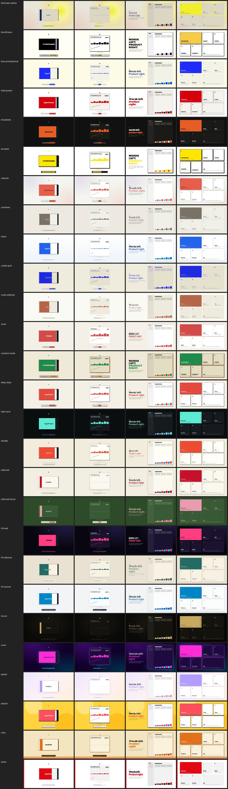

# Themes (Phase 10c)

A theme is one file, `themes/<name>.css`, picked by `"style"` in project.json or `--style <name>`. It sets every
`--kit-*` token from `tools/kit.css`: palette, bundled fonts, shape, a motion archetype (`--kit-ease`, `--kit-ease-in`,
`--kit-tempo`, `--kit-stagger`, `--kit-settle`) and a caption skin (`--kit-sub-*`, plus a few `.kit-subrow` rules).
`./video.sh themes` lists them. `./video.sh remix <name>` shows the three furthest from yours.

## The 27 themes

| Theme | Look | From |
|---|---|---|
| clean, dark-tech, editorial, luxury, neon, pastel, playful, retro, swiss, brutalist, doodle | see each file's header | Reelwright |
| hf-bold | night-club poster: violet black, hot pink, cyan; Bebas Neue caps | HyperFrames theme pack `bold` |
| hf-editorial | warm sand paper, teal accent; Libre Baskerville over EB Garamond | HyperFrames theme pack `editorial` |
| hf-neutral | quiet product UI: cool grey, sky blue; Inter | HyperFrames theme pack `neutral` |
| biennale-yellow | museum catalogue: parchment, indigo ink, solar-yellow bloom; Instrument Serif | HyperFrames frame preset |
| blockframe | loud neobrutalist: 4px black borders, hard shadows, candy pastels; Archivo Black caps | HyperFrames frame preset |
| blue-professional | consulting restraint: cream, one cobalt; Space Grotesk + Inter | HyperFrames frame preset |
| bold-poster | vintage poster: Shrikhand, Baskerville, tomato red | HyperFrames frame preset |
| broadside | protest poster: ink black, fire orange, lowercase Barlow 900 | HyperFrames frame preset |
| capsule | friendly editorial: pills, cream, coral; Bodoni Moda | HyperFrames frame preset |
| cartesian | quiet catalogue: warm stone, taupe hairlines; Playfair + Inter | HyperFrames frame preset |
| cobalt-grid | two-colour risograph: cream paper, cobalt ink, graph grid; Newsreader | HyperFrames frame preset |
| code-editorial | developer brand book: warm paper, terracotta; EB Garamond | HyperFrames frame preset |
| coral | bold magazine: coral, ink, cream planes, 45° hatch; Bebas Neue | HyperFrames frame preset |
| creative-mode | sparse neobrutalist: cream, 4px ink borders; Archivo Black caps | HyperFrames frame preset |
| daisy-days | picture book: charcoal outlines, sunny pastels; Fredoka | HyperFrames frame preset |
| editorial-forest | literary: forest green, oat cream, dusty rose; Source Serif 4 | HyperFrames frame preset |

Ported from [HyperFrames](https://github.com/heygen-com/hyperframes) (Apache-2.0, © HeyGen): `themes/{bold,editorial,neutral}.css`
and `skills/hyperframes/assets/frame-presets/*/` (`FRAME.md` + `caption-skin.html`). Each ported file says so in its
header. The hex values come from the presets, except where a value failed contrast. There the port uses the preset's
own darker sibling, or a mix of its ink and paper, and the header says which. Fonts upstream doesn't bundle are swapped
for the nearest bundled OFL family: Impact → Bebas Neue, Inter 900 → Archivo Black, Fredoka One → Fredoka 600.

## How the HyperFrames tokens map

| HyperFrames | Reelwright |
|---|---|
| `--bg --fg --muted --surface --brand/--accent --accent-2` | `--kit-bg --kit-ink --kit-muted --kit-surface --kit-accent --kit-accent-2` (+ `--kit-on-accent`) |
| `--font-display --font-body --font-mono` | `--kit-font-display --kit-font-text --kit-font-mono --kit-label-font` (bundled `fonts/` only) |
| `--radius --space-2 --border` | `--kit-radius --kit-space --kit-border` (+ `--kit-shadow`) |
| `--dur-beat --ease-standard --ease-emphasis` | `--kit-tempo` (≈ dur-beat / 0.4 s), `--kit-ease` (cubic-bezier → nearest `KIT.easing` name: (0.16,1,0.3,1) → `expo.out`, (0.34,1.56,0.64,1) → `back.out(1.56)`) |
| preset `caption-skin.html` | `--kit-sub-bg --kit-sub-ink --kit-sub-said --kit-sub-now --kit-sub-font --kit-sub-radius --kit-sub-deco` + `.kit-subrow` rules |

No new tokens were needed. The presets leave motion out of scope, so each port takes the archetype its look implies:
loud posters get fast `expo` / `back` with a short stagger, quiet catalogues get slow `premium` / `power2` with a long
settle.

## Checking a theme

- `node tools/theme-check.mjs [theme …]` runs without a browser. It FAILs on a missing token, a non-hex palette colour
  or a font that isn't bundled. It WARNs on token contrast: ink ≥ 4.5, muted ≥ 3, accent on bg ≥ 3, on-accent ≥ 3. CI
  runs it through `tools/selfcheck/themes.mjs`, which also requires the HyperFrames ports to have no WARN.
- `node tools/theme-gallery.mjs [theme …] [--out dir] [--sheet file.jpg]` renders each theme on example-hf and
  layouts-hf, on copies of the two projects. Stills land mid-sentence so the captions show. It then runs page QA:
  caption contrast and fit on real pixels, plus the overlap, tiny-text and wordy WARNs. Last, it writes one sheet with a
  row per theme. `--sheet docs/playbook/theme-gallery.jpg` rebuilds the picture above. Build each project's audio first
  with `./video.sh audio <project>`.
- A new theme: copy the closest file, change the values, and run both tools until they print nothing. Then look at the
  sheet.

Known WARNs (owner's call, left as they are): the brand accents of brutalist (yellow on white, 1.27:1), pastel (accent
2.05, muted 2.64/2.96, on-accent 2.30), playful (accent 2.23) and retro (accent 2.53, on-accent 2.53) sit under the 3:1
token contrast. Everything else in all 27 themes prints clean in `theme-gallery`.
