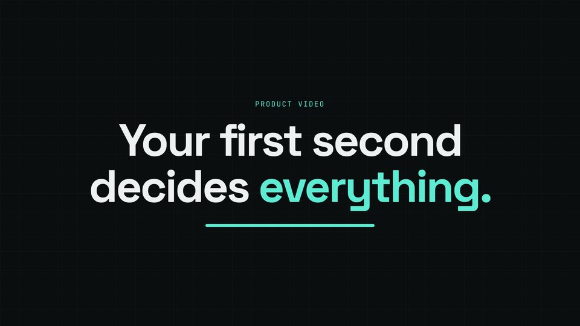
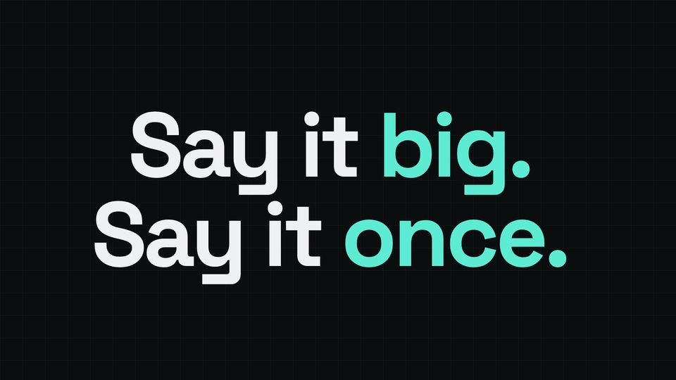
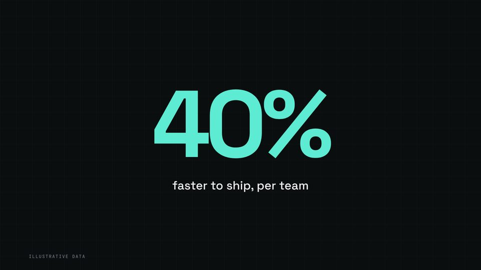
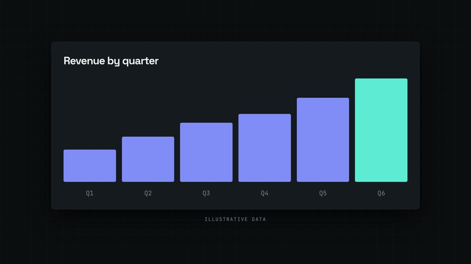
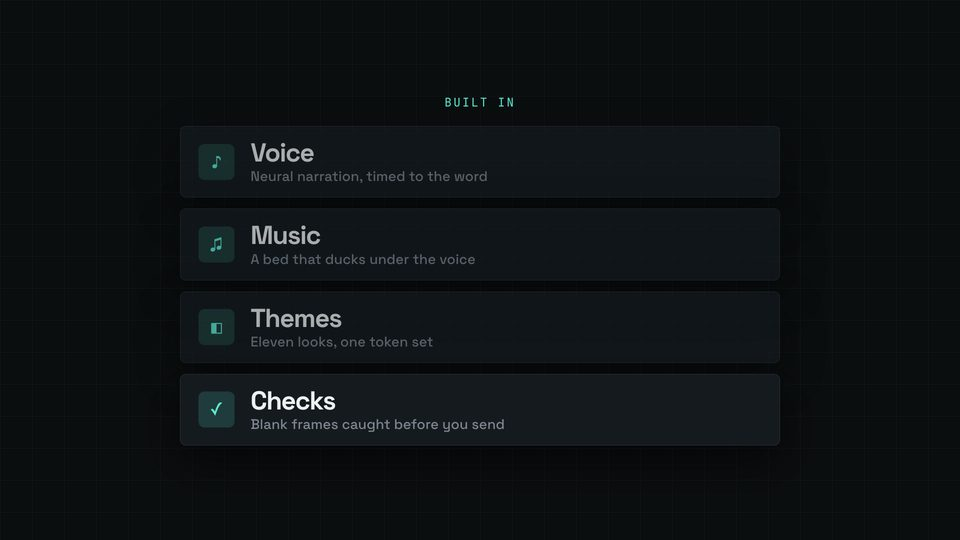
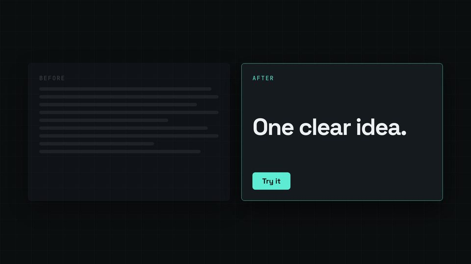
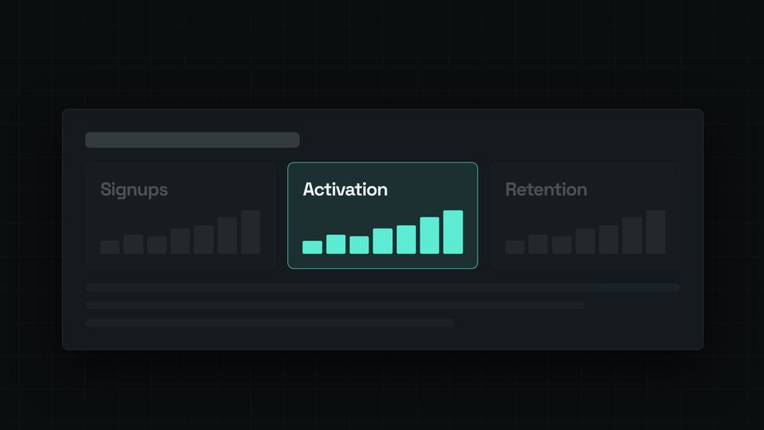
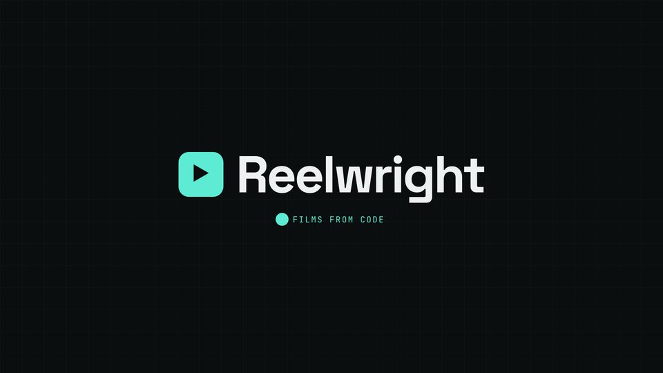

# Recipes: proven scene patterns

Eight scenes of one real HyperFrames film (`docs/recipes/film/`, style `dark-tech`), each with its snippet, timing notes and a still.
The snippets are excerpts of that film's `hf/film.js` and `hf/index.html`: the same code, with the other scenes' lines removed.
Copy a recipe into your film, change the content, keep the timing calls. Read [PLAYBOOK](../PLAYBOOK.md) first for the rules these follow:
every time from `W()` / `V()` / `KIT.snap()`, `render(t)` a pure function of `t`, made-up numbers labelled "Illustrative data".

| Recipe | What it is for | Still | KIT calls |
|---|---|---|---|
| [Hook title on the beat](hook-title.md) | The first scene of a film: a kicker and a two-line title that land on a beat, with an accent underline that draws as it settles. | [](img/hook-title.jpg) | KIT.snap, KIT.ease, KIT.stagger, KIT.dur, KIT.win, V() |
| [Kinetic type line](kinetic-line.md) | A slogan as the spoken line itself, set huge, each word landing as it is spoken, accent words in the theme colour. | [](img/kinetic-line.jpg) | KIT.layout.kinetic (KIT.words, KIT.align), KIT.ease, KIT.dur |
| [Stat with count-up](stat-count-up.md) | One number that matters, counting up on the spoken number, with the "Illustrative data" label. | [](img/stat-count-up.jpg) | KIT.layout.stat (KIT.count), KIT.snap, W(), KIT.cue |
| [Chart grows on the beat](chart-grows.md) | Bars that rise one after another from a beat after a spoken word, the last one in the accent colour. | [](img/chart-grows.jpg) | KIT.snap, KIT.stagger, KIT.ease, KIT.dur, W(), KIT.cue |
| [Feature list stagger](feature-stagger.md) | Rows that land on the word that names them; the row being spoken is bright and the earlier ones settle back. | [](img/feature-stagger.jpg) | W(), KIT.ease, KIT.dur, KIT.stagger (alternative) |
| [Before / after split](before-after.md) | Two panes: the old way as a dimmed wall of grey lines, the new way arriving on the word "After". | [](img/before-after.jpg) | W(), KIT.ease, KIT.dur, fmt classes |
| [Camera push-in on a UI card](push-in.md) | A slow push toward the one tile that matters, the rest of the card dimming as the camera arrives. | [](img/push-in.jpg) | KIT.shot.pushIn, KIT.shoot, KIT.ease, KIT.dur, V(), KIT.snap |
| [Logo end card](end-card.md) | The wordmark pops in on its spoken word with a small spring overshoot; a dot underneath pumps on every beat. | [](img/end-card.jpg) | KIT.spring, KIT.pulse, KIT.ease, W(), KIT.cue |

## Shared setup

Every recipe assumes this block at the top of `film.js` (scenes start on the beat before their line and crossfade into the next, so no frame is blank),
and these helper styles in the film's `<style>`. The `hf/index.html` loads `kit/layouts.js` and `kit/shots.js` after `kit/engine.js`.

```js
const { V, W, snap, cue, seg, win, el, u } = KIT, L = KIT.layout, S = KIT.shot;
const IDS = ['hook', 'kinetic', 'stat', 'chart', 'features', 'split', 'push', 'end'];
const DUR = window.PROJECT.speechEnd + window.PROJECT.tail;
const IN = IDS.map((id, i) => (i ? snap(V(id).start - KIT.dur(0.45)) : 0));            // each scene: the beat before its line
const OUT = (i) => (i < IDS.length - 1 ? IN[i + 1] + KIT.dur(0.45) : DUR - KIT.dur(0.2));   // …until the next one is in
const span = (i) => ({ in: IN[i], out: OUT(i) });                                      // what every KIT.layout.* takes
const fade = (i, t) => win(t, IN[i], OUT(i), KIT.dur(0.45), KIT.dur(0.45));            // the same crossfade for a hand-built scene
const sc = (cls, html) => el('div', `sc fmt-${KIT.fmt} ${cls}`, KIT.stage, html);        // a hand-built scene in the safe box
const ent = (t, a, d = 0.6) => KIT.ease(seg(t, a, a + KIT.dur(d)));                     // eased 0 → 1 starting at a
IN.slice(1).forEach((t) => cue(t, 'whoosh', 0.6));
```

```css
/* a custom scene sits in the title-safe box; sizes in --kit-u so 16x9, 9x16 and 1x1 all fit */
.sc { left: var(--kit-safe-x); top: var(--kit-safe-y); width: var(--kit-safe-w); height: var(--kit-safe-h); display: flex;
      flex-direction: column; align-items: center; justify-content: center; visibility: hidden; color: var(--kit-ink); font-family: var(--kit-font-text); }
.kick { font-family: var(--kit-label-font); font-size: calc(24 * var(--kit-u)); letter-spacing: .14em; text-transform: uppercase; color: var(--kit-accent); }
.disp { font-family: var(--kit-font-display); font-weight: var(--kit-display-weight); letter-spacing: var(--kit-display-tracking); text-transform: var(--kit-display-case); }
.card { background: var(--kit-surface); border: var(--kit-border); border-radius: var(--kit-radius); box-shadow: var(--kit-shadow); }
.note { font-family: var(--kit-label-font); font-size: calc(20 * var(--kit-u)); letter-spacing: .14em; text-transform: uppercase; color: var(--kit-muted); }
```

## Rebuilding the stills

```sh
node bin/reelwright.mjs audio docs/recipes/film        # needs internet (edge-tts voice); writes vo/, music, mix.wav
node bin/reelwright.mjs stills docs/recipes/film 2.8,5.7,8.6,11.7,15.3,19.3,22.8,25.8
node bin/reelwright.mjs embed docs/recipes/film        # out/embed.html: a self-contained preview page
node tools/checks/taste.page.mjs docs/recipes/film     # pre-render taste check
```

The build output (`vo/`, `hf/kit/`, `stills/`, `out/`, …) is git-ignored; only the film's source and `img/` are committed. The film is not in CI.

- [Shotcards A](shotcards/README.md) and [Shotcards B](shotcards/b-index.md): recipes for the video-shotcraft cards (KIT.shotcards).

- More recipes: [pr-to-video](pr-to-video.md), [lyric-video](lyric-video.md), [faceless-explainer](faceless-explainer.md).
