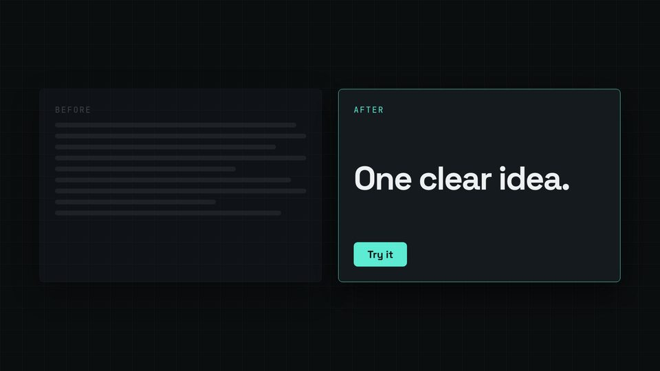

# Before / after split

Two panes: the old way as a dimmed wall of grey lines, the new way arriving on the word "After".



## When to use

- A payoff: slow vs fast, messy vs clean. Two panes, one idea each. The "after" pane carries the single clear thing.
- For text beside a product picture, use `KIT.layout.split` instead.

## The code

This is the scene from `docs/recipes/film/` (scene 6 of 8), unchanged.

**CSS** (in the film's `<style>`):

```css
.vs { display: flex; gap: calc(48 * var(--kit-u)); width: 100%; height: 62%; }
.fmt-9x16 .vs, .fmt-1x1 .vs { flex-direction: column; height: 82%; }
.pane { flex: 1; padding: calc(44 * var(--kit-u)); display: flex; flex-direction: column; gap: calc(22 * var(--kit-u)); }
.pane .kick { color: var(--kit-muted); }
.wall i { display: block; height: calc(14 * var(--kit-u)); margin-bottom: calc(18 * var(--kit-u)); border-radius: calc(7 * var(--kit-u)); background: color-mix(in srgb, var(--kit-ink) 16%, transparent); }
.pane.after { border-color: var(--kit-accent); }
.pane.after .kick { color: var(--kit-accent); }
.pane.after .idea { margin: auto 0; font-size: calc(96 * var(--kit-u)); line-height: 1.02; }
.pane.after .cta { align-self: flex-start; padding: calc(16 * var(--kit-u)) calc(40 * var(--kit-u)); border-radius: var(--kit-radius); font-size: calc(30 * var(--kit-u));
                   font-weight: 700; background: var(--kit-accent); color: var(--kit-on-accent); }
```

**film.js** (after the shared setup, see the [README](README.md#shared-setup)):

```js
const split = sc('split-sc', `<div class="vs">
  <div class="pane card before"><div class="kick">Before</div><div class="wall">${[96, 100, 88, 100, 72, 94, 100, 64, 90].map((w) => `<i style="width:${w}%"></i>`).join('')}</div></div>
  <div class="pane card after"><div class="kick">After</div><div class="idea disp">One clear idea.</div><div class="cta">Try it</div></div></div>`);
const [before, after] = [split.querySelector('.before'), split.querySelector('.after')];
const BEFORE = W('split', 'Before'), AFTER = W('split', 'After');

function render(t) {
  KIT.show(split, fade(5, t));
  const pb = ent(t, BEFORE), pa = ent(t, AFTER, 0.7);
  before.style.opacity = pb * (1 - 0.55 * pa); before.style.transform = `translateY(${(1 - pb) * 40 * u}px)`;   // dims as "After" arrives
  after.style.opacity = pa; after.style.transform = `translateX(${(1 - pa) * 120 * u}px)`;
  // …the other scenes' set(t) calls
}
```

## Timing and easing

- Both panes are driven by spoken words: Before enters at `W('split', 'Before')`, After at `W('split', 'After')`, so the picture follows the sentence.
- When After arrives, the Before pane drops to 45 % opacity (`1 - 0.55 * pa`) rather than disappearing: the contrast is the point, and the grey lines stay readable as "a wall of text".
- After slides in 120 px × `KIT.u` from the right with the theme ease over 0.7 s; Before rises 40 px over 0.6 s.
- The `.fmt-9x16 .vs` / `.fmt-1x1 .vs` rules stack the panes in vertical and square formats; check them with `stills --formats 9x16`.

## Common mistakes

- Showing the new way first: the "before" then reads as a step backward.
- Real copy in the Before pane: use placeholder lines so nobody reads it and misses the point.
- Moving both panes at once: one mover per segment.

[Back to the index](README.md)
