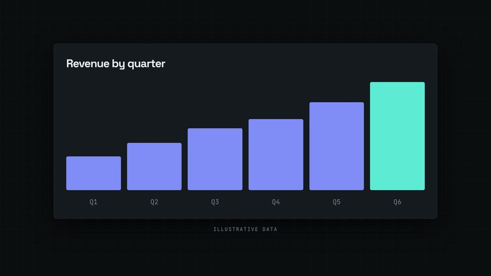

# Chart grows on the beat

Bars that rise one after another from a beat after a spoken word, the last one in the accent colour.



## When to use

- A trend or comparison where growth is the message. Six or fewer bars; the last bar (today) is the accent.
- For a curve drawn as it is spoken, use `KIT.math.axes` and `KIT.math.plot` instead (PLAYBOOK, Math).

## The code

This is the scene from `docs/recipes/film/` (scene 4 of 8), unchanged.

**CSS** (in the film's `<style>`):

```css
.chart { width: min(calc(1500 * var(--kit-u)), 100%); padding: calc(48 * var(--kit-u)); display: flex; flex-direction: column; gap: calc(28 * var(--kit-u)); }
.chart h3 { font-size: calc(44 * var(--kit-u)); }
.cols { display: grid; grid-template-columns: repeat(6, 1fr); gap: calc(24 * var(--kit-u)); }
.cols.bars { height: calc(440 * var(--kit-u)); align-items: end; }
.cols.bars i { display: block; border-radius: calc(6 * var(--kit-u)); background: var(--kit-accent-2); transform-origin: bottom; }
.cols.bars i:last-child { background: var(--kit-accent); }
.cols span { text-align: center; font-family: var(--kit-label-font); font-size: calc(26 * var(--kit-u)); color: var(--kit-muted); }
.chart-note { margin-top: calc(28 * var(--kit-u)); }
```

**film.js** (after the shared setup, see the [README](README.md#shared-setup)):

```js
const BARS = [30, 42, 55, 63, 78, 96];                                                  // % of the chart height
const chart = sc('chart-sc', `<div class="chart card"><h3 class="disp">Revenue by quarter</h3>
  <div class="cols bars">${BARS.map((h) => `<i style="height:${h}%"></i>`).join('')}</div>
  <div class="cols">${BARS.map((_, i) => `<span>Q${i + 1}</span>`).join('')}</div></div><div class="note chart-note">Illustrative data</div>`);
const bars = [...chart.querySelectorAll('.bars i')];
const GROW = snap(W('chart', 'grows'));                    // the first bar starts on the beat nearest "grows"
cue(GROW, 'riser', 0.7);

function render(t) {
  KIT.show(chart, fade(3, t));
  bars.forEach((b, i) => { b.style.transform = `scaleY(${ent(t, GROW + KIT.stagger(i, bars.length, KIT.dur(0.4)), 0.7)})`; });
  // …the other scenes' set(t) calls
}
```

## Timing and easing

- `GROW = snap(W('chart', 'grows'))`: the first bar starts on the beat nearest the word "grows"; the six bars are spread over `KIT.dur(0.4)` with `KIT.stagger`, each taking 0.7 s with the theme ease. The whole growth is about a second, so the eye follows it instead of waiting.
- Bars are `<i>` with a percentage height and `transform-origin: bottom`; only `scaleY` changes per frame (a pure function of `t`).
- The chart sits in a card, the "Illustrative data" label below it on its own element so it stays readable while the bars move.
- Growing bars start at scale 0, so the card is never empty: the title and the axis labels are on screen before the first bar.

## Common mistakes

- Hiding the title and the quarter labels until the bars are up: viewers cannot tell what is growing. Keep them on screen.
- Easing with `linear`: bars then rise like a progress bar. Use the theme ease.
- More than about 0.5 s between the first and last bar start: the chart reads as slow.
- Real-looking figures without the label: made-up chart data gets "Illustrative data".

[Back to the index](README.md)
