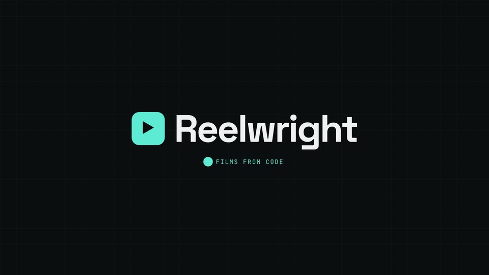

# Logo end card

The wordmark pops in on its spoken word with a small spring overshoot; a dot underneath pumps on every beat.



## When to use

- The last scene: logo, name and a three-word line. The pulsing dot keeps the frame alive while the music's final hit rings out.
- The wordmark appears on the word, not on the scene start, so the voice and the logo land together.

## The code

This is the scene from `docs/recipes/film/` (scene 8 of 8), unchanged.

**CSS** (in the film's `<style>`):

```css
.logo { display: flex; align-items: center; gap: calc(36 * var(--kit-u)); white-space: nowrap; }
.logo i { flex: none; width: calc(130 * var(--kit-u)); height: calc(130 * var(--kit-u)); border-radius: calc(30 * var(--kit-u)); background: var(--kit-accent); color: var(--kit-on-accent);
          font-style: normal; font-size: calc(60 * var(--kit-u)); display: flex; align-items: center; justify-content: center; }
.logo b { font-size: min(calc(150 * var(--kit-u)), calc(var(--kit-safe-w) / 9)); line-height: 1; }
.tag { margin-top: calc(40 * var(--kit-u)); display: flex; align-items: center; gap: calc(20 * var(--kit-u)); }
.tag .pulse { width: calc(22 * var(--kit-u)); height: calc(22 * var(--kit-u)); border-radius: 50%; background: var(--kit-accent); }
```

**film.js** (after the shared setup, see the [README](README.md#shared-setup)):

```js
const end = sc('end-sc', `<div class="logo"><i>▶</i><b class="disp">Reelwright</b></div>
  <div class="tag"><span class="pulse"></span><span class="kick">Films from code</span></div>`);
const [logo, tag] = [end.querySelector('.logo'), end.querySelector('.tag')];
const LOGO = W('end', 'Reelwright'), TAG = W('end', 'Films');
const pop = KIT.spring({ damping: 12, stiffness: 120 });   // 0 → 1 with a small overshoot, closed form
cue(LOGO, 'impact', 0.7);

function render(t) {
  KIT.show(end, fade(7, t));
  const pl = pop(t - LOGO);
  logo.style.opacity = seg(t, LOGO, LOGO + 0.2); logo.style.transform = `scale(${0.7 + 0.3 * pl})`;
  tag.style.opacity = ent(t, TAG, 0.4);
  end.querySelector('.pulse').style.transform = `scale(${1 + 0.7 * KIT.pulse(t)})`;   // a dot that pumps on every beat
  // …the other scenes' set(t) calls
}
```

## Timing and easing

- `LOGO = W('end', 'Reelwright')`: the logo pops in at the spoken name with `KIT.spring({ damping: 12, stiffness: 120 })`: a closed form (so scrubbing is safe) that overshoots a little and settles; scale `0.7 + 0.3 * pop`.
- The tagline fades in on its own word (`Films`), the dot rides `KIT.pulse(t)`, which is 1 on each beat and decays, so the card is never static (the taste check flags 4 s without motion).
- An `impact` cue lands on the logo; `chime` or `impact`, one is enough.
- The last scene's `out` is the film end minus 0.2 s; the stage fades over the last 0.6 s, so the film never ends on a hard cut.

## Common mistakes

- A spring with `damping` far under 8: the logo wobbles for a second and looks nervous.
- Putting the logo on screen from the scene start: an early frame with a big mark and no voice.
- Ending on a still frame for several seconds: the pulse is the cheapest fix; the music hit should land with it (`music.drop_bar`, `beatgrid`).

[Back to the index](README.md)
