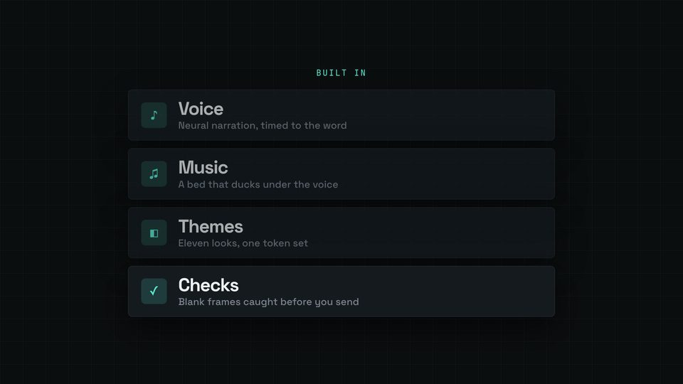

# Feature list stagger

Rows that land on the word that names them; the row being spoken is bright and the earlier ones settle back.



## When to use

- A short list read out loud: 3-5 items, one word each in the VO ("Voice, music, themes, and checks").
- For tiles rather than rows (more content per item), use `KIT.layout.bento`, which staggers on the beat by itself.

## The code

This is the scene from `docs/recipes/film/` (scene 5 of 8), unchanged.

**CSS** (in the film's `<style>`):

```css
.list { width: min(calc(1200 * var(--kit-u)), 100%); display: flex; flex-direction: column; gap: calc(22 * var(--kit-u)); margin-top: calc(32 * var(--kit-u)); }
.row { display: flex; align-items: center; gap: calc(32 * var(--kit-u)); padding: calc(24 * var(--kit-u)) calc(36 * var(--kit-u)); }
.row .ic { flex: none; width: calc(72 * var(--kit-u)); height: calc(72 * var(--kit-u)); border-radius: var(--kit-radius); display: flex; align-items: center;
           justify-content: center; font-size: calc(36 * var(--kit-u)); color: var(--kit-accent); background: color-mix(in srgb, var(--kit-accent) 16%, transparent); }
.row b { display: block; font-size: calc(52 * var(--kit-u)); line-height: 1.1; }
.row span { font-size: calc(28 * var(--kit-u)); color: var(--kit-muted); }
```

**film.js** (after the shared setup, see the [README](README.md#shared-setup)):

```js
const FEATURES = [['Voice', '♪', 'Neural narration, timed to the word'], ['Music', '♫', 'A bed that ducks under the voice'],
  ['Themes', '◧', 'Eleven looks, one token set'], ['Checks', '✓', 'Blank frames caught before you send']];
const features = sc('features-sc', `<div class="kick">Built in</div><div class="list">${FEATURES.map(([n, ic, d]) =>
  `<div class="row card"><div class="ic">${ic}</div><div><b class="disp">${n}</b><span>${d}</span></div></div>`).join('')}</div>`);
const rows = [...features.querySelectorAll('.row')];
const ROW_AT = FEATURES.map(([n]) => W('features', n));    // row i comes in as its word is spoken

function render(t) {
  KIT.show(features, fade(4, t));
  rows.forEach((r, i) => {
    const p = ent(t, ROW_AT[i], 0.5), live = i === rows.length - 1 || t < ROW_AT[i + 1];
    r.style.opacity = p * (live ? 1 : 0.7);                // the row being spoken is bright, earlier ones settle back
    r.style.transform = `translateX(${(1 - p) * -60 * u}px)`;
  });
  // …the other scenes' set(t) calls
}
```

## Timing and easing

- `ROW_AT = FEATURES.map(([n]) => W('features', n))`: each row enters at the moment its word is spoken, so the stagger is the speaker's rhythm. No `KIT.stagger` here, since the gaps are not even.
- If the VO is not a list of words (a sentence per feature), stagger on a fixed spacing instead: `KIT.stagger(i, n, KIT.dur(0.4))` keeps the group under 0.5 s.
- The `live` flag dims earlier rows to 0.7 (the "dim the rest" rule; 0.7 keeps the muted description text legible), so the eye follows the voice.
- Rows slide 60 px × `KIT.u` in from the left and fade; never more than a third of the screen.

## Common mistakes

- Rows that all appear together: the voice is then ahead of the picture.
- Description text under 24 px × `KIT.u`: `qa` warns `tiny-text`. Here it is 28.
- Dimming earlier rows to 0.25: their grey description then fails the contrast check. They stay at 0.7 here because the text must still be readable.

[Back to the index](README.md)
