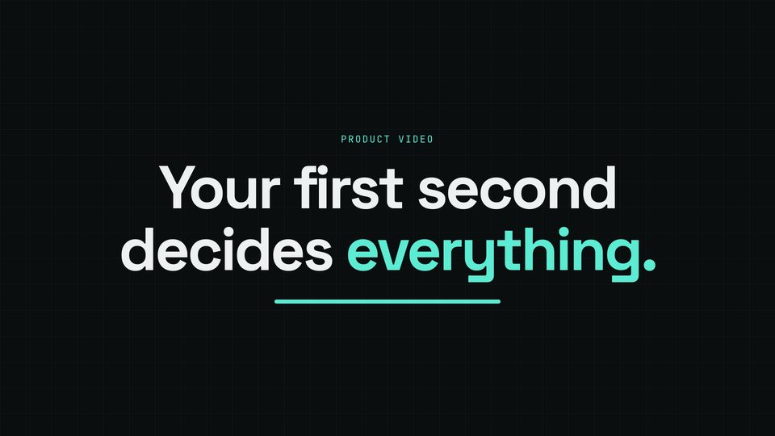

# Hook title on the beat

The first scene of a film: a kicker and a two-line title that land on a beat, with an accent underline that draws as it settles.



## When to use

- The first thing a viewer sees: the pain or the promise, as a big line. Two lines of 2-4 words each read at a glance.
- A hand-built title (kicker, lines, underline) when you want control of each piece. For a title that is only the spoken line, use [kinetic-line](kinetic-line.md).

## The code

This is the scene from `docs/recipes/film/` (scene 1 of 8), unchanged.

**CSS** (in the film's `<style>`):

```css
.hl { text-align: center; line-height: 1.02; margin-top: calc(28 * var(--kit-u)); font-size: min(calc(150 * var(--kit-u)), calc(var(--kit-safe-w) / 11)); }
.hl .ln { display: block; }
.hl b { color: var(--kit-accent); font-weight: inherit; }
.bar { display: block; height: calc(10 * var(--kit-u)); width: min(calc(560 * var(--kit-u)), 60%); margin-top: calc(48 * var(--kit-u));
       border-radius: calc(5 * var(--kit-u)); background: var(--kit-accent); }
```

**film.js** (after the shared setup, see the [README](README.md#shared-setup)):

```js
const hook = sc('hook', `<div class="kick">Product video</div>
  <div class="hl disp"><span class="ln">Your first second</span><span class="ln">decides <b>everything.</b></span></div><i class="bar"></i>`);
const [hookLines, hookBar] = [[...hook.querySelectorAll('.ln')], hook.querySelector('.bar')];
const HOOK = snap(V('hook').start);                       // the title lands on the beat nearest the first word

function render(t) {
  KIT.show(hook, fade(0, t));
  hookLines.forEach((e, i) => {
    const p = ent(t, HOOK + KIT.stagger(i, hookLines.length, KIT.dur(0.25)));
    e.style.opacity = p; e.style.transform = `translateY(${(1 - p) * 0.35}em)`;
  });
  hookBar.style.transform = `scaleX(${ent(t, HOOK + KIT.dur(0.6), 0.5)})`;   // the underline draws as the title settles
  // …the other scenes' set(t) calls
}
```

## Timing and easing

- `HOOK = snap(V('hook').start)` puts the landing on the beat nearest the first word, within half a beat of it.
- Lines enter with `KIT.stagger(i, n, KIT.dur(0.25))`: the whole group takes a quarter second (stagger budget: under about 0.5 s). Each line rises 0.35 em with `KIT.ease` (the theme's entrance curve: `expo.out` in dark-tech).
- The underline draws one beat-fraction later (`KIT.dur(0.6)`) so the eye gets the title first, the mark second. It scales from its centre; use `transform-origin: left` for a left-to-right draw.
- The scene itself fades in with the shared `fade(0, t)` (the kicker shows first); the first second holds little on purpose, well under the near-empty limit of the taste check.

## Common mistakes

- Hard-coding `0.6` instead of `snap(V(...).start)`: the title drifts off the beat the moment the script changes.
- A title longer than two lines or four words a line: nobody reads it before the next scene.
- Font size as a bare px value: use `min(150 * var(--kit-u), safe-w / 11)` so it fits 9x16 and 1x1 too (11 is roughly the title's widest line in em).
- Animating `top`/`left` instead of `transform`: layout work every frame and sub-pixel jitter.

[Back to the index](README.md)
