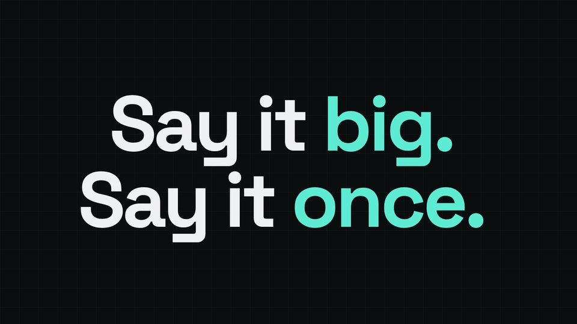

# Kinetic type line

A slogan as the spoken line itself, set huge, each word landing as it is spoken, accent words in the theme colour.



## When to use

- A slogan or the one sentence you want remembered, 3-7 words. The words are the VO, so the picture and the voice say the same thing and the audience cannot miss it.
- Not for a sentence of more than about 8 words: the font fits itself to the safe box and gets small.

## The code

This is the scene from `docs/recipes/film/` (scene 2 of 8), unchanged.

**film.js** (after the shared setup, see the [README](README.md#shared-setup)):

```js
const kinetic = L.kinetic({ ...span(1), line: 'kinetic', accent: ['big', 'once'] });   // words land as they are spoken

function render(t) {
  kinetic.set(t);
  // …the other scenes' set(t) calls
}
```

## Timing and easing

- `line: 'kinetic'` is the VO line id; the layout splits the text into words and lands word *i* at `KIT.align('kinetic')[i]` (the time that word is spoken), 0.06 s early so the word is visible as it is heard.
- `accent` takes words (punctuation ignored): the matching words render in `--kit-accent`. Two accents per line is plenty.
- The layout sizes the type with a binary search on the real font, once fonts have loaded, so every render page picks the same size.
- `in`/`out` come from the shared `span(i)`: in on the beat before the line, out a crossfade after the next scene starts.

## Common mistakes

- Typing the words again in `film.js` instead of passing the line id: the on-screen text then drifts from the voice when the script changes.
- Stacking this over a second headline: it fills the safe box on purpose.
- Accenting every other word: no word is then the accent.

[Back to the index](README.md)
