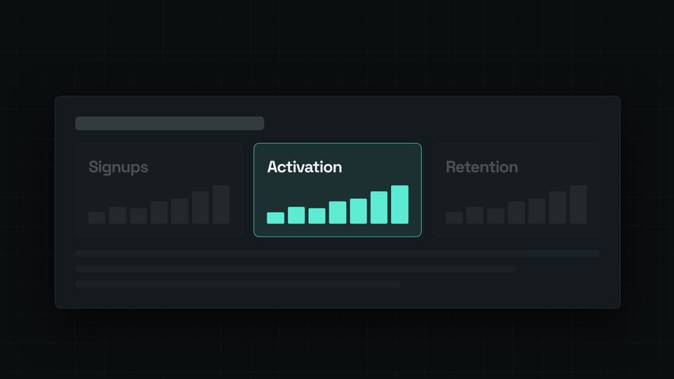

# Camera push-in on a UI card

A slow push toward the one tile that matters, the rest of the card dimming as the camera arrives.



## When to use

- Pointing at one part of a UI: a metric, a button, a result. Slow, purposeful, then still.
- Not for a full-width element: the zoom crops it (PLAYBOOK, Picture). Here the card is 1240 px wide in a 1920 px frame, 1612 px at the end of the push.

## The code

This is the scene from `docs/recipes/film/` (scene 7 of 8), unchanged.

**CSS** (in the film's `<style>`):

```css
/* the filmed layer: frame-sized, on a floor 40 % bigger than the frame, so no edge ever shows */
.scene, .cam { position: absolute; inset: 0; }
.bleed { position: absolute; inset: -40%; background: var(--kit-bg); background-image: var(--kit-bg-image); background-size: calc(64 * var(--kit-u)) calc(64 * var(--kit-u)); }
.ui { position: absolute; left: 50%; top: 50%; transform: translate(-50%, -50%); width: min(calc(1240 * var(--kit-u)), 86%); padding: calc(44 * var(--kit-u));
      display: flex; flex-direction: column; gap: calc(28 * var(--kit-u)); }
.ui .h { height: calc(30 * var(--kit-u)); width: 36%; border-radius: calc(8 * var(--kit-u)); background: color-mix(in srgb, var(--kit-ink) 60%, transparent); }
.ui .kpis { display: flex; gap: calc(24 * var(--kit-u)); }
.kpi { flex: 1; padding: calc(28 * var(--kit-u)); border-radius: var(--kit-radius); border: var(--kit-border); background: color-mix(in srgb, var(--kit-ink) 5%, transparent);
       display: flex; flex-direction: column; gap: calc(18 * var(--kit-u)); }
.kpi.key { border-color: var(--kit-accent); background: color-mix(in srgb, var(--kit-accent) 10%, transparent); }
.kpi b { font-size: calc(36 * var(--kit-u)); }
.kpi .spark { display: flex; align-items: flex-end; gap: calc(8 * var(--kit-u)); height: calc(84 * var(--kit-u)); }
.kpi .spark i { flex: 1; display: block; border-radius: calc(3 * var(--kit-u)); background: color-mix(in srgb, var(--kit-ink) 22%, transparent); }
.kpi.key .spark i { background: var(--kit-accent); }
.ui .feed { display: flex; flex-direction: column; gap: calc(18 * var(--kit-u)); }
.ui .feed i { display: block; height: calc(16 * var(--kit-u)); border-radius: calc(8 * var(--kit-u)); background: color-mix(in srgb, var(--kit-ink) 12%, transparent); }
```

**film.js** (after the shared setup, see the [README](README.md#shared-setup)):

```js
const spark = [30, 44, 40, 58, 66, 84, 100].map((h) => `<i style="height:${h}%"></i>`).join('');
const kpi = (name, cls = '') => `<div class="kpi ${cls}"><b class="disp">${name}</b><div class="spark">${spark}</div></div>`;
const push = el('div', 'scene', KIT.stage);                                    // frame-sized, shown while the scene is on
const cam = el('div', 'cam', push, `<div class="bleed"></div><div class="ui card"><div class="h"></div>
  <div class="kpis">${kpi('Signups')}${kpi('Activation', 'key')}${kpi('Retention')}</div>
  <div class="feed"><i></i><i style="width:84%"></i><i style="width:62%"></i></div></div>`);
const ui = cam.querySelector('.ui'), key = cam.querySelector('.key'), others = [...cam.querySelectorAll('.kpi:not(.key), .feed, .h')];
const PUSH = snap(V('push').start);
let pushShot;                                              // built on the first frame, once the card has its real size

function render(t) {
  pushShot ||= S.pushIn({ t0: PUSH, t1: V('push').end + KIT.dur(0.3), from: 1, to: 1.3,
    x: KIT.W_ / 2 + key.offsetLeft + key.offsetWidth / 2 - ui.offsetWidth / 2, y: KIT.H_ / 2 + key.offsetTop + key.offsetHeight / 2 - ui.offsetHeight / 2 });
  KIT.show(push, fade(6, t));
  KIT.shoot(cam, pushShot(t));
  const dim = 1 - 0.75 * ent(t, PUSH, 0.5);                  // everything but the card in focus drops to ~0.25
  others.forEach((e) => { e.style.opacity = dim; });
  // …the other scenes' set(t) calls
}
```

## Timing and easing

- `pushIn({ t0, t1, from, to, x, y })` zooms 1 → 1.3 about (x, y) with `power2.in`, so it accelerates into the hold; `t0 = snap(V('push').start)`, `t1` a third of a second after the line ends. It holds the end state afterwards: the stillness is built in.
- The focal point is the key tile's centre, read from `offsetLeft`/`offsetTop` once, on the first frame (`pushShot ||=`), after layout. It is the only per-card number.
- The filmed layer is frame-sized with a `.bleed` floor 40 % bigger than the frame, so no edge shows however the camera moves.
- Everything except the key tile eases to about 0.25 opacity over `KIT.dur(0.5)` as the push starts (the focus rule), no layout moves while the camera moves.

## Common mistakes

- Zooming past about 1.4: the mock UI loses its lines and the card looks blurry in the mp4.
- Putting the key tile far from the centre: a push about an off-centre point slides the card; keep the focal point near the middle or use a floor (`.bleed`).
- Adding an entrance animation on the card while the camera moves: one mover per segment.
- Blur or a shake on a push: reserve them for `crashZoom` and `whipPan`.

[Back to the index](README.md)
